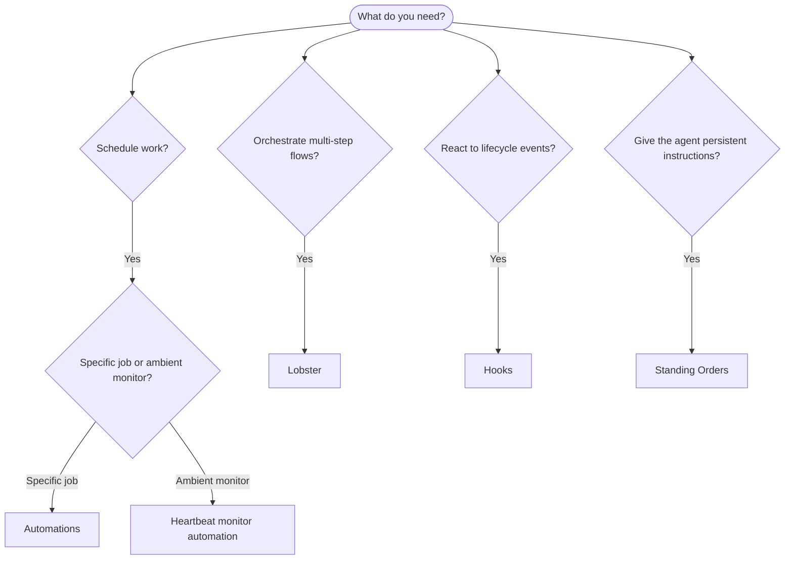

OpenClaw 通过本机运行时、计划作业、事件挂钩和常设指令在后台运行工作。使用此页面选择正确的机制。

##  快速决策指南

| 使用场景                                  | 推荐方案                                | 原因                                                    |
| ----------------------------------------- | ------------------------------------------ | ------------------------------------------------------ |
| 于 9 AM 准时发送每日报告           | 自动化                                | 精确计时，隔离执行                       |
| 20 分钟后提醒我                   | 自动化                                | 使用精确时间的一次性任务（`--at`）                  |
| 每周运行一次深度分析                  | 自动化                                | 独立任务，可使用不同的模型               |
| 每 30 分钟检查一次收件箱                  | 自动化                                | 独立的循环时间表和工作历史记录         |
| 在新的 IMAP 电子邮件上安全触发          | IMAP插件                                | 发件人门控的隔离读者会话                  |
| 监控日历中的即将到来的事件      | 自动化                                | 明确的重复时间表和交付政策        |
| Surface 环境主会话更新      | 心跳                                  | 系统拥有的监控自动化和安静警报       |
| 会话重置时运行脚本             | 钩子                                      | 内部 `HOOK.md` 脚本对生命周期事件做出反应   |
| 从外部服务触发代理 | [Webhooks](/automation/cron-jobs#webhooks) | 经过身份验证的 HTTP 入口，不是内部事件挂钩 |
| 每次工具调用时执行代码           | 插件钩子                               | 类型化的 `api.on(...)` 处理程序可以拦截工具调用  |
| 回复前始终检查合规性   | 常驻指令                            | 自动注入每个会话              |

<a id="scheduled-tasks-cron-vs-heartbeat" />

###  自动化 vs 心跳

| 维度       | 用户编写的自动化                   | 心跳监测自动化            |
| --------------- | ------------------------------------------- | --------------------------------------- |
| 时间安排          | 一次性、间隔或 cron 表达式      | Scheduler拥有的时间间隔，默认30min |
| 会话上下文 | 隔离、当前、命名或主会话   | 主会话，可选择隔离       |
| 送货        | 通道、Webhook 或静默                 | 所有者发送警报或静音           |
| 最适合        | 明确的报告、提醒、重复工作 | 环境监测和事件跟踪  |

两者都使用相同的自动化调度程序。根据自己的指令或时间表创建工作自动化；当定期主会话感知有用时，使用心跳作为系统拥有的环境监视器。

##  核心概念

###  自动化

自动化是 OpenClaw 的内置调度程序，用于所有重复性和一次性工作，包括心跳监视器。调度程序会保留作业，在正确的时间唤醒代理，并可以将输出传递到聊天通道或 Webhook 端点。它支持一次性提醒、重复间隔和 cron 表达式以及入站 Webhook 触发器。

参见 [自动化](/automation/cron-jobs)。

###  后台执行和工作流程

使用 [Sub-agents](/tools/subagents) 启动并等待委托运行，使用 [ACP](/tools/acp-agents) 进行编码工具会话，并使用自动化运行历史记录来检查计划的工作。每个运行时都拥有执行和完成。

[龙虾](/tools/lobster)运行具有可恢复批准的本地管道。共享任务分类账，TaskFlow编排API， 和TaskFlowWebhooks 插件已被删除。通用的[网关HTTP钩子](/automation/cron-jobs#webhooks)仍然可用于经过身份验证的外部触发器。

###  固定指令

固定指令授予代理对指定程序的永久操作权限。它们存储在工作区文件中（通常是 `AGENTS.md`），并注入到每个会话中。与自动化结合使用，可实现基于时间的强制执行。

请参阅 [ 站立式 Orders](/automation/standing-orders)。

###  钩子

内部 hooks 是由代理生命周期事件 (`/new`、`/reset`、`/stop`)、会话压缩、Gateway 启动以及消息流触发的事件驱动脚本。它们从 hook 目录中发现，并通过 `openclaw hooks` 管理。对于进程内工具调用拦截，请使用 [插件 hooks](/plugins/hooks)。

参见 [Hooks](/automation/hooks)。

###  心跳

Heartbeat 是系统拥有的监控自动化功能，默认情况下每 30 分钟运行一次定期主会话。它可以使用小的监视器临时上下文来显示任何需要注意的内容，而无需延长会话的新鲜度。为需要自己的时间表的工作创建单独的自动化作业。空划痕会跳过为 `empty-heartbeat-file`。当主队列或自动化工作繁忙、同一代理的另一个运行处于活动状态或者目标会话具有活动或排队工作时，计划的监视器轮流会延迟。

参见 [心跳](/gateway/heartbeat)。

##  它们如何协同工作

- **Automations** 拥有每个定期计划，包括报告、提醒和心跳监视器。
- **Heartbeat** 是系统拥有的环境监测自动化。独立安排的检查属于它们自己的自动化作业。
- **Hooks** 通过自定义脚本响应特定事件（会话重置、压缩、消息流）。插件钩子涵盖工具调用。
- **Standing orders** 为代理提供持久化上下文和权限边界。

##  已退役的推断承诺

v2026.8.1 中删除了推断承诺实验：OpenClaw 不再从对话中提取后续内容或通过心跳传递它们。 `openclaw commitments`维护CLI也不见了。数据库迁移会丢弃旧的承诺行并删除它们的表和索引。

对于提醒或计划工作，请创建显式 [automation](/automation/cron-jobs)。自动化是一种替代方案，包含您选择的时间表和说明；他们不恢复推断的后续行动。

##  相关内容

- [自动化](/automation/cron-jobs) — 精确的计划安排和一次性提醒
- [IMAP 电子邮件触发器](/automation/imap) — 发件人控制的入站电子邮件和隔离的读者会话
- [MCP Events](/automation/mcp-events) — 订阅事件、签名回调和自动化运行
- [钩子](/automation/hooks) — 事件驱动的生命周期脚本
- [插件钩子](/plugins/hooks) — 进程内工具、提示、消息和生命周期钩子
- [站立 Orders](/automation/standing-orders) — 持久代理指令
- [HHeartbeat](/gateway/heartbeat) — 周期性主会话轮次
- [配置 Reference](/gateway/configuration-reference) — 所有配置键
