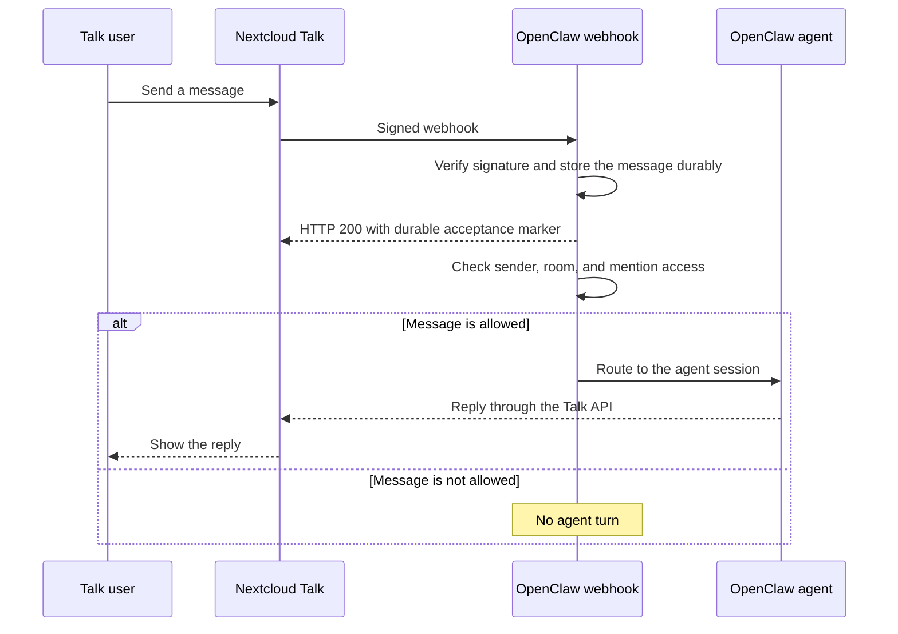

Nextcloud Talk 是一个可下载的通道插件 （`@openclaw/nextcloud-talk`），它通过 Talk webhook 机器人将 OpenClaw 连接到自托管 Nextcloud 实例。支持私信、房间、反应、markdown消息、入站Talk文件共享；出站媒体以 URL 形式发出。

## <a id="install"></a> 安装

```bash
openclaw plugins install @openclaw/nextcloud-talk
```

使用裸包规范来遵循当前的官方发布标签。仅当您需要可重复安装时才固定确切版本。

入站附件需要提供 `runtime.channel.media.deleteMediaBuffer` 的主机。通过测试的源检查并不能证明已发布的主机提供了此 API。使用下面合格的协调 host/plugin 版本，而不是该插件及其历史兼容性元数据的独立构建。

从本地结账（开发工作流程）：

```bash
openclaw plugins install ./path/to/local/nextcloud-talk-plugin
```

安装后检查[应用结果](/plugins/manage-plugins#apply-changes-and-inspect)。

## <a id="how-messages-reach-the-agent"></a> 消息如何到达代理



Webhook 确认确认持久接收，而不是允许运行代理或完成其回复。接受后，访问检查仍然适用。未知的 DM 发件人可能会收到配对代码而不是代理回复。 Webhook URL 必须可从 Nextcloud 访问；回复通过 Talk API 而不是在 Webhook 响应中传回。

## <a id="quick-setup-(beginner)"></a><a id="quick-setup-beginner"></a> 快速设置（初级）

1. 安装插件（见上文）。
2. 通过 HTTPS 反向代理发布网关 webhook 路由 `/nextcloud-talk-webhook`，转发到网关端口（默认 `18789`）。在您的 Nextcloud 服务器上，使用该公共 URL 创建一个机器人：

   ```bash
   ./occ talk:bot:install "OpenClaw" "<shared-secret>" "<webhook-url>" --feature webhook --feature response --feature reaction
   ```

   保留 `--feature response`：如果没有它，外发回复会以 401 失败。可使用 `./occ talk:bot:state --feature webhook --feature response --feature reaction <botId> 1` 修复已存在的机器人。

3. 在目标房间设置中启用该机器人。
4. 配置 OpenClaw：
   - 配置项：`channels.nextcloud-talk.baseUrl` + `channels.nextcloud-talk.botSecret`
   - 或环境变量：`NEXTCLOUD_TALK_BOT_SECRET`（仅默认账户）

   CLI 设置（`--url`/`--token` 是显式字段的别名；`nc-talk` 和 `nc` 可作为频道别名）：

   ```bash
   openclaw channels add --channel nextcloud-talk \
     --url https://cloud.example.com \
     --token "<shared-secret>"
   ```

   等效的显式字段：

   ```bash
   openclaw channels add --channel nextcloud-talk \
     --base-url https://cloud.example.com \
     --secret "<shared-secret>"
   ```

   基于文件的 secret：

   ```bash
   openclaw channels add --channel nextcloud-talk \
     --base-url https://cloud.example.com \
     --secret-file /path/to/nextcloud-talk-secret
   ```

5. 检查`openclaw channels status --probe`；如果网关离线，则启动网关。配置更改遵循 [hot reload](/gateway/configuration/hot-reload)。如果您更改了服务环境，请重新启动网关以加载它。

最小配置：

```json5
{
  channels: {
    "nextcloud-talk": {
      enabled: true,
      baseUrl: "https://cloud.example.com",
      botSecret: "shared-secret",
      dmPolicy: "pairing",
    },
  },
}
```

## <a id="notes"></a> 说明

- Bot 无法发起私信。用户必须先向 Bot 发送消息。
- 必须可从 Nextcloud 服务器访问 Webhook URL。网关在其自己的 HTTP 端口上为 `webhookPath` 提供服务。现有安装可能会为以前的端口 `8788` 保留显式的 `legacyWebhook` 引脚；新安装不打开单独的端口。使用代理时，将 `webhookPublicUrl` 设置为机器人的外部回调 URL。 Webhook 请求使用 bot 密钥签名 HMAC-SHA256；无效签名将被拒绝并受到速率限制。
- 仅在原始事件持久存储后，Message webhooks 才会返回 HTTP 200；存储故障返回 HTTP 500。持久 `200` 带有 `x-openclaw-delivery-accepted: durable`，因此反向代理可能需要标记来区分 OpenClaw 接受与通用 `200`。不受支持的非消息事件返回 HTTP 200，不带标记，并记录为已忽略。
- webhook监听器最多允许64个并发的未经身份验证的body读取；溢出请求接收 `HTTP/1.1 429` 和 `Connection: close`。一个保持活动连接上的请求会按顺序应答，因此排队传送的 `200` 确认始终会在任何溢出拒绝关闭套接字之前刷新。 64 读取预算是固定的且不可配置。共享网关路径名的帐户共享其准入和失败的身份验证预算；每个保留的旧主机和端口都保留独立的预算。定期饱和的部署应该减少或缓冲上游并发性（例如，限制向侦听器的反向代理扇入），并接受饱和期间拒绝的交付可能会丢失。
- Bot API 不支持媒体上传；出站媒体会追加为一行 `Attachment: <url>`。
- webhook负载不区分DM和房间；设置 `apiUser` + `apiPassword` 启用房间类型查找（缓存约 5 分钟）。没有它们，每次对话都被视为一个房间。入站附件检索也需要此 API 帐户。
- 网络获取（包括经过身份验证的入站附件请求和出站请求）将通过 SSRF 防护。对于受信任的 private/internal 网络上的 Nextcloud 主机，请选择使用 `channels.nextcloud-talk.network.dangerouslyAllowPrivateNetwork: true`。
- 设置 `apiUser`/`apiPassword` 和 `webhookPublicUrl` 后，`openclaw channels status` 会检查机器人，并在 `response` 功能缺失时发出警告。

2026 年 7 月之前的 `<state-dir>/nextcloud-talk/replay-dedupe/` 下的 JSON 重播缓存超出了支持的升级窗口。医生保留这些文件不变并停止并提供恢复指导。 [通过`2026.9.5`](/install/updating#upgrading-very-old-versions)升级并在安装最新版本之前运行其Doctor。支持的 SQLite 重播状态继续迁移到持久 Webhook 重复数据删除。

## <a id="moving-existing-webhook-endpoints-to-the-gateway"></a> 将现有 Webhook 端点移至网关

Doctor 会使用一次性 `legacyWebhook: { port: 8788, host: "0.0.0.0" }` 引脚保留先前的 Webhook 侦听器地址，以供依赖于隐式端点的现有安装上启用的帐户使用。需要先前操作的证据；全新安装不打开单独的端口。显式 `{ port, host? }` 对象选择该端点；省略的 `host` 使用 `0.0.0.0`。省略或`false`不打开监听器，受帐户继承限制。显式侦听器使用相同的网关路由、HMAC 验证和通道处理程序。

Nextcloud 将机器人回调 URL 存储在 OpenClaw 外部，因此更新无法安全地重写它。要仅使用网关侦听器，请保留公共 HTTPS 地址并将反向代理的上游更改为网关 HTTP 端口（默认为 `18789`），保留 `/nextcloud-talk-webhook` 或您配置的 `webhookPath`。如果 Nextcloud 直接连接，请将机器人回调更新为该网关路由的可到达的 HTTPS 端点。如果其公共地址发生变化，则更新`webhookPublicUrl`；该字段记录状态检查的地址，不会更改Nextcloud的机器人注册。

`openclaw doctor --fix` 使用 Doctor 的正常配置备份和写入流程将旧的 `webhookPort` 和 `webhookHost` 设置迁移到 `legacyWebhook`。仅主机设置保留具有端口 `8788` 的主机。命名帐户保留其有效端点。现有设置（包括继承的 `false`）优先于已停用的密钥。医生和启动报告有效侦听器和网关目标，而不更改外部回调 URL。

已弃用的 TypeScript `webhookPort` 和 `webhookHost` 输入字段保持源兼容，直到下一个插件 SDK 主要版本为止。运行时配置使用`legacyWebhook`；运行 `openclaw doctor --fix` 迁移旧密钥。

帐户可以共享网关路径：后端来源和签名必须准确识别一个帐户，因此在共享网关路径时，为同一 Nextcloud 后端上的帐户提供不同的机器人机密。即使帐户具有相同的后端和秘密，单独的旧端点也会保留其原始帐户选择以及独立的准入和失败的身份验证预算。

Webhook 路径保留精确的请求匹配，包括查询字符串、大小写和尾部斜杠。 `/health`、`/healthz`、`/ready`、`/readyz`、`/startup` 和 `/startupz` 属于网关检查，包括后面有查询字符串的情况。 `/api/channels`下的路径需要网关身份验证，包括编码的别名； Nextcloud 的签名不提供该身份验证。 Doctor 对这些路径发出警告，没有显式遗留侦听器的帐户无法从其中开始。将 `webhookPath` 设置为 `/nextcloud-talk-webhook` 并将 Nextcloud 机器人回调和反向代理上游更新到网关端口和该路径。在此切换期间，已启用的旧侦听器将继续为其配置的路径提供服务； OpenClaw 不会默默地重写回调路径。

通过网关路由验证传送后，删除 `legacyWebhook` 引脚并重新启动帐户以禁用其旧转发。当另一个帐户使用该端点时，共享侦听器保持打开状态。保留医生用引脚保存的 `meta.migrations.webhookListeners`，这样以后的运行就不会重新创建它。有关包含的只读配置源，请参阅 [webhook 迁移](/gateway/doctor/config-migrations#channel-webhook-listeners)。在帐户上使用显式 `false` 来覆盖继承的根侦听器。传统端口保留准确的 `/healthz` 响应：对于每个普通 HTTP 方法（HEAD 没有主体），`200 ok` 和 `Content-Type: text/plain`。查询字符串、大小写更改和尾部斜杠与该运行状况路径不匹配。这使得现有的反向代理运行状况检查保持正常运行。将代理上移时，使用网关自身的健康检查和`openclaw channels status --probe`；主网关端口保留其现有的 JSON 检查响应。

## <a id="access-control-(dms)"></a><a id="access-control-dms"></a> 访问控制（私信）

- 默认值：`channels.nextcloud-talk.dmPolicy = "pairing"`。未知发送者将收到配对代码。
- 批准方式：
  - `openclaw pairing list nextcloud-talk`
  - `openclaw pairing approve nextcloud-talk <CODE>`
- 公开直接消息：`channels.nextcloud-talk.dmPolicy="open"`，并设置 `channels.nextcloud-talk.allowFrom=["*"]`。
- `allowFrom` 仅匹配 Nextcloud 用户 ID（小写）；显示名称将被忽略。

## <a id="rooms-(groups)"></a><a id="rooms-groups"></a> 房间（群组）

- 默认：`channels.nextcloud-talk.groupPolicy = "allowlist"`（需提及门控）。
- 使用 `channels.nextcloud-talk.rooms` 允许名单中的房间，以 room token 为键；`"*"` 设置通配默认值：

```json5
{
  channels: {
    "nextcloud-talk": {
      rooms: {
        "room-token": { requireMention: true },
      },
    },
  },
}
```

- 每房间密钥：`requireMention`（默认为 true）、`enabled`（为 false 禁用房间）、`allowFrom`（每个房间发件人白名单）、`tools`（allow/deny 工具覆盖）、`skills`（限制加载技能）、 `systemPrompt`。
- 若要不允许任何房间，请保持允许名单为空，或设置 `channels.nextcloud-talk.groupPolicy="disabled"`。

## <a id="inbound-file-shares"></a> 入站文件共享

- 将文件共享到 Talk 对话中以通知机器人。仅将其上传到 Nextcloud 文件，或创建文件共享而不将其发布到 Talk 中，不会发出受支持的 Talk 文件共享 Webhook。
- `channels.nextcloud-talk.mediaAllowFrom` 是可以下载和处理附件的 Nextcloud 用户 ID 的账户级白名单。当通道根被省略或为空时，它会失败关闭。指定帐户在省略时继承 root 设置；明确的空列表否认该帐户的媒体。仅当每个其他授权的发送者都可以发送媒体时才使用 `["*"]`。
- 此媒体门从不扩展访问。普通DM/group、房间、发件人、提及要求必须先承认消息。当只有媒体门拒绝附件时，不会下载文件，但其他可接受的标题会继续通过普通文本路径。
- `channels.nextcloud-talk.mediaMaxMb` 限制入站暂存和出站媒体大小。取消设置后，它会回退到 `agents.defaults.mediaMaxMb`（默认值：20 MB）。
- Talk 的 webhook 链接必须位于确切配置的 `baseUrl` 源（相同方案、主机名和有效端口）。由于谈话室共享仅供参与者使用，OpenClaw 使用配置的 `apiUser`/API 密码重新读取确切的房间消息，而不更改其读取、通知或在线状态；根据已签名的 Webhook 验证其文件元数据；解析账户的规范Nextcloud用户ID；并在检索文件之前验证 WebDAV 文件 ID。 API账户必须能够访问房间共享；不请求或使用发件人凭据。
- 经过身份验证的附件请求从不遵循重定向。 Talk 的 `hide-download` 限制、现有的 SSRF/private-network 策略以及配置的字节限制在暂存之前或期间仍然强制执行。
- 媒体授权后，隐藏的、格式错误的、来源错误的、不可用的或过大的文件将从媒体上下文中省略。其标题继续为代理提供通用附件不可用标记，同时为操作员记录特定的有限原因。

## <a id="release-qualification-for-attachment-support"></a> 附件支持资格解除

在发布此带有附件支持的插件之前，版本所有者必须限定包含 `runtime.channel.media.deleteMediaBuffer` 的第一个主机版本。此更改不会分配未来的版本号，也不会声明现有注册表工件包含 API。

使用现有的完整版本候选者和发布工作流程，而不是单独的仅插件发布：

1. 选择实际的新主机发布版本并运行普通版本同步。 `scripts/sync-plugin-versions.ts` 将此官方插件的版本、`openclaw.compat.pluginApi`、同行要求和构建版本提升到该版本。它故意保持 `openclaw.install.minHostVersion` 不变：与版本一致的 **插件 API Floor** 排除了缺少此 API 的主机。不要使用旧的 API 地板发布附件实现。
2. 验证由不可变的完整版本候选清单绑定的确切主机和插件 tarball。需要 SDK 表面报告及其通过现有发布门的明确发布确认。清单或成功的源测试本身并不能建立库存运行时兼容性。
3. 一起测试确切的工件：新主机必须加载新插件和阶段，保留已接受的附件，并通过公共运行时 API 删除 rejected/cancelled 附件。以前支持的主机必须在激活之前拒绝显式的新插件安装。还可以使用已安装的新插件测试主机降级：外部插件发现必须跳过不兼容的 API 层并保留其配置。使用之前的插件和未固定的稳定安装程序的兼容版本回退检查新主机。
4. 保留现有的出版物排序。组合的工作流程在核心 npm 之前发布插件 npm 工件，ClawHub 发布与插件一起启动。这些注册表不是原子事务。在此期间，新插件的 API 层必须阻止在旧主机上激活；未固定的稳定安装可以选择旧的兼容插件。首先发布主机并不能替代此兼容性合同。
5. 在声明版本可用之前，请读回确切已发布的主机和插件工件、npm dist-tags和ClawHub version/compatibility元数据。根据合格的清单验证它们，并重复库存工件兼容性检查。排队的 ClawHub 发布不是元数据可用性。

包版本同步和 install/discovery 回归测试运用本地实施路径。注册表回读、实际库存运行时测试和发布 SDK 确认仍然是发布时的职责。

## <a id="capabilities"></a> 功能

| 功能         | 状态                                 |
| --------------- | -------------------------------------- |
| 直接消息 | 支持                              |
| 房间           | 支持                              |
| 线程         | 不支持                          |
| 媒体           | 入站文件共享；出站 URL-only |
| 反应       | 支持                              |
| 原生命令 | 不支持                          |

## <a id="configuration-reference-(nextcloud-talk)"></a><a id="configuration-reference-nextcloud-talk"></a> 配置参考（Nextcloud Talk）

完整配置：[配置](/gateway/configuration)

提供商选项：

- `channels.nextcloud-talk.enabled`：enable/disable 通道启动。
- `channels.nextcloud-talk.baseUrl`：Nextcloud 实例 URL。
- `channels.nextcloud-talk.botSecret`：bot 共享密钥（字符串或密钥引用）。
- `channels.nextcloud-talk.botSecretFile`：普通文件密钥路径。不接受符号链接。
- `channels.nextcloud-talk.apiUser`：API 登录用于房间查找（DM 检测）、状态检查和授权入站附件检索。 OpenClaw 将登录解析为 WebDAV 路径的规范 Nextcloud 用户 ID。
- `channels.nextcloud-talk.apiPassword`：用​​于经过身份验证的房间查找和入站附件检索的 API/app 密码。
- `channels.nextcloud-talk.apiPasswordFile`：API 密码文件路径。
- `channels.nextcloud-talk.legacyWebhook`：`false | { port, host? }`。一个对象打开一个转发监听器； `host` 默认为 `0.0.0.0`。省略或`false`不打开监听器。指定帐户将继承根设置，除非它们覆盖它。
- `channels.nextcloud-talk.webhookPath`：webhook 路径（默认：/nextcloud-talk-webhook）。
- `channels.nextcloud-talk.webhookPublicUrl`：外部可访问的 webhook URL。
- `channels.nextcloud-talk.dmPolicy`：`pairing | allowlist | open | disabled`（默认：pairing）。`open` 需要 `allowFrom=["*"]`。
- `channels.nextcloud-talk.allowFrom`：DM 白名单（用户 ID）。
- `channels.nextcloud-talk.mediaAllowFrom`：入站附件允许列表（用户 ID）；根部省略或为空失败关闭。命名帐户继承根列表，除非被覆盖；明确的空列表拒绝媒体。它永远不会绕过普通授权或提及门控。
- `channels.nextcloud-talk.groupPolicy`：`allowlist | open | disabled`（默认：allowlist）。
- `channels.nextcloud-talk.groupAllowFrom`：房间发件人白名单（用户 ID）；取消设置时回落至 `allowFrom`。
- `channels.nextcloud-talk.rooms`：按房间的设置和白名单（见上文）。
- 静态发送方访问组可以从 `allowFrom` 和 `groupAllowFrom` 以及 `accessGroup:<name>` 中引用。
- `channels.nextcloud-talk.historyLimit`：群组历史记录限制（0 表示禁用）。
- `channels.nextcloud-talk.dmHistoryLimit`：DM 历史记录限制（0 表示禁用）。
- `channels.nextcloud-talk.dms`：每个 DM 覆盖由用户 ID （`historyLimit`） 键入的密钥。
- `channels.nextcloud-talk.textChunkLimit`：出站文本分块大小（字符数，默认：4000）。
- `channels.nextcloud-talk.mediaMaxMb`：MB 中的 inbound/outbound 介质大小限制；回落到 `agents.defaults.mediaMaxMb`（默认值：20）。
- `channels.nextcloud-talk.streaming.chunkMode`：`length`（默认）或 `newline`，先按空行（段落边界）拆分，再进行长度分块。
- `channels.nextcloud-talk.streaming.block.enabled`：为此通道启用或禁用块流式传输。
- `channels.nextcloud-talk.streaming.block.coalesce`：块流式传输合并调优。
- `channels.nextcloud-talk.replyToMode`：回复引用模式（`off | first | all | batched`；默认：`all`）。指定帐户可以使用 `channels.nextcloud-talk.accounts.<id>.replyToMode` 覆盖它。
- `channels.nextcloud-talk.responsePrefix`：出站回复前缀。
- `channels.nextcloud-talk.markdown.tables`：markdown 表格渲染模式（`off | bullets | code | block`）。
- `channels.nextcloud-talk.network.dangerouslyAllowPrivateNetwork`：允许 private/internal Nextcloud 主机通过 SSRF 防护。
- `channels.nextcloud-talk.accounts.<id>`：按账号覆盖项（相同键）；`defaultAccount` 选择默认账号。环境变量 `NEXTCLOUD_TALK_BOT_SECRET` / `NEXTCLOUD_TALK_API_PASSWORD` 仅适用于默认账号。

## <a id="related"></a> 相关内容

- [Channels Overview](/channels) — 所有支持的通道
- [配对](/channels/pairing) — DM 身份验证和配对流程
- [Groups](/channels/groups) — 群聊行为和提及门控
- [通道路由](/channels/channel-routing) — 消息的会话路由
- [Reactions](/tools/reactions) — `message` 工具的表情符号反应语义
- [Security](/gateway/security) — 访问模型和强化
