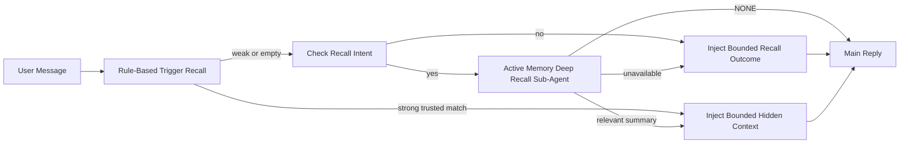

## <a id="how-it-works"></a> 工作原理



深度召回子代理只能调用已配置的内存召回工具（请参阅[内存工具](/concepts/active-memory/memory-tools#memory-tools)）。如果查询和可用内存之间的连接很弱，它会返回 `NONE` 并且主要回复将在没有额外上下文的情况下继续进行。有意无意的跳过和不可用的回忆仅添加固定的、有限的结果注释。

主动记忆是一种会话增强功能，而不是平台范围的推理功能：

| 表面                                                             | 是否运行主动记忆？                                      |
| ------------------------------------------------------------------- | -------------------------------------------------------- |
| Control UI / 网络聊天持续会话                           | 是，当任一激活路径以代理为目标时       |
| 控制界面 / Web 聊天持久会话 | 是，当任一激活路径目标指向该代理时 |
| 同一持久聊天路径上的其他交互式通道会话                                              | No                                                       |
| Heartbeat/background 运行                                           | No                                                       |
| 通用内部 `agent-command` 路径                              | No                                                       |
| 子 agent/internal 帮助程序执行                                 | No                                                       |

会话间消息和子完成传递不会运行 Active Memory，即使它们到达可见对话时也是如此。 OpenClaw 使用其键入的交付来源来跳过召回。根据通常的定位和会话规则，同一对话中的后续人工消息仍然符合资格。

当会话持久且面向用户时使用它，代理具有有意义的长期记忆来搜索，并且 continuity/personalization 比原始提示确定性更重要：稳定的偏好、反复出现的习惯、应该自然浮现的长期上下文。它不太适合自动化、内部员工、一次性 API 任务或任何隐藏的个性化令人惊讶的地方。

## <a id="when-it-runs"></a> 何时运行

Active Memory 有两个面向 deep-recall 通道的定位路径：

1. **跨会话记忆** 会自动定位到其有效 `memory.search.rememberAcrossConversations` 设置已启用的 agent，但仅限于私密直接对话或持久化的显式 UI 会话。
2. **高级活动内存** 以 `plugins.entries.active-memory.config.agents` 中列出的代理 ID 为目标，并应用插件的聊天类型和聊天 ID 控件。

这两条路径都要求插件已启用，并且会话必须是符合条件的交互式持久会话。会话级 `/active-memory off` 会暂停该会话的这两条路径。如果任何条件不满足，active memory 就不会在该轮运行，主回复也不会受影响。

`config.mode` 控制目标轮次何时启动阻塞式子 agent：

| 模式       | 行为                                                                |
| ---------- | ----------------------------------------------------------------------- |
| `escalate` | 默认值。仅在 lane 1 没有强匹配时，针对 recall 意图运行。      |
| `always`   | 保留之前的行为，在每个符合条件的目标轮次都运行。 |
| `off`      | 在不卸载插件的情况下禁用 deep recall。                       |

基于规则的可信触发通道在 `off` 模式下仍然可用。 `rememberAcrossConversations` 不变：它仍然控制深度召回是否可以搜索其他私人对话。

### <a id="session-types"></a> 会话类型

`config.allowedChatTypes` 控制哪些类型的会话可以运行高级 Active Memory 路径。它不能扩大跨会话记忆的范围：即使高级 Active Memory 允许在群组或频道中运行，该产品设置仍然只限私密场景。默认值：

```json5
allowedChatTypes: ["direct"]
```

有效值：`direct`、`group`、`channel`、`explicit`（门户风格会话，具有一个不透明的 session id，例如 `agent:main:explicit:portal-123`）。直接消息会话默认运行；group、channel 和 explicit 会话需要显式启用：

```json5
allowedChatTypes: ["direct", "group"]
allowedChatTypes: ["direct", "group", "channel"]
```

如果要在某个允许的聊天类型内进行更小范围的灰度发布，可以添加 `config.allowedChatIds` 和 `config.deniedChatIds`：

- `allowedChatIds` 是已解析会话 id 的允许名单。非空时，active memory 只会在会话 id 位于该列表中的会话上运行——这会一次性收窄**所有**允许的聊天类型，包括直接消息。若要保留所有直接消息，同时只收窄群组，请把直接对端 id 也加入 `allowedChatIds`，或者将 `allowedChatTypes` 仅限制在你正在测试的 group/channel 灰度范围内。
- `deniedChatIds` 是拒绝名单，优先级始终高于 `allowedChatTypes` 和 `allowedChatIds`。

ID 来自持久通道会话密钥（例如 Feishu `chat_id`/`open_id`、Telegram 聊天 id、Slack 通道 id）。匹配不区分大小写。如果 `allowedChatIds` 非空并且 OpenClaw 无法解析会话的对话 ID，则活动内存会跳过该回合而不是猜测。

```json5
allowedChatTypes: ["direct", "group"],
allowedChatIds: ["ou_operator_open_id", "oc_small_ops_group"],
deniedChatIds: ["oc_large_public_group"]
```
