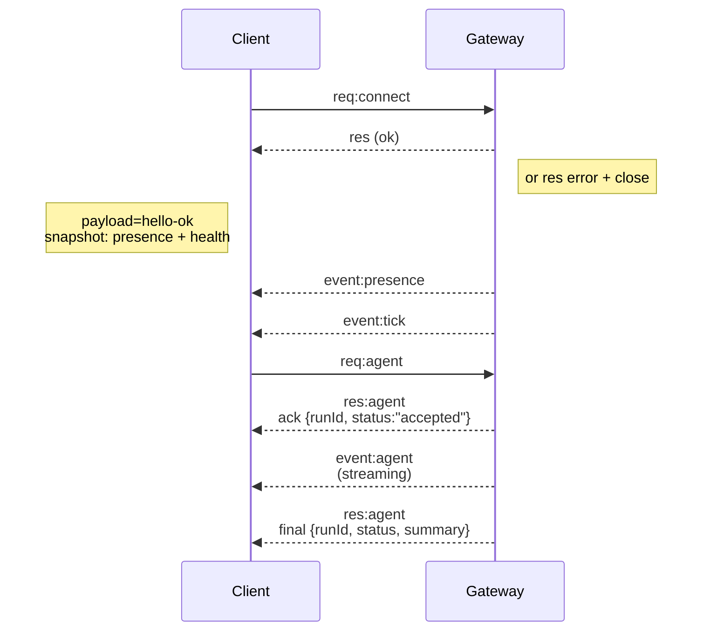

## <a id="overview"></a> 概览

- 一个长期运行的 **Gateway** 负责所有消息接入面（通过 Baileys 的 WhatsApp、通过 grammY 的 Telegram、Slack、Discord、Signal、iMessage、WebChat）。
- Control-plane 客户端（macOS 应用程序、CLI、Web UI、自动化）通过配置的绑定主机上的 **WebSocket** 连接到网关（默认`127.0.0.1:18789`）。
- **Nodes** （macOS/iOS/Android/headless） 也通过 **WebSocket** 连接，但使用显式 caps/commands. 声明 `role: node`
- 每个主机一个网关。这是打开 WhatsApp 会话的唯一位置。
- **托管小部件表面**由网关HTTP服务器提供服务，位于：
  - `/__openclaw__/canvas/`（托管小部件文档）
  - `/__openclaw__/a2ui/`（A2UI 渲染器资源）

  它使用与 Gateway 相同的端口（默认 `18789`）。

## <a id="components-and-flows"></a> 组件与流程

### <a id="gateway-(daemon)"></a><a id="gateway-daemon"></a> Gateway（守护进程）

- 维护 provider 连接。
- 暴露类型化的 WS API（请求、响应、服务端推送事件）。
- 根据 JSON Schema 验证入站帧。
- 发出诸如 `agent`、`chat`、`presence`、`health`、`heartbeat`、`cron` 的事件。

### <a id="clients-(mac-app-%2F-cli-%2F-web-admin)"></a><a id="clients-mac-app-/-cli-/-web-admin"></a> 客户端（mac 应用 / CLI / web 管理）

- 每个客户端一个 WS 连接。
- 发送请求（`health`、`status`、`send`、`agent`、`system-presence`）。
- 订阅事件（`tick`、`agent`、`presence`、`shutdown`）。

### <a id="nodes-(macos-%2F-ios-%2F-android-%2F-headless)"></a><a id="nodes-macos-/-ios-/-android-/-headless"></a> Nodes（macOS / iOS / Android / 无头环境）

- 以 `role: node` 连接到 **同一个 WS 服务器**。
- 在`connect`中提供设备标识。配对是基于 **设备的**（角色 `node`），并且批准位于设备配对存储中。
- 公开 `camera.*`、`screen.record` 和 `location.get` 等命令。 macOS 应用程序还在 `canvas.*` 下公开小部件面板命令。

Protocol details: [Gateway 协议](/gateway/protocol)

### WebChat

- 静态 UI，使用网关 WS API 进行聊天历史记录并发送。
- 在远程部署中，通过与其他客户端相同的 SSH/Tailscale 隧道连接。

## <a id="connection-lifecycle-(single-client)"></a><a id="connection-lifecycle-single-client"></a> 连接生命周期（单个客户端）



## <a id="wire-protocol-(summary)"></a><a id="wire-protocol-summary"></a> 线路协议（摘要）

- 传输：WebSocket，文本帧内承载 JSON payload。
- 首帧**必须**是 `connect`。
- 完成握手后：
  - 请求：`{type:"req", id, method, params}` → `{type:"res", id, ok, payload|error}`
  - 事件：`{type:"event", event, payload, seq?, stateVersion?}`
- `hello-ok.features.methods` / `events` 是发现元数据，而不是每一个可调用 helper 路由的生成式导出。
- 共享密钥身份验证接受 `connect.params.auth.token` 或 `connect.params.auth.password` 中配置的密钥。 `gateway.auth.mode` 选择配置的值（`gateway.auth.token` 或 `gateway.auth.password`），而不是所需的接线字段。
- 带身份模式，例如 Tailscale Serve （`gateway.auth.allowTailscale: true`）或非 loopback 的 `gateway.auth.mode: "trusted-proxy"`，会通过请求头而不是 `connect.params.auth.*` 满足认证。
- Private-ingress `gateway.auth.mode: "none"` 完全禁用共享秘密身份验证。保持该模式远离公共或不受信任的入口。
- 副作用方法（`send`、`agent`）需要 Idempotency 密钥才能安全重试。服务器保留短暂的重复数据删除缓存。
- 节点必须包含 `role: "node"` 以及 `connect` 中的 caps/commands/permissions。

## <a id="pairing-and-local-trust"></a> 配对与本地信任

- 所有 WS 客户端（操作员 + 节点）在 `connect` 时都包含一个 **设备身份**。
- 新设备 ID 需要配对批准。网关为后续连接颁发 **设备令牌**。
- 直接的本地回环连接可以自动批准，以保持同主机 UX 的流畅性。
- OpenClaw 还具有用于可信共享秘密帮助程序流的狭窄 backend/container-local 自连接路径。
- Tailnet 和 LAN 连接，包括同主机 tailnet 绑定，仍然需要显式的配对批准。
- 所有连接都必须对 `connect.challenge` 随机数进行签名。签名负载`v3`还绑定`platform`和`deviceFamily`。网关在重新连接时固定配对元数据，并需要针对元数据更改进行修复配对。
- **非本地** 连接仍然需要显式批准。
- Gateway 认证（`gateway.auth.*`）仍然适用于**所有**连接，无论本地还是远程。

详情：[Gateway protocol](/gateway/protocol)、[Pairing](/channels/pairing)、 [Security](/gateway/security)。

## <a id="protocol-typing-and-codegen"></a> 协议类型与代码生成

- TypeBox schemas 定义协议。
- JSON Schema 从这些 schemas 生成。
- Swift models 从 JSON Schema 生成。

## <a id="remote-access"></a> 远程访问

- 首选：Tailscale 或 VPN。
- 替代方案：SSH 隧道

  ```bash
  ssh -N -L 18789:127.0.0.1:18789 user@gateway-host
  ```

- 隧道中仍适用相同的握手 + 认证令牌。
- 远程部署中的 WS 可启用 TLS + 可选 pinning。

## <a id="operations-snapshot"></a> 运行概览

- 启动：`openclaw gateway`（前台运行，日志输出到 stdout）。
- 健康检查：通过 WS 的 `health`（也会包含在 `hello-ok` 中）。
- 守护：使用 launchd/systemd 自动重启。

### <a id="timed-work-and-shutdown"></a> 定时工作和关机

网关内核拥有一个 `GatewayScheduler` 用于注册维护和 cron 唤醒。所有者收到该实例并注册作业；一个主机定时器驱动下一次唤醒。对于持久工作，商店保留最后期限，并且其所有者在启动时重建时间表，而不是保留第二个调度程序状态。

睡眠后，延迟唤醒会分派每个可运行对象，并为该唤醒注册一次。定期注册在开始下一个间隔之前等待其回调和跟踪工作完成；错过的刻度被合并。墙上时间赶上睡眠，而经过时间则通过向后时钟校正保持相对延迟和节奏移动。默认情况下，重新安排会替换等待的作业； `mode: "earliest"` 保留同一作业 ID 的较早墙和已过的最后期限，因此过时的读取不能推迟已承诺的唤醒。

`beginClose()` 关闭调度准入，取消挂起的唤醒，并发出关闭信号。 `stop()` 加入已经运行的回调并由其异步范围跟踪工作；网关生命周期拥有外部关闭预算和资源拆卸。请求截止日期、流本地计时器和子进程清理由其操作所有者保留。 SQLite WAL 检查点计时器由存储所有者保留。

插件通过其服务或通道帐户生命周期接收版本化的 `PluginServiceSchedulerV1` 功能。其`beginClose()`取消待处理工作并关闭入场； `stop()` 在主机释放生命周期之前加入正在运行的回调和子作用域。插件仍然拥有域清理顺序，包括套接字关闭和持久刷新。参见[服务调度](/plugins/sdk-runtime/gateway-and-nodes#service-scheduling)。

## <a id="invariants"></a> 不变量

- 每台主机上仅有一个 Gateway 控制一个 Baileys 会话。
- 握手是强制性的。任何非 JSON 或非连接第一帧都是硬关闭。
- 事件不会重播。客户必须刷新空白。

## <a id="related"></a> 相关内容

- [Agent Loop](/concepts/agent-loop) — 详细的 agent 执行周期
- [Gateway Protocol](/gateway/protocol) — WebSocket 协议契约
- [Queue](/concepts/queue) — 命令队列与并发
- [Security](/gateway/security) — 信任模型与加固
- [Network](/network) — OpenClaw 如何跨本地主机、LAN 和尾网连接、配对和保护设备的集线器
