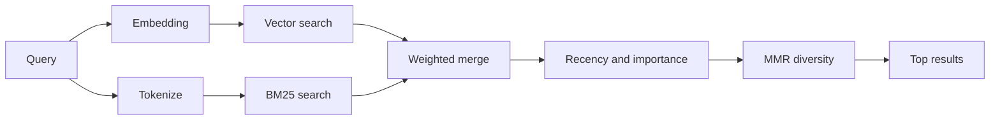

`memory_search` 会从你的 memory 文件中查找相关笔记，即使措辞与原文不同也是如此。它会将 memory 分块为较小的片段，并使用嵌入、关键词或两者进行搜索。

结果计数参数是`maxResults`（至少为一个整数1）。该工具还接受`max_results`和`limit`作为别名。如果提供多个​​，`maxResults`优先于`max_results`，它优先于`limit`，无论参数顺序如何。仅验证选定的值；无效的较高优先级值将被拒绝，而不是回退到有效的别名。广告中的工具架构继续使用`maxResults`。

当索引 Markdown 时，内置引擎将仅标题块附加到以下内容块。这可以防止短标题自行占据搜索结果槽，同时保留章节上下文和源代码行引用。没有后续内容的最终标题仍可搜索。已经分割成多个块的超大标题保留其片段，并且提供者输入限制仍然适用于合并的块。带有自己的召回注释的标题保持独立，保留其项目范围、触发点和重要性。策划条目内的类似标题的片段保留在该条目的注释范围内。

升级后，现有的内置索引会在下一次正常搜索或同步时重建一次以应用此分块更改。无需更改配置或手动 `memory index --force`。内存文件和数据库模式不变；如果重建无法立即完成，关键字搜索仍然可用。

## <a id="quick-start"></a> 快速开始

OpenClaw 默认使用 OpenAI 嵌入模型。要使用其他提供商，请显式设置它：

```json5
{
  memory: {
    search: {
      provider: "openai", // or "gemini", "voyage", "mistral", "bedrock", "local", "ollama", "lmstudio", "github-copilot", "openai-compatible"
    },
  },
}
```

`provider` 还可以引用自定义 `models.providers.<id>` 条目（例如 `ollama-5080`），只要该条目将 `api` 设置为 `"ollama"` 或具有内存嵌入适配器的其他提供者 ID。

对于没有 API 密钥的本地嵌入，请安装并配置官方 llama.cpp 提供程序，然后设置 `provider: "local"`：

```bash
openclaw plugins install @openclaw/llama-cpp-provider
```

在交互式设置中选择 llama.cpp 一次。 OpenClaw 安装经过验证的 `llama-server`，下载嵌入 GGUF，并写入其托管服务配置。

禁用批量索引时，托管 `local` 和 Ollama 嵌入一次索引一个文件。这限制了完全重建期间的后台嵌入请求；在之前并行运行多个本地作业的主机上，大型索引可能需要更长的时间。

EmbeddingGemma 自动使用其经过训练的任务前缀进行查询和索引文档，包括通过 Ollama、LM Studio 和 OpenAI- 兼容提供程序。升级后，现有的无前缀 EmbeddingGemma 索引将在下次搜索或同步时重建一次。 OpenClaw 生成新的嵌入，而不是重用无前缀的缓存条目。如果重建无法立即完成，关键字搜索仍然可用；无需手册 `memory index --force`。删除任何添加这些前缀的代理解决方法，这样它们就不会应用两次。

某些 OpenAI- 兼容嵌入端点需要非对称 `input_type` 标签，例如用于搜索的 `"query"` 和用于索引块的 `"document"`/`"passage"`。用 `queryInputType` 和 `documentInputType` 设置这些；参见[内存配置参考](/reference/memory-config#provider-specific-config)。

## <a id="supported-providers"></a> 支持的提供商

| 提供者          | ID                  | 需要 API key | 笔记                             |
| ----------------- | ------------------- | ------------- | --------------------------------- |
| 基岩           | `bedrock`           | No            | 使用 AWS 凭证链     |
| DeepInfra         | `deepinfra`         | 是           | 默认模型 `BAAI/bge-m3`       |
| Gemini            | `gemini`            | 是           | 支持image/audio索引     |
| GitHub Copilot    | `github-copilot`    | No            | 使用你的 Copilot 订阅    |
| 本地             | `local`             | No            | 托管 llama.cpp GGUF、~0.3 GB   |
| LM Studio         | `lmstudio`          | No            | Local/self-hosted 服务器          |
| Mistral           | `mistral`           | 是           | 默认模型 `mistral-embed`     |
| Ollama            | `ollama`            | No            | Local/self-hosted 服务器          |
| OpenAI            | `openai`            | 视情况而定       | API 密钥或符合条件的 Codex OAuth   |
| OpenAI-兼容 | `openai-compatible` | 通常       | 通用 `/v1/embeddings` 端点 |
| 航程            | `voyage`            | 是           | 默认模型 `voyage-4-large`    |

要移走 Ollama，[llmman](/providers/llmman#advanced-configuration) 服务于相同的 `/api/embed`，因此 `provider: "ollama"` 只需要一个新的 `remote.baseUrl`。

## <a id="how-search-works"></a> 搜索如何工作

OpenClaw 会并行运行两条检索路径，并合并结果：



- **向量搜索** 匹配相似含义（“gateway host” 匹配 “the machine running OpenClaw”）。
- **BM25 关键字搜索** 匹配确切的术语（ID、错误字符串、配置键）。它接受 NFC 和 NFD Unicode 拼写，无需重写注释或重建现有索引，包括跨单词混合这些形式的注释。首先搜索需要每个查询词。仅当正文和文件名搜索均未找到匹配项时，它才会使用任何查询词和特定于语言的关键字扩展重试正文搜索一次，按 BM25 排名。这可以恢复答案，而无需扩大已具有匹配项的关键字查询。
- **文件名搜索** 将路径与笔记正文分开索引。完整的精确路径、基名以及文件名词干的排名高于部分路径匹配，而摘要和正文关键词分数仍然来自笔记内容。

如果只有一条路径可用，则另一条路径单独运行。关键字提升保持有限，而不会将不同的词汇分数削减到相同的最大值，因此当过时的笔记衰减时，相关性会继续影响排名。

然后内置引擎应用固定的排名规则：

```text
hybrid relevance × recency decay × importance multiplier
```

重要性只在条目被写入时评估一次，而写入该条目的记忆工作流中已经有模型参与。如果缺少重要性，则视为中性，因此现有索引会保留其之前的相关性信号。带日期的日记笔记会按照 30 天半衰期衰减；像 `MEMORY.md` 和 `USER.md` 这样的整理文件则始终有效。这沿用了 [生成式智能体（arXiv:2304.03442）](https://arxiv.org/abs/2304.03442) 中相关性、时效性和重要性的结果，但没有增加一次查询时的模型调用。

MMR 随后会对评分后的混合候选集重新排序，以减少重复的片段。它不会更改分数或阈值资格，也不会再次调用提供商。

`minScore` 阈值使用新近度衰减之前的相关性，包括重要性和项目权重。新近度改变了符合条件的点击的顺序，而不是它们是否符合条件。因此，相关日期票据返回的最终 `score` 可能低于 `minScore`。结果限制仍然适用：符合条件的旧笔记可以在返回的窗口之外排名。

当每个结果的预衰减分数低于配置的最低分数时，搜索会保留关键字匹配。混合搜索还可以使用仅关键字匹配来填充剩余的结果槽。这些规则也适用于项目会话；仅语义匹配仍需要满足配置的最低分数。

当检索到的关键字候选落在顶级向量候选之外时，混合排名还会对从存储的嵌入中检索到的关键字候选进行评分。当许多相似的注释填满矢量窗口时，这可以使强关键字答案保持合格。

<a id="deterministic-trigger-recall" />

## <a id="rule-based-trigger-recall"></a> 基于规则的触发召回

在符合条件的交互轮次中，内置引擎还会将传入消息与存储在已索引条目中的短触发短语进行比较。强匹配可以在回复前向隐藏上下文中添加最多三条精简条目。预过滤使用现有的关键词和向量检索路径，不会运行召回模型。

自动注入的范围刻意比 `memory_search` 更窄：只有已提升、受信任的条目才符合条件。在可用索引来源信息之前，这意味着仅来自根目录 `MEMORY.md` 和 `USER.md` 的条目。日记、导入的转录文本以及会话转录文本仍可通过显式记忆工具或主动记忆升级来访问，但绝不会自动注入。

**FTS-only 模式。** 设置 `provider: "none"` 以有意禁用嵌入并仅使用关键字进行搜索。当嵌入设置或请求失败时，将 `provider` 保留为未设置或设置为 `"auto"` 会回退到仅关键字排名，`provider: "local"`（GGUF/llama.cpp 提供商）也是如此。创建时回退仍然对关键字搜索的文本进行索引，包括第一次搜索之前的手动和后台索引。即使没有匹配项，`memory_search` 也会在 `debug.embeddingBootstrap` 中包含经过编辑的嵌入引导原因。

失败的本地嵌入请求保留对匹配索引的关键字访问，并将降级的提供程序记录在内存状态和网关日志中。真实的模型或索引配置不匹配仍然会暂停搜索，而不是提供不匹配的数据。

**显式提供程序不可用。** 如果您显式指定任何其他提供程序（例如 `openai`、`ollama`、`gemini`）并且该提供程序在请求时变得不可用（身份验证错误、网络故障），则 `memory_search` 会报告内存不可用，而不是静默降级为FTS-仅结果。这使得损坏的配置提供者可见。设置 `provider: "none"` 以便仅召回 FTS-，或修复 provider/auth 配置以恢复语义排名。

如果显式提供程序返回的查询嵌入的维度计数与索引不同，则搜索会报告不匹配情况，而不是比较这些向量。验证提供者的模型，然后使用 `openclaw memory index --force --agent <agent-id>` 进行重建。

## <a id="improving-search-quality"></a> 提升搜索质量

默认情况下，混合搜索会启用两个基于规则的排名过程。

### <a id="recency-decay"></a> 新近度衰减

旧笔记逐渐失去排名权重，因此最近的信息首先出现。默认半衰期为 30 天，上个月的纸币重量为原始重量的 50%，同时保留其腐烂前的资格。 `MEMORY.md`、`USER.md` 和 `memory/` 下未注明日期的文件保持常绿。注明日期的 `YYYY-MM-DD.md` 和 `YYYY-MM-DD-<slug>.md` 文件可在任何深度衰减，包括会话记忆笔记和嵌套梦境报告。

会话记录命中使用索引期间捕获的源活动时间戳。保留的转录档案使用其索引文件修改时间。各个消息时间戳仍然是来源元数据，并不确定源的新近度权重。

### <a id="mmr-(diversity)"></a><a id="mmr-diversity"></a> MMR（多样性）

减少冗余结果。如果五个注释都提到相同的路由器配置，则 MMR 倾向于具有不同内容的相似相关结果，而不是重复几乎相同的片段。固定相关性偏差设置使用 lambda `0.7` 和 Jaccard 重叠片段标记。它的本地工作是 `O(k²)`：普通默认要求每个检索段 200 个候选，重叠之前最多 400 个唯一的非精确候选；更广泛的项目和标识符搜索仍然单独受到限制。

<Tip>
无需配置。 FTS-only 和仅向量后备路径不运行混合 MMR 通道。
</Tip>

## <a id="multimodal-memory"></a> 多模态记忆

使用 `gemini-embedding-2`，您可以与 Markdown 一起索引图像和音频。这只适用于`memory.search.extraPaths`下的文件；默认内存根（`MEMORY.md`、`memory/*.md`）仅保留Markdown-。搜索查询仍然是文本，但它们与视觉和音频内容相匹配。请参阅 [ 内存配置参考 ](/reference/memory-config#multimodal-memory-gemini) 进行设置。

## <a id="session-memory-search"></a> 会话记忆搜索

如需从会话转录中进行精确的全文回忆，请使用 [`sessions_search`](/concepts/session-search) ，然后再通过 `sessions_history` 打开结果。会话记忆搜索仍然是语义化的、 实验性的补充功能。

也可以选择索引会话转录，以便 `memory_search` 回忆更早的对话。这是可选功能：设置 `experimental.sessionMemory: true` 并将 `"sessions"` 添加到 `sources` 中（默认的 `sources` 为 `["memory"]`）。

使用 `corpus: "memory"` 仅搜索内存笔记。不包含会话记录的结果不会加载会话历史记录或执行会话可见性查找。

会话点击遵循 `tools.sessions.visibility`，默认为 `"all"`。 `memory_search` 仍然搜索所选代理的索引语料库；使用 [`sessions_search`](/concepts/session-search) 在网关上跨代理进行转录搜索。可见的文字记录可以包括其他用户的对话。跨代理会话访问默认处于启用状态，并受 `tools.agentToAgent` 管辖；设置 `enabled: false` 以阻止普通的跨代理访问（请求者拥有的本机子代理和 ACP 子会话在 `tree` 或 `all` 下保持可访问）或使用 `allow` 限制代理对。每个对等点 `session.dmScope` 分隔 DM 上下文，但不限制通过会话工具进行转录访问。选择显式 `"agent"` 进行同一代理召回，选择 `"tree"` 进行当前加上衍生范围（主要是代理范围的例外），或选择 `"self"` 进行严格的当前会话召回。仅沙箱生成的限制和隐身排除仍然适用。

## <a id="troubleshooting"></a> 故障排查

**没有结果？** 运行 `openclaw memory status` 检查索引。如果为空，运行 `openclaw memory index --force`。

**只有关键词匹配？** 你的嵌入提供方可能尚未配置。检查 `openclaw memory status --deep`。

**本地嵌入超时？** `ollama`、`lmstudio` 和 `local` 使用较长的提供商拥有的批次截止时间。在重建索引之前运行 `openclaw memory status --deep` 以检查托管服务器端点。

OpenAI- 兼容的嵌入请求遵守调用者的截止日期，包括较长的索引预算，而没有较早的 HTTP 标头或正文超时。深度状态探测会使用提供程序的查询预算进行一次尝试：对于远程提供程序，通常为 60 秒；对于 `local`，通常为 5 分钟，除非提供程序提供自己的查询预算。托管服务器准备情况保留其单独的预算。停止的探测器报告 `memory embedding probe timed out after Ns`。

**找不到 CJK 文本？** 使用 `openclaw memory index --force` 重建 FTS 索引。

## <a id="related"></a> 相关内容

- [内存概览](/concepts/memory)
- [内存架构](/concepts/memory-architecture)
- [活动内存](/concepts/active-memory)
- [内置内存引擎](/concepts/memory-builtin)
- [内存配置参考](/reference/memory-config)
- [内存 LanceDB](/plugins/memory-lancedb)
