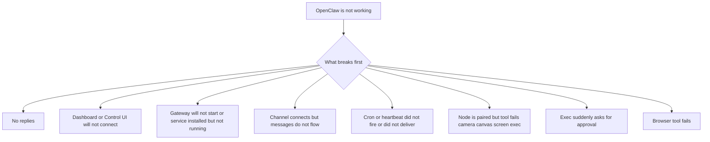

分诊入口。2 分钟内得出诊断，然后跳转到深入页面。

## <a id="first-60-seconds"></a> 前 60 秒

按顺序运行这个梯子：

```bash
openclaw triage
openclaw status
openclaw status --all
openclaw gateway probe
openclaw gateway status
openclaw doctor
openclaw channels status --probe
openclaw logs --follow
```

良好的输出，每行一条：

- `openclaw triage` 写入经过清理的、代理就绪的诊断，并在网关可访问时写入支持存档。请参阅 [Triage](/cli/triage) 了解座席切换选项。
- `openclaw status` 显示已配置的通道，没有认证错误。
- `openclaw status --all` 生成完整、可共享的报告。
- `openclaw gateway probe` 显示 `Reachable: yes`。 `Capability: ...`是检查证明的授权级别。缺少 `operator.read` 范围限制读取诊断；这并不意味着连接失败。
- `openclaw gateway status` 显示 `Runtime: running`、成功的连接检查以及合理的 `Capability: ...`。添加 `--require-rpc` 还需要读取范围 RPC 证明。
- `openclaw doctor` 报告没有阻塞 config/service 错误。
- `openclaw channels status --probe` 在网关可达时返回按账户划分的实时传输状态（`works` / `audit ok`）；在不可达时回退为仅配置摘要。
- `openclaw logs --follow` 显示稳定活动，没有重复出现的致命错误。

## <a id="assistant-feels-limited-or-missing-tools"></a> Assistant 感觉受限或缺少工具

检查有效的工具配置：

```bash
openclaw status
openclaw status --all
openclaw doctor
```

常见原因：

- `tools.profile: "minimal"` 允许 `session_status` 和仅更新 `gateway`。
- `tools.profile: "messaging"` 较窄，适用于仅限聊天的座席。
- `tools.profile: "coding"` 选择存储库、文件、shell 和运行时工作。
- `tools.profile: "full"` 是本地登录默认值。它删除了核心配置文件过滤并选择可选的插件工具，但受到独立的限制。
- 未设置的配置文件不会过滤核心工具，但本身不会选择可选的插件工具。除非再次运行登录，否则现有配置保持不变。
- Per-agent `agents.entries.*.tools` 覆盖缩小或扩展一个代理的根配置文件。

更改配置文件，重新启动或重新加载网关，然后使用 `openclaw status --all` 重新检查。分别查看聊天**执行权限**菜单；完整的工具选择不会授予完全访问权限或配置缺少的插件。完整的 profile/group 表：[ 刀具轮廓](/gateway/config-tools/tool-policy#tool-profiles)。

## <a id="anthropic-long-context-429"></a> Anthropic 长上下文 429

`HTTP 429: rate_limit_error: Extra usage is required for long context requests` → [Anthropic 429 需要额外使用量以支持长上下文](/gateway/troubleshooting#anthropic-429-extra-usage-required-for-long-context)。

## <a id="local-openai-compatible-backend-works-directly-but-fails-in-openclaw"></a> Local OpenAI-兼容后端直接工作但在OpenClaw中失败

您的 local/self-hosted `/v1` 后端应答直接 `/v1/chat/completions` 检查，但在 `openclaw infer model run` 或正常代理轮次上失败：

1. 错误提示 `messages[].content` 需要字符串：将 `models.providers.<provider>.models[].compat.requiresStringContent: true`。
2. 仍然只在 OpenClaw agent 轮次中失败：设置 `models.providers.<provider>.models[].compat.supportsTools: false` 并重试。
3. 微小的直接调用可以工作，但较大的 OpenClaw 提示会导致后端崩溃：这是上游 model/server 限制，而不是 OpenClaw 错误。继续在 [Local OpenAI- 兼容后端通过直接检查，但代理运行失败](/gateway/troubleshooting#local-openai-compatible-backend-passes-direct-probes-but-agent-runs-fail)。

## <a id="plugin-install-fails-with-missing-openclaw-extensions"></a> 插件安装失败，缺少 openclaw 扩展

`package.json missing openclaw.extensions` 表示插件包使用了 OpenClaw 不再接受的结构。

在插件包中修复：

1. 将 `openclaw.extensions` 添加到 `package.json`，指向已构建的运行时文件（通常是 `./dist/index.js`）。
2. 重新发布，然后再次运行 `openclaw plugins install <package>`。

```json
{
  "name": "@openclaw/my-plugin",
  "version": "1.2.3",
  "openclaw": {
    "extensions": ["./dist/index.js"]
  }
}
```

参考：[插件架构](/plugins/architecture)

## <a id="install-policy-blocks-plugin-installs-or-updates"></a> 安装策略阻止插件安装或更新

更新完成了，但插件已过时、被禁用，或者显示 `blocked by install policy`、`install policy failed closed`，或 `Disabled "<plugin>" after plugin update failure`：检查 `security.installPolicy`。

安装策略会在插件安装和更新时运行。`@openclaw/*` 插件版本通常会随着 OpenClaw 发布而变化，因此 OpenClaw 更新后，在更新同步期间可能需要匹配的插件更新。

除非你也维护相应的升级规则，否则避免使用以下策略形状：

- 将 OpenClaw- 拥有的插件冻结到一个确切的旧版本（例如，仅 `@openclaw/*@2026.5.3`）。
- 仅按来源类型进行阻止（每个 npm、network，或 `request.mode: "update"` 请求）。
- 将策略命令视为可选：启用 `security.installPolicy` 时，丢失、缓慢、不可读或权限受阻的策略可执行文件会阻止安装。
- 在未检查请求的 `openclawVersion` 与插件候选元数据的情况下批准版本。

优先使用允许受信任的 `@openclaw/*` 更新、且与当前宿主兼容的规则，而不是永久锁定到某个发布版本。如果你默认阻止 npm，请为你使用的插件 id 添加一个窄范围例外，并将同样的信任规则同时应用于 `request.mode: "update"` 和安装。

恢复：

```bash
openclaw doctor --deep
openclaw plugins update --all
openclaw status --all
```

如果策略是有意设得很严格，请在受信任的升级窗口放宽它，重新运行 `openclaw plugins update --all`，然后再恢复更严格的规则。如果更新失败导致某个插件被禁用，请在重新启用前先检查：

```bash
openclaw plugins inspect <plugin-id> --runtime --json
openclaw plugins enable <plugin-id>
```

参考：[操作员安装政策](/tools/skills-config#operator-install-policy-security-installpolicy)

## <a id="plugin-present-but-blocked-by-suspicious-ownership"></a> 插件存在但被可疑所有权阻止

`openclaw doctor`、setup 或启动警告显示：

```text
blocked plugin candidate: suspicious ownership (... uid=1000, expected uid=0 or root)
plugin present but blocked
```

插件文件的所有者与加载它们的进程不是同一个 Unix 用户。不要删除插件配置；请修复文件所有权，或使用拥有状态目录的用户运行 OpenClaw。

Docker 安装以 `node`（uid `1000`）运行。修复宿主机绑定挂载：

```bash
sudo chown -R 1000:1000 /path/to/openclaw-config /path/to/openclaw-workspace
openclaw doctor --fix
```

如果你有意以 root 身份运行 OpenClaw，则改为修复受管理的插件根目录：

```bash
sudo chown -R root:root /path/to/openclaw-config/npm
openclaw doctor --fix
```

更深入的文档：[Blocked 插件路径所有权](/tools/plugin#blocked-plugin-path-ownership)、[Docker：权限和 EACCES](/install/docker#permissions-and-eacces)

## <a id="decision-tree"></a> 决策树



每个分支下面都有一个手风琴的标题。

<AccordionGroup>
  <Accordion id="no-replies" title="没有回复">
    ```bash
    openclaw status
    openclaw gateway status
    openclaw channels status --probe
    openclaw pairing list --channel <channel> [--account <id>]
    openclaw logs --follow
    ```

    良好输出：

    - `Runtime: running`
    - A 连接检查成功
    - `Capability: read-only`、`write-capable` 或 `admin-capable`
    - Channel 显示已连接的传输，以及 `channels status --probe` 中支持的 `works` 或 `audit ok`
    - 发件人已批准（或 DM 策略为 open/allowlist）

    日志特征：

    - `drop guild message (mention required` → Discord 提及门控阻止了消息。
    - `pairing request` → 发送者未获批准，正在等待 DM 配对审批。
    - `blocked` / `allowlist` in channel logs → 发送者、房间或群组被过滤。

    深入页面：[无回复](/gateway/troubleshooting#no-replies)，[通道故障排查](/channels/troubleshooting)，[配对](/channels/pairing)

  </Accordion>

  <Accordion id="dashboard-or-control-ui-will-not-connect" title="仪表板或 Control UI 将无法连接">
    ```bash
    openclaw status
    openclaw gateway status
    openclaw logs --follow
    openclaw doctor
    openclaw channels status --probe
    ```

    良好输出：

    - `Dashboard: http://...` 显示在 `openclaw gateway status` 中
    - A 连接检查成功
    - `Capability: read-only`、`write-capable` 或 `admin-capable`
    - 日志中没有认证循环

    日志特征：

    - `device identity required` → HTTP/non-secure 上下文无法完成设备身份验证。
    - `origin not allowed` → 浏览器 `Origin` 不被允许用于 Control UI 网关目标。
    - `AUTH_TOKEN_MISMATCH` with `canRetryWithDeviceToken=true` → 可能会自动进行一次受信任的设备令牌重试，重试时复用已配对令牌的缓存作用域。
    - 重试后重复 `unauthorized` → 错误的 token/password、身份验证模式不匹配或陈旧的配对设备令牌。
    - `too many failed authentication attempts (retry later)` → 该浏览器多次出现故障 `Origin` 被暂时锁定；其他本地主机来源使用单独的存储桶。有关 Tailscale 服务并发重试的详细信息，请参阅 [Dashboard/Control UI 连接性](/gateway/troubleshooting#dashboard-control-ui-connectivity)。
    - `gateway connect failed:` → UI 的目标是错误的 URL/port，或者网关无法访问。

    深入页面：[Dashboard/Control UI connectivity](/gateway/troubleshooting#dashboard-control-ui-connectivity)，[Control UI](/web/control-ui)，[Authentication](/gateway/authentication)

  </Accordion>

  <Accordion id="gateway-will-not-start-or-service-installed-but-not-running" title="网关无法启动或服务已安装但未运行">
    ```bash
    openclaw status
    openclaw gateway status
    openclaw logs --follow
    openclaw doctor
    openclaw channels status --probe
    ```

    良好输出：

    - `Service: ... (loaded)`
    - `Runtime: running`
    - A 连接检查成功
    - `Capability: read-only`、`write-capable` 或 `admin-capable`

    日志特征：

    - `Gateway start blocked: set gateway.mode=local` or `existing config is missing gateway.mode` → 网关模式是 remote，或配置缺少 local-mode 标记，需要修复。
    - `refusing to bind gateway ... without auth` → 没有有效身份验证路径的非环回绑定（token/password 或配置的可信代理）。
    - `another gateway instance is already listening` or `EADDRINUSE` → 端口已被占用。

    深层页面：[网关服务未运行](/gateway/troubleshooting#gateway-service-not-running)、[监管和服务生命周期](/gateway#supervision-and-service-lifecycle)、[配置](/gateway/configuration)

  </Accordion>

  <Accordion id="channel-connects-but-messages-do-not-flow" title="通道已连接但消息不流动">
    ```bash
    openclaw status
    openclaw gateway status
    openclaw logs --follow
    openclaw doctor
    openclaw channels status --probe
    ```

    良好输出：

    - 通道传输已连接。
    - Pairing/allowlist 检查通过。
    - 在需要时已检测到提及。

    日志特征：

    - `mention required` → 群组提及门控阻止了处理。
    - `pairing` / `pending` → DM 发送者尚未获批准。
    - `not_in_channel`、`missing_scope`、`Forbidden`、`401/403` → 通道权限令牌问题。

    深入页面：[通道已连接，但消息不流动](/gateway/troubleshooting#channel-connected-messages-not-flowing)，[通道故障排查](/channels/troubleshooting)

  </Accordion>

  <Accordion id="cron-or-heartbeat-did-not-fire-or-did-not-deliver" title="Cron 或 heartbeat 未触发或未交付">
    ```bash
    openclaw status
    openclaw gateway status
    openclaw automations status
    openclaw automations list
    openclaw automations runs <jobId> --limit 20
    openclaw logs --follow
    ```

    良好输出：

    - `automations status` 显示调度程序在下一次唤醒时启用。
    - `automations runs` 显示最近的 `ok` 条目。
    - Heartbeat 已启用且处于活动时段内。

    日志特征：

    - `cron: scheduler disabled; jobs will not run automatically` → cron 被禁用。
    - `heartbeat skipped` 原因 `quiet-hours` → 超出配置的活动时间。
    - `heartbeat skipped` 原因 `empty-heartbeat-file` → 心跳监视器暂存仅包含空白、注释、标题、栅栏或空检查表标记。
    - `heartbeat skipped` 原因 `alerts-disabled` → `showOk`、`showAlerts` 和 `useIndicator` 均关闭。
    - `requests-in-flight`→主车道繁忙；心跳唤醒延迟。
    - `unknown accountId` → 心跳投放目标账户不存在。

    深层页面：[Cron和心跳投递](/gateway/troubleshooting#cron-and-heartbeat-delivery)、[定时任务：Troubleshooting](/automation/cron-jobs#troubleshooting)、[Heartbeat](/gateway/heartbeat)

  </Accordion>

  <Accordion id="node-is-paired-but-tool-fails-camera-canvas-screen-exec" title="Node 已配对，但工具无法执行相机画布屏幕">
    ```bash
    openclaw status
    openclaw gateway status
    openclaw nodes status
    openclaw nodes describe --node <idOrNameOrIp>
    openclaw logs --follow
    ```

    良好输出：

    - Node 列为已连接并已与角色 `node` 配对。
    - 你正在调用的命令具备相应能力。
    - 该工具的权限状态已授予。

    日志特征：

    - `NODE_BACKGROUND_UNAVAILABLE` → 将节点应用切换到前台。
    - `*_PERMISSION_REQUIRED` → OS 权限 denied/missing.
    - `SYSTEM_RUN_DENIED: approval required` → exec 审批正在等待中。
    - `SYSTEM_RUN_DENIED: allowlist miss` → 命令不在 exec 白名单中。

    深入页面：[节点已配对，但工具失败](/gateway/troubleshooting#node-paired-tool-fails)，[节点故障排查](/nodes/troubleshooting)，[Exec 审批](/tools/exec-approvals)

  </Accordion>

  <Accordion id="exec-suddenly-asks-for-approval" title="Exec突然请求批准">
    ```bash
    openclaw config get tools.exec.host
    openclaw config get tools.exec.security
    openclaw config get tools.exec.ask
    openclaw gateway restart
    ```

    发生了什么变化：

    - 未设置的 `tools.exec.host` 默认为 `auto`；当沙箱运行时环境处于激活状态时，它会解析为 `sandbox`，否则为 `gateway`。
    - `host=auto` 仅限航线；无提示行为来自 `security=full` 加上 gateway/node. 上的 `ask=off`
    - Unset `tools.exec.security` 默认为 `gateway`/`node`. 上的 `full`
    - 未设置的 `tools.exec.ask` 默认为 `off`。
    - 如果你现在看到审批，说明某个宿主机本地或按会话的策略把 exec 收紧到了这些默认值之外。

    恢复当前的无审批默认值：

    ```bash
    openclaw config set tools.exec.host gateway
    openclaw config set tools.exec.security full
    openclaw config set tools.exec.ask off
    openclaw gateway restart
    ```

    更安全的替代方案：

    - 仅设置 `tools.exec.host=gateway`，以获得稳定的宿主路由。
    - 使用 `security=allowlist` 并配合 `ask=on-miss`，在白名单未命中时对宿主 exec 进行审查。
    - 启用沙箱模式，使 `host=auto` 重新解析回 `sandbox`。

    日志特征：

    - `Approval required.` → 命令正在等待 `/approve ...`。
    - `SYSTEM_RUN_DENIED: approval required` → 节点主机 exec 审批正在等待中。
    - `exec host=sandbox requires a sandbox runtime for this session` → implicit/explicit 沙箱选择，但沙箱模式已关闭。

    深层页面：[Exec](/tools/exec)、[Exec 批准](/tools/exec-approvals)、[ 安全性：审核检查的内容](/gateway/security/running-the-audit#what-the-audit-checks-high-level)

  </Accordion>

  <Accordion id="browser-tool-fails" title="浏览器工具失败">
    ```bash
    openclaw status
    openclaw gateway status
    openclaw browser status
    openclaw logs --follow
    openclaw doctor
    ```

    良好输出：

    - 浏览器状态显示 `running: true` 和选定的 browser/profile.
    - `openclaw` 配置文件启动成功，或 `user` 配置文件能看到本地 Chrome 标签页。

    日志特征：

    - `unknown command "browser"` → `plugins.allow` 已设置且排除了 `browser`。
    - `Failed to start Chrome CDP on port` → 本地浏览器启动失败。
    - `browser.executablePath not found` → 配置的二进制路径错误。
    - `browser.cdpUrl must be http(s) or ws(s)` → 配置的 CDP URL 使用了不支持的协议。
    - `browser.cdpUrl has invalid port` → 配置的 CDP URL 端口无效或超出范围。
    - `No Chrome tabs found for profile="user"` → Chrome MCP attach 配置文件没有打开的本地 Chrome 标签页。
    - `Remote CDP for profile "<name>" is not reachable` → 从此主机无法访问配置的远程 CDP 端点。
    - `Browser attachOnly is enabled ... not reachable` → attach-only 配置文件没有可用的 live CDP 目标。
    - Stale viewport/dark-mode/locale/offline 覆盖仅连接或远程 CDP 配置文件 → 运行 `openclaw browser stop --browser-profile <name>` 以关闭控制会话并释放仿真状态，而无需重新启动网关。

    深层页面：[浏览器工具失败](/gateway/troubleshooting#browser-tool-fails)、[缺少浏览器命令或工具](/tools/browser/setup#missing-browser-command-or-tool)、[浏览器：Linux故障排除](/tools/browser-linux-troubleshooting)、[浏览器： WSL2/Windows 远程 CDP 故障排除](/tools/browser-wsl2-windows-remote-cdp-troubleshooting)

  </Accordion>

</AccordionGroup>

## <a id="related"></a> 相关内容

- [FAQ](/help/faq) — 常见问题
- [Gateway Troubleshooting](/gateway/troubleshooting) — 网关特定问题
- [Doctor](/gateway/doctor) — 自动化健康检查和修复
- [Channel Troubleshooting](/channels/troubleshooting) — 通道连接问题
- [Scheduled tasks: Troubleshooting](/automation/cron-jobs#troubleshooting) — cron 和 heartbeat 问题
