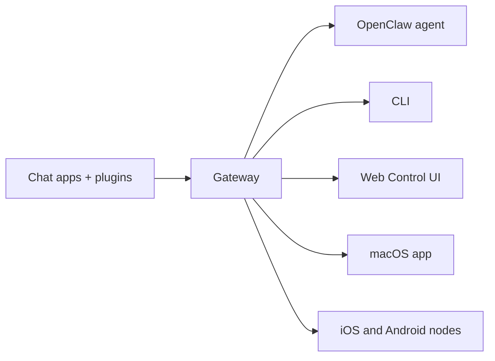

# OpenClaw 🦞

<p align="center">
    
    
</p>

> _"EXFOLIATE! EXFOLIATE!"_ — 一只太空龙虾，大概吧

<p align="center">
  <strong>你的 AI 助手，运行在你自己的硬件上，接入你日常使用的聊天应用。</strong><br />
  一个 Gateway，任意模型，任意设备，无需中间托管服务。<br />由独立的 501(c)(3) 非营利组织 <a href="https://openclaw.org">OpenClaw Foundation</a> 公开开发。没有付费层级，默认仅执行可关闭的<a href="/gateway/telemetry">版本检查</a>，不收集其他遥测数据，也不隶属于任何 AI 实验室。
</p>

<Columns>
  <Card title="开始使用" href="/start/getting-started" icon="rocket">
    安装 OpenClaw，并在几分钟内启动网关。
  </Card>
  <Card title="运行入门引导" href="/start/wizard" icon="list-checks">
    使用 `openclaw onboard` 和配对流程进行引导式设置。
  </Card>
  <Card title="连接渠道" href="/channels" icon="message-circle">
    连接 Discord、Signal、Telegram、WhatsApp 等，即可随时随地聊天。
  </Card>
  <Card title="打开 Control UI" href="/web/control-ui" icon="layout-dashboard">
    启动用于聊天、配置和会话的浏览器仪表盘。
  </Card>
</Columns>

## <a id="browse-docs"></a> 浏览文档

移动浏览器可能只显示章节菜单，不显示完整的桌面标签栏。你可以通过以下入口，从页面正文访问各个文档分类。

<Columns>
  <Card title="开始使用" href="/start/getting-started" icon="rocket">
    概述、第一步和设置指南。
  </Card>
  <Card title="安装" href="/install" icon="download">
    安装路径、更新、容器、托管和高级设置。
  </Card>
  <Card title="渠道" href="/channels" icon="messages-square">
    消息渠道、配对、路由、访问组和渠道质量验证。
  </Card>
  <Card title="智能体" href="/concepts/architecture" icon="bot">
    架构、会话、上下文、记忆和多智能体路由。
  </Card>
  <Card title="功能" href="/tools" icon="wand-sparkles">
    工具、技能、cron、webhook 和自动化功能。
  </Card>
  <Card title="ClawHub" href="/clawhub" icon="store">
    插件市场、发布、精选与信任指南。
  </Card>
  <Card title="模型" href="/providers" icon="brain">
    提供商、模型配置、故障切换和本地模型服务。
  </Card>
  <Card title="平台" href="/platforms" icon="monitor-smartphone">
    macOS、Windows、iOS、Android、节点和 Web 界面。
  </Card>
  <Card title="Gateway 与运维" href="/gateway" icon="server">
    网关配置、安全性、诊断和运维。
  </Card>
  <Card title="参考" href="/cli" icon="terminal">
    CLI 参考、架构、RPC 和模板。
  </Card>
  <Card title="发布" href="/releases" icon="tag">
    每个版本的发行说明，包含亮点和源链接。
  </Card>
  <Card title="帮助" href="/help" icon="life-buoy">
    故障排查、常见问题、测试、诊断和环境检查。
  </Card>
</Columns>

## <a id="what-is-openclaw%3F"></a><a id="what-is-openclaw"></a> 什么是 OpenClaw？

OpenClaw 是一个**自托管网关**，通过渠道插件，将 Discord、Google Chat、iMessage、Matrix、Microsoft Teams、Signal、Slack、Telegram、WhatsApp、Zalo 等聊天应用连接到 AI 编程智能体。你只需在自己的计算机或服务器上运行一个 Gateway 进程，就能将消息应用连接到随时可用的 AI 助手。

**适合谁使用？** 适合希望随时向 AI 助手发送消息，同时保持数据控制权、不依赖托管服务的开发者、进阶用户和团队。同一个 Gateway 既可以在笔记本电脑上充当个人助手，也可以作为共享的[团队部署](/start/teams)运行，两者仅配置不同。

**它有何不同？**

- **自托管**：在你的硬件上运行，按你的规则办
- **多频道**：一个 Gateway 可同时为所有已配置的频道插件提供服务
- **面向智能体**：专为编程智能体构建，支持工具调用、会话、记忆和多智能体路由
- **开源**：MIT 许可，社区驱动

关于可信网关、不可信执行、由代码强制实施的策略，以及同一产品如何兼顾个人和团队使用的完整架构说明，请参阅[为什么选择 OpenClaw](/start/why-openclaw)。

**需要准备什么？** 推荐使用 Node 26，也支持 Node 24.16+ 或 Node 26.1+。你还需要所选提供商的 API 密钥和约 5 分钟时间。为获得更好的质量和安全性，请使用可用的最新一代高性能模型。

## <a id="how-it-works"></a> 工作原理



网关是会话、路由和通道连接的唯一事实来源。

## <a id="key-capabilities"></a> 核心能力

<Columns>
  <Card title="多通道网关" icon="network" href="/channels">
    使用单个网关进程即可支持 Discord、iMessage、Signal、Slack、Telegram、WhatsApp、WebChat 等。
  </Card>
  <Card title="插件频道" icon="plug" href="/tools/plugin">
    通道插件可添加 Matrix、Nostr、Twitch、Zalo 等；官方插件可按需安装。
  </Card>
  <Card title="多智能体路由" icon="route" href="/concepts/multi-agent">
    按智能体、工作区或发送者隔离会话。
  </Card>
  <Card title="媒体支持" icon="image" href="/nodes/images">
    发送和接收图像、音频和文档。
  </Card>
  <Card title="网页 Control UI" icon="monitor" href="/web/control-ui">
    用于聊天、配置、会话和节点的浏览器仪表板。
  </Card>
  <Card title="移动节点" icon="smartphone" href="/nodes">
    将 iOS 和 Android 节点配对以实现摄像头、屏幕和支持语音的工作流程。
  </Card>
  <Card title="技能" icon="graduation-cap" href="/tools/skills">
    为智能体定义可重复执行的流程，并按需加载。
  </Card>
  <Card title="自动化" icon="clock" href="/automation">
    使用 cron 作业、挂钩和 Webhook 按计划运行工作。
  </Card>
  <Card title="构建插件" icon="hammer" href="/plugins/building-plugins">
    针对插件 SDK 编写您自己的通道、提供商和工具插件。
  </Card>
</Columns>

## <a id="quick-start"></a> 快速开始

<Steps>
  <Step id="install-openclaw" title="安装 OpenClaw">
    <Tabs>
      <Tab title="macOS / Linux / WSL2">
        ```bash
        curl -fsSL https://openclaw.ai/install.sh | bash
        ```
      </Tab>
      <Tab title="Windows (PowerShell)">
        ```powershell
        iwr -useb https://openclaw.ai/install.ps1 | iex
        ```
      </Tab>
    </Tabs>

    安装程序会检测操作系统，按需安装 Node，安装 OpenClaw，然后启动入门引导。npm、pnpm、bun、Docker、Nix 和源码安装等其他方式，请参阅[安装](/install)。

  </Step>
  <Step id="complete-onboarding" title="完成入门引导">
    入门引导提供 **Quick start** 和 **Custom setup** 两种选项。Quick start 会复用检测到的 AI 访问凭据，通过一次实际的模型请求验证凭据，并打开网页仪表盘，让 Gateway 在前台运行。Custom setup 则会逐项完成全部引导。`openclaw onboard --classic` 会打开经典的分步设置向导。

  </Step>
  <Step id="install-the-gateway-service" title="安装 Gateway 服务">
    Quick start 会让 Gateway 在前台运行。按 **Ctrl+C** 停止后，再安装后台服务：

    ```bash
    openclaw gateway install
    ```

  </Step>
  <Step id="chat" title="聊天">
    在浏览器中打开Control UI并发送消息：

    ```bash
    openclaw dashboard
    ```

    或者连接一个通道（[Telegram](/channels/telegram) 是最快的），然后在手机上聊天。

  </Step>
</Steps>

需要完整的安装和开发设置说明？请参阅[入门](/start/getting-started)。

## <a id="dashboard"></a> 仪表板

网关启动后打开浏览器Control UI。

- 本地默认地址：[http://127.0.0.1:18789/](http://127.0.0.1:18789/)
- 远程访问：[Web 界面](/web) 和 [Tailscale](/gateway/tailscale)

<p align="center">
  
</p>

## <a id="configuration-(optional)"></a><a id="configuration-optional"></a> 配置（可选）

配置位于 `~/.openclaw/openclaw.json`。

- 如果你**什么都不做**，OpenClaw 会使用内置的 OpenClaw 代理运行时；私信会共享代理的主会话，而每个群聊都会获得自己的会话。
- 如果你想加强限制，可以从 `channels.whatsapp.allowFrom` 和（对于群组）提及规则开始。

示例：

```json5
{
  channels: {
    whatsapp: {
      allowFrom: ["+15555550123"],
      groups: { "*": { requireMention: true } },
    },
  },
  messages: { groupChat: { mentionPatterns: ["@openclaw"] } },
}
```

## <a id="start-here"></a> 从这里开始

<Columns>
  <Card title="文档中心" href="/start/hubs" icon="book-open">
    按使用场景组织的全部文档和指南。
  </Card>
  <Card title="配置" href="/gateway/configuration" icon="settings">
    核心网关设置、令牌和提供商配置。
  </Card>
  <Card title="远程访问" href="/gateway/remote" icon="globe">
    SSH 和 tailnet 访问模式。
  </Card>
  <Card title="渠道" href="/channels" icon="message-square">
    Discord、Feishu、Microsoft Teams、Telegram、WhatsApp 等的通道特定设置。
  </Card>
  <Card title="节点" href="/nodes" icon="smartphone">
    iOS 和 Android 节点具有配对、摄像头、屏幕和设备操作。
  </Card>
  <Card title="帮助" href="/help" icon="life-buoy">
    常见修复和故障排查入口。
  </Card>
</Columns>

## <a id="learn-more"></a> 了解更多

<Columns>
  <Card title="完整功能列表" href="/concepts/features" icon="list">
    完整的通道、路由和媒体能力。
  </Card>
  <Card title="多智能体路由" href="/concepts/multi-agent" icon="route">
    工作区隔离和按代理划分的会话。
  </Card>
  <Card title="安全" href="/gateway/security" icon="shield">
    令牌、允许列表和安全控制。
  </Card>
  <Card title="故障排查" href="/gateway/troubleshooting" icon="wrench">
    网关诊断和常见错误。
  </Card>
  <Card title="关于和制作人员" href="/reference/credits" icon="info">
    项目起源、贡献者和许可证。
  </Card>
</Columns>
