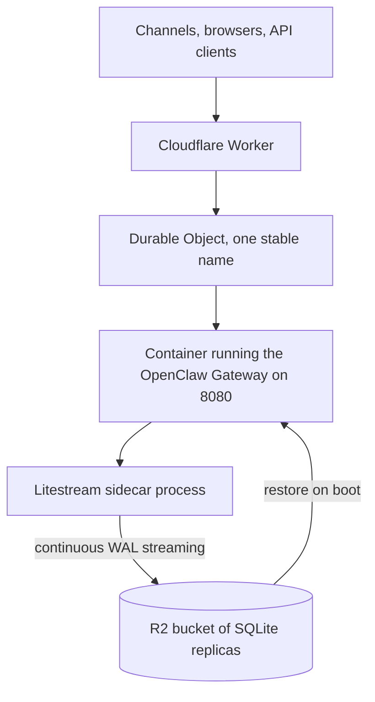

在 Cloudflare Worker 和命名的持久对象后面运行一个 OpenClaw 安装，并使用官方 OpenClaw 映像和 Litestream 复制到 R2。

<Warning>
  此部署目标为实验性功能。Litestream 保护的是 SQLite 数据库，而不是完整的 OpenClaw 状态目录。在使用生产凭据前，请阅读[限制和恢复](#limits-and-recovery)。
</Warning>

## <a id="what-you-need"></a> 准备工作

- A Cloudflare 帐户，包含 Workers、Container 和 R2 可用
- 支持 `linux/amd64` 的 Docker Buildx
- A 派生映像的公共 Docker Hub 存储库，以及可以推送到它的 `docker login` 会话
- S3- 兼容的 CLI，例如 AWS CLI，稍后用于验证 Litestream 复制
- Node.js 和 npm
- OpenClaw 设置所需的 Provider 和频道凭据

模板位于 [`scripts/cloudflare`](https://github.com/openclaw/openclaw/tree/main/scripts/cloudflare)。它会部署一个 `standard-2` Container，并设置 `max_instances: 1`。

## <a id="how-it-works"></a> 工作原理

Worker 将每个 HTTP 和 WebSocket 请求转发到一个稳定的持久对象名称。该持久对象拥有一个容器实例，并且是 Litestream 副本周围的单写入器围栏。容器在端口 `8080` 上公开 OpenClaw，持久对象在路由到它之前轮询那里的 `/healthz`。



Litestream 会监视两个 SQLite 根目录：

- `/home/node/.openclaw/state/*.sqlite`
- `/home/node/.openclaw/agents/**/*.sqlite`

启动时，入口点使用 R2 的 S3 `ListObjectsV2` API 作为恢复清单，拒绝位于这些根目录之外的路径，恢复每个发现的数据库，然后才启动 Gateway。

在此模板上针对真实的 R2 存储桶进行测量：从写入到副本大约需要 2.4 秒，将两个数据库恢复到新容器中大约需要 9 秒，该容器在启动后大约 13 秒到达健康网关。将这些视为数量级的期望，而不是保证。

## <a id="deploy"></a> 部署

<Steps>
  <Step id="prepare-the-template" title="准备模板">
    克隆 OpenClaw 并进入模板目录：

    ```bash
    git clone https://github.com/openclaw/openclaw.git
    cd openclaw/scripts/cloudflare
    npm install
    npx wrangler login
    npx wrangler whoami
    ```

    在创建资源前，确认 Wrangler 选择的是目标 Cloudflare 账户。

  </Step>

  <Step id="create-r2-storage" title="创建R2存储">
    创建存储桶：

    ```bash
    npx wrangler r2 bucket create openclaw-backups
    ```

    在 Cloudflare 仪表板中，创建 R2 API 令牌，其中对象 read/write 访问权限仅限于该存储桶。将访问密钥 ID 和秘密访问密钥保留在结账之外。

    在 `wrangler.jsonc` 中，将 endpoint 里的 `<account-id>` 替换为实际值。如果使用其他存储桶名称，请同时更新 `LITESTREAM_BUCKET` 和 `r2_buckets[].bucket_name`。

    R2 binding 用于 Worker 侧访问和文档完整性。Litestream 无法在 Container 内使用 Worker binding；它使用 R2 的 S3 endpoint，以及通过 Worker secrets 传入的凭据。

  </Step>

  <Step id="publish-the-container-image" title="发布容器镜像">
    将 `Dockerfile` 中的 `<official-openclaw-image-digest>` 替换为官方 [`openclaw/openclaw`](https://hub.docker.com/r/openclaw/openclaw) Docker Hub 存储库中的不可变摘要。

    为 Cloudflare 所需的架构构建派生镜像，并将其推送到公开的 Docker Hub 仓库：

    ```bash
    docker buildx build \
      --platform linux/amd64 \
      --tag docker.io/<docker-hub-user>/openclaw-cloudflare:<version> \
      --push \
      .
    docker buildx imagetools inspect \
      docker.io/<docker-hub-user>/openclaw-cloudflare:<version>
    ```

    将 `wrangler.jsonc` 中的 `containers[].image` 占位符替换为生成的不可变 `docker.io/...@sha256:...` 引用。 Cloudflare 容器可以直接拉取公共 Docker Hub 镜像； GHCR 不是此模板的受支持源。

  </Step>

  <Step id="deploy-the-worker-and-container" title="部署 Worker 和容器">
    编译 Worker 并进行部署：

    ```bash
    npm run check
    npm run deploy
    ```

    第一个部署创建 Worker、SQLite-backed Durable Object 类、Container 应用程序和 R2 绑定。

  </Step>

  <Step id="set-runtime-secrets" title="设置运行时秘密">
    通过 Wrangler 的 secret 提示添加 R2 和 Gateway 凭据：

    ```bash
    npx wrangler secret put LITESTREAM_ACCESS_KEY_ID
    npx wrangler secret put LITESTREAM_SECRET_ACCESS_KEY
    npx wrangler secret put OPENCLAW_GATEWAY_TOKEN
    ```

    根据需要添加 Provider 和频道变量。例如：

    ```bash
    npx wrangler secret put OPENAI_API_KEY
    npx wrangler secret put TELEGRAM_BOT_TOKEN
    ```

    `src/container.ts` 会将一个明确的环境变量 allowlist 传递给 Container。在使用其他由环境变量提供的凭据前，请先在那里添加对应名称。

  </Step>

  <Step id="bootstrap-openclaw" title="引导程序 OpenClaw">
    第一次启动需要容器内的一个交互式会话。 SSH 船舶禁用；通过将其添加到 `wrangler.jsonc` 中的容器条目来临时启用它，然后重新部署：

    ```jsonc
    "ssh": { "enabled": true }
    ```

    打开已部署的Worker URL一次即可启动实例。然后找到应用程序和实例 ID 并连接：

    ```bash
    npx wrangler containers list
    npx wrangler containers instances <application-id> --json
    npx wrangler containers ssh <instance-id>
    ```

    SSH 由 wrangler 介导，仅限拥有 Container 写入权限的账户使用。引导完成后，可以移除 `ssh` 区块并重新部署；恢复的状态会通过 Litestream 在替换后继续保留。

    在 Container 内，运行基于 SecretRef 的设置。此示例使用 OpenAI 和 Telegram：

    ```bash
    cd /app
    node openclaw.mjs onboard --non-interactive --accept-risk --skip-health \
      --mode local \
      --auth-choice openai-api-key \
      --secret-input-mode ref \
      --gateway-auth token \
      --gateway-token-ref-env OPENCLAW_GATEWAY_TOKEN \
      --skip-channels \
      --no-install-daemon
    node openclaw.mjs channels add --channel telegram --use-env
    node openclaw.mjs doctor --json
    ```

    将确切的引导步骤保存在私有且可复现的运行手册中。全新的 Container 磁盘不会保留生成的配置。

  </Step>
</Steps>

## <a id="verify-the-deployment"></a> 验证部署

在第一次引导之后、依赖此部署之前运行这些检查。

确认网关答案。 `/healthz` 报告侦听器已启动。 `/startupz` 还报告启动工作已完成，同时忽略通道运行状况，因此当一个通道帐户损坏时它会保持绿色；它仅由从 v2026.8.1 或更新版本构建的映像提供服务：

```bash
curl -sS https://<worker-subdomain>.workers.dev/healthz
curl -sS -H "Authorization: Bearer $OPENCLAW_GATEWAY_TOKEN" \
  https://<worker-subdomain>.workers.dev/readyz
```

确认复制实际上已达到 R2。 Litestream 在 `replicas/state/<database>/<generation>/` 下写入密钥，因此使用您向 Litestream 提供的相同 R2 凭据列出任何 S3- 兼容客户端的前缀。 Wrangler 无法列出对象键，只能通过确切路径获取它们：

```bash
aws s3 ls "s3://openclaw-backups/replicas/" --recursive \
  --endpoint-url "https://<account-id>.r2.cloudflarestorage.com"
```

Cloudflare 仪表板的 R2 对象浏览器显示相同的树。活动几分钟后出现空前缀意味着复制不起作用；在继续之前修复它。

在需要之前演练恢复。未经测试的恢复路径不是备份：

1. 发送一条消息，以便网关写入会话行。
2. 等待大约十秒进行复制。
3. 删除Container实例，或重新部署强制替换。
4. 重新打开 Worker URL 并确认对话仍然存在。

如果步骤 4 丢失数据，请在连接生产通道之前停止并修复复制。

## <a id="cost-and-sizing"></a> 成本和尺寸

容器需要工人付费计划。只要容器处于唤醒状态，该实例类型的资源 **provisioned** 上的内存和磁盘费用； CPU 仅根据实际使用情况计费。

默认 `standard-2` 实例配置 1 个 vCPU、6 个 GiB 内存和 12 个 GB 磁盘。因此，让它永远在线运行一整月主要取决于配置的内存，而不是代理的繁忙程度。按照公布的费率，每月大约需要 40 到 50 US 美元，包括出口之前的计划费用（主要是内存费用）。

这对于以下生命周期决策很重要：

- **Socket 通道使容器保持唤醒状态**，因此它们支付始终在线的费用。小型始终在线的虚拟机通常更便宜。此处选择 Cloudflare 是因为其运营模型、与其他 Cloudflare 服务并置或 R2 持久性路径，而不是为了省钱。
- 仅 **Webhook 安装会休眠**，并且休眠容器不收取任何费用。这就是这个目标真正便宜的地方。

在提交之前，请在 [Cloudflare 的容器定价页面 ](https://developers.cloudflare.com/containers/pricing/) 上验证当前费率；这些数字是根据公布的价目表估算的，其变化与 OpenClaw 无关。

## <a id="observability"></a> 可观测性

在重现问题时流式传输工作程序和容器日志：

```bash
npx wrangler tail
npx wrangler containers list
npx wrangler containers instances <application-id> --json
```

网关日志保留在容器内。通过引导步骤中描述的临时 SSH 会话联系它们，或将它们转发给您自己的收集器。容器文件系统是短暂的，因此将容器内日志视为调试输出而不是持久记录。

## <a id="choose-the-lifecycle-mode"></a> 选择生命周期模式

`OPENCLAW_WEBHOOK_ONLY` 默认为 `false`，这会使 Container 在空闲期间保持运行。对于维护 socket 或长期运行进程的频道，请保留此默认值，包括：

- Discord
- Slack 插座模式
- WhatsApp

仅当所有启用的频道都通过 HTTP webhook 接收流量时，才将 `OPENCLAW_WEBHOOK_ONLY` 设置为 `true`。在此模式下，Container 会在空闲十分钟后停止，并在下一个请求到达时冷启动。

<Warning>
  缩容至零会从全新的磁盘启动。只有在外部进程能够重新应用声明式引导时才启用此功能。Litestream 可以恢复 SQLite，但无法重新创建 `openclaw.json`、凭据文件、已安装的插件或工作区。
</Warning>

## <a id="limits-and-recovery"></a> 限制和恢复

- **单个编写器：** 每个请求都会解析相同的持久对象名称，并且 Cloudflare 为该名称运行一个实时持久对象实例。不要增加 `max_instances` 或在该栅栏周围引入备用路由。在平台更换或推出期间短暂的 old/new 容器重叠是可接受的实验权衡。
- **恢复点：**一秒的 Litestream 同步间隔通常会产生秒级 RPO。这不是同步复制，突然终止可能会导致尚未到达 R2 的写入丢失。
- **临时磁盘：**每次休眠、替换或主机重启都会从镜像以及已恢复的 SQLite 数据库开始。对于配置、凭据文件、插件文件和工作区，请使用[完整 OpenClaw 归档](/install/backups#full-archives)。
- **回滚：**较旧的数据库字节是时间旅行。棘轮通道凭证，尤其是 WhatsApp，可能会导致不同步；批准和 delivery/dedupe 状态也回滚。重新链接受影响的频道并在恢复之前查看待批准的内容。请参阅 [Restore](/install/backups#restore)。
- **WebSockets：**Worker 和 Container 代理支持 WebSockets。Cloudflare 将每条接收的 WebSocket 消息限制为 32 MiB。
- **出口流量：**出站请求使用共享的 Cloudflare IP 地址空间。此目标不提供固定的出口地址。
- **Provider 边界：**这是一个部署模板，而不是 OpenClaw 的 `cloudWorkers` Provider。其操作员 SSH 访问并未实现该 Provider 的 SSH 执行契约。

## <a id="update"></a> 更新

从新的不可变官方 OpenClaw digest 构建新的派生镜像，将其推送，然后更新 `wrangler.jsonc` 中的派生 digest 并进行部署：

```bash
npm run check
npm run deploy
```

先针对单独的 R2 存储桶测试更新和回滚。在激活较旧字节前，保留当前状态。

## <a id="troubleshooting"></a> 故障排查

**Worker 返回 5xx，容器永远不会就绪**——Cloudflare 仅运行从公共注册表中提取的 `linux/amd64` 映像。使用 `--platform linux/amd64` 重建，确认派生的 Docker Hub 存储库是公共的，并确认 `containers[].image` 使用推送的摘要而不是移动标签。

**部署成功，但每个请求超时** -- 容器助手等待`GET /healthz`。检查容器内的网关是否侦听端口 `8080`，并且没有引导步骤更改该端口。

**A 检查通过，但网关实际上并未提供服务** -- Control UI 使用包罗万象的 `200` 来回答未知路径，因此检查图像未提供的路由看起来永远健康。在信任检查之前，请验证响应正文是 JSON，而不是 HTML。

**Litestream 记录身份验证或签名错误** - Litestream 需要 R2 S3 API 凭据，这与 Cloudflare API 令牌不同。创建 R2 API 令牌并使用其访问密钥 ID 和秘密访问密钥，并确认 `LITESTREAM_ENDPOINT` 包含您的帐户 ID。

**首次启动不会记录要恢复的数据库** -- 预计在空存储桶上。入口点将空副本列表视为全新安装并正常启动网关。

**`/readyz` 返回 503，而 `/startupz` 返回 200**——按设计工作。启动完成，配置的通道帐号不健康。检查通道状态而不是重新启动容器；请参阅 [ 健康检查 ](/gateway/health#http-probes)。

**`wrangler containers ssh` 被拒绝** -- SSH 已禁用。将 `"ssh": { "enabled": true }` 添加到容器条目中，重新部署，然后连接。

**配置在睡眠或重新部署后消失** -- Litestream 仅恢复 SQLite 数据库。 `openclaw.json`、凭证文件、已安装的插件文件和工作区位于临时磁盘上。重新应用引导运行手册，或保持安装始终开启并获取 [ 完整存档 ](/install/backups#full-archives)。

**Channel 会话在恢复后中断** — 恢复旧字节会回滚棘轮凭证。重新链接受影响的渠道并审查待批准的事项；请参阅 [ 限制和恢复 ](#limits-and-recovery)。

**WebSocket 连接在大负载上关闭** -- Cloudflare 关闭收到的大于 32 MiB 的 WebSocket 消息。减少附件大小或将其转移到带外。

## <a id="related"></a> 相关内容

- [备份](/install/backups)
- [Docker](/install/docker)
- [网关安全](/gateway/security)
- [密钥管理](/gateway/secrets)
