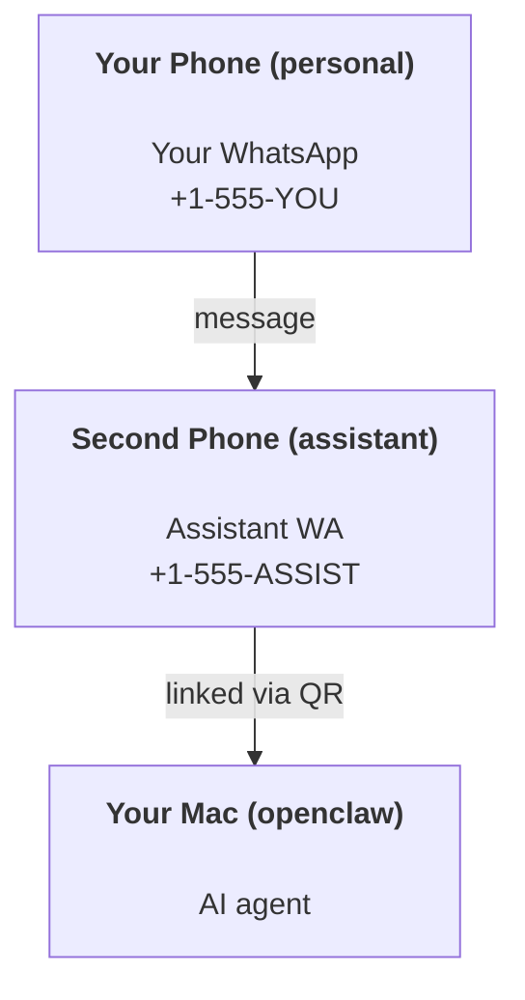

OpenClaw 是一个自托管网关，连接 Discord、Google Chat、iMessage、Matrix、Microsoft Teams、Signal、Slack、Telegram、 WhatsApp、Zalo等为AI智能体。本指南介绍了“个人助理”设置：一个专用的 WhatsApp 号码，其行为就像您始终在线的 AI 助理一样。为多人设置共享网关？请参阅 [ 团队设置 ](/start/teams)。

## <a id="good-defaults-first"></a> Good 默认优先

连接的代理是一种功能强大的代理：根据您的工具策略，它可以运行命令、处理工作区中的文件以及代表您向人员发送消息。默认设置使该权力仅限于您；有一些设置值得预先确认：

- 始终设置 `channels.whatsapp.allowFrom`（切勿在你的个人 Mac 上对全世界开放运行）。
- 为助手使用一个专用的 WhatsApp 号码。
- Heartbeats 默认为每 30 分钟一次。设置 `agents.defaults.heartbeat.every: "0m"` 以在评估设置时禁用重复轮询。有针对性的事件驱动的后续操作仍然可以运行，因此请保持工具策略和沙箱保守，直到您信任该设置。

## <a id="prerequisites"></a> 先决条件

- OpenClaw 已安装并上线 - 如果您尚未执行此操作，请参阅 [ 获取 Started](/start/getting-started)
- 已安装的 WhatsApp 插件，或在入门期间选择的 WhatsApp。 WhatsApp是一个按需安装的官方插件。查看 [WhatsApp](/channels/whatsapp)
- A 助理的第二个电话号码 （SIM/eSIM/prepaid）

## <a id="the-two-phone-setup-(recommended)"></a><a id="the-two-phone-setup-recommended"></a> 双手机设置（推荐）

你需要这样配置：



如果你将你的个人 WhatsApp 链接到 OpenClaw，那么发给你的每一条消息都会变成“代理输入”。这通常不是你想要的。

## <a id="5-minute-quick-start"></a> 5 分钟快速开始

1. 配对WhatsApp网页（显示QR；用助手手机扫描）：

```bash
openclaw channels login
```

2. 启动 Gateway（保持运行）：

```bash
openclaw gateway --port 18789
```

3. 在 `~/.openclaw/openclaw.json` 中放入一个最小配置：

```json5
{
  gateway: { mode: "local" },
  channels: { whatsapp: { allowFrom: ["+15555550123"] } },
}
```

现在，从你的允许名单中的手机向助手号码发送消息即可。

当初始化完成后，OpenClaw 会自动打开仪表盘，并打印一个干净的（未加 token 的）链接。如果仪表盘提示进行身份验证，请将已配置的共享密钥粘贴到 Control UI 设置中。初始化默认使用 token（`gateway.auth.token`），但如果你将 `gateway.auth.mode` 切换为 `password`，也可以使用密码验证。稍后重新打开：`openclaw dashboard`。

## <a id="give-the-agent-a-workspace-(agents)"></a><a id="give-the-agent-a-workspace-agents"></a> 为代理提供工作区（AGENTS）

OpenClaw 会从其工作区目录中读取操作说明和“记忆”。

默认情况下，OpenClaw 使用 `~/.openclaw/workspace` 作为代理工作区，并在载入或首次代理运行时自动创建它（加上启动器 `AGENTS.md`、`SOUL.md`、`IDENTITY.md`、`USER.md`）。将特定于环境的工具注释放在 `AGENTS.md` 的 `## Tools` 部分中。 `BOOTSTRAP.md` 仅为全新工作区创建，删除后不应再出现。 `MEMORY.md` 是可选的，不会自动创建；如果存在，它将加载正常会话。子代理会话仅注入 `AGENTS.md`。

<Tip>
把这个文件夹当作 OpenClaw 的记忆，并将其作为一个 git 仓库（最好是私有仓库），这样你的 `AGENTS.md` 和记忆文件就能得到备份。如果已安装 git，全新的工作区会自动执行 `git init`。
</Tip>

要在不运行完整入门向导的情况下创建工作区和配置文件夹：

```bash
openclaw setup --baseline
```

（直接运行 `openclaw setup` 是 `openclaw onboard` 的别名，会执行完整的交互式向导。）

完整的工作区布局 + 备份指南：[Agent workspace](/concepts/agent-workspace) 记忆工作流：[Memory](/concepts/memory)

可选：使用 `agents.defaults.workspace` 选择不同的工作区（支持 `~`）。

```json5
{
  agents: {
    defaults: {
      workspace: "~/.openclaw/workspace",
    },
  },
}
```

如果你已经从仓库中提供了自己的工作区文件，也可以完全禁用引导文件创建：

```json5
{
  agents: {
    defaults: {
      skipBootstrap: true,
    },
  },
}
```

## <a id="the-config-that-turns-it-into-%22an-assistant%22"></a><a id="the-config-that-turns-it-into-an-assistant"></a> 将其变成“助手”的配置

OpenClaw 默认提供了适合助手的配置，但你通常还需要调整：

- persona/instructions in [`SOUL.md`](/concepts/soul)
- 思考默认值（如果需要）
- 心跳（等你信任之后再开启）

示例：

```json5
{
  logging: { level: "info" },
  agents: {
    defaults: {
      workspace: "~/.openclaw/workspace",
      thinkingDefault: "high",
      timeoutSeconds: 1800,
      // Start with 0; enable later.
      heartbeat: { every: "0m" },
    },
    entries: {
      main: {
        groupChat: {
          mentionPatterns: ["@openclaw", "openclaw"],
        },
      },
    },
  },
  channels: {
    whatsapp: {
      allowFrom: ["+15555550123"],
      groups: {
        "*": { requireMention: true },
      },
    },
  },
  session: {
    scope: "per-sender",
    resetTriggers: ["/new", "/reset"],
    reset: {
      mode: "daily",
      atHour: 4,
      idleMinutes: 10080,
    },
  },
}
```

## <a id="sessions-and-memory"></a> 会话与记忆

- 会话行、转录行以及元数据（token 使用量、最后路由等）：`~/.openclaw/agents/<agentId>/agent/openclaw-agent.sqlite`
- Legacy/archive 转录工件：`~/.openclaw/agents/<agentId>/sessions/`
- 旧版行迁移来源：`~/.openclaw/agents/<agentId>/sessions/sessions.json`
- `/new` 或 `/reset` 会为该聊天开启一个全新的会话（可通过 `session.resetTriggers` 配置）。如果单独发送，OpenClaw 会确认重置，而不会调用模型。
- `/compact [instructions]` 会压缩会话上下文并报告剩余的上下文预算。

## <a id="heartbeats-(proactive-mode)"></a><a id="heartbeats-proactive-mode"></a> 心跳（主动模式）

默认情况下，OpenClaw 每 30 分钟运行一次心跳，或者在配置 Anthropic OAuth/token 身份验证时每小时运行一次心跳（包括 Claude CLI 重用）。有关完整默认值，请参阅 [HHeartbeat](/gateway/heartbeat)。提示符为：`Follow the heartbeat monitor scratch context when provided. Recurring tasks are automations; create or change their schedules with the automations tool, not heartbeat scratch. Do not infer or repeat old tasks from prior chats. If nothing needs attention, reply NO_REPLY.` 设置`agents.defaults.heartbeat.every: "0m"` 禁用循环节奏。有针对性的事件驱动唤醒（例如后台执行完成后续操作）仍然可用，并且不会创建重复计划。心跳检查表存在于监视器的 cron 暂存中（请参阅 [HHeartbeat](/gateway/heartbeat)）； `openclaw doctor --fix` 将旧工作区 `HEARTBEAT.md` 迁移到其中。

- 如果监视器草稿存在但实际上是空的（只有空白行、Markdown/HTML 注释、像 `# Heading` 这样的 Markdown 标题、代码块分隔符，或空的待办清单占位项），OpenClaw 会跳过心跳运行以节省 API 调用。
- 如果不存在草稿，心跳仍会运行，由模型自行决定要做什么。
- 如果代理回复 `NO_REPLY`，则 OpenClaw 会抑制该检测信号的出站传送。旧版 `HEARTBEAT_OK` 回复仍然支持固定的 300 个字符的确认预算。
- 默认情况下，允许向 DM-style `user:<id>` 目标传送心跳。设置 `agents.defaults.heartbeat.directPolicy: "block"` 以抑制直接目标传递，同时保持心跳运行活动。
- 心跳以完整的代理轮次运行——间隔越短，消耗的 token 越多。

```json5
{
  agents: {
    defaults: {
      heartbeat: { every: "30m" },
    },
  },
}
```

## <a id="media-in-and-out"></a> 收发媒体

入站附件 （images/audio/docs） 可以通过模板显示在您的命令中：

- `{{AttachmentPath}}`（本地临时文件路径）
- `{{AttachmentUrl}}`（原始 URL 或提供方引用）
- `{{AttachmentContentType}}`（MIME 内容类型）
- `{{AttachmentDir}}`（包含本地路径的目录）
- `{{AttachmentIndex}}`（从零开始的源事实索引）
- `{{Transcript}}`（如果启用了音频转录）

较旧的 `{{MediaPath}}`、`{{MediaUrl}}`、`{{MediaType}}` 和 `{{MediaDir}}` 名称仍然可用，但已作为弃用的兼容别名保留。

来自代理的外发附件会在消息工具或回复载荷中使用结构化媒体字段，例如 `media`、`mediaUrl`、`mediaUrls`、`path` 或 `filePath`。消息工具参数示例：

```json
{
  "message": "Here's the screenshot.",
  "mediaUrl": "https://example.com/screenshot.png"
}
```

OpenClaw 会把结构化媒体与文本一起发送。为了兼容性，旧式的最终助手回复仍可能被规范化，但工具输出、浏览器输出、流式块和消息操作不会将文本解析为附件命令。

如果必须使用旧式最终回复中的 `MEDIA:` 行，请将其保留为独立的纯文本行。Markdown 包装、代码围栏和诸如 `**MEDIA:/path.png**`、`` `MEDIA:/path.png` `` 或 `Here is the image: MEDIA:/path.png` 这样的行内文本都会被保留为文本，不会附加媒体。请参阅[富输出协议](/reference/rich-output-protocol#legacy-media-lines)。

本地路径行为遵循与代理相同的文件读取信任模型：

- 如果 `tools.fs.workspaceOnly` 是 `true`，则出站本地媒体路径仍限制为 OpenClaw 临时根、媒体缓存、代理工作区路径以及活动会话沙箱中生成的文件。同级沙箱中的文件仍然无法访问。
- 如果 `tools.fs.workspaceOnly` 为 `false`，外发的本地媒体可以使用代理已经被允许读取的主机本地文件。
- 本地路径可以是绝对路径、相对工作区路径，或使用 `~/` 的主目录相对路径。
- 主机本地发送仍然仅允许媒体和支持的文档类型（图像、音频、视频、PDF、Office 文档，包括启用宏的 Excel `.xlsm` 以及经过验证的文本文档，例如 Markdown/MD、TXT、JSON、YAML 和YML）。这是现有主机读取信任边界的扩展，而不是秘密扫描器：如果代理可以读取主机本地 `secret.txt` 或 `config.json`，则当扩展名和内容验证匹配时，它可以附加该文件。文件类型验证并不能确定附加工作簿的宏可以安全运行。

将敏感文件保留在代理可读文件系统之外，或保留 `tools.fs.workspaceOnly: true` 以进行更严格的本地路径发送。

当消息工具无法暂存当前对话的附件时，其错误会标识文件和报告的原因，例如文件丢失或本地格式不受支持。位于工作区内部并不意味着每种文件类型都适合主机本地附件读取。

## <a id="operations-checklist"></a> 运维检查清单

```bash
openclaw status          # local status (creds, sessions, queued events)
openclaw status --all    # full diagnosis (read-only, pasteable)
openclaw status --deep   # check channels (WhatsApp Web + Telegram + Discord + Slack + Signal)
openclaw health --json   # gateway health snapshot over the WS connection
```

日志位于 `/tmp/openclaw/` 下：默认配置文件使用 `openclaw-YYYY-MM-DD.log`，命名配置文件使用 `openclaw-<profile>-YYYY-MM-DD.log`。

## <a id="next-steps"></a> 下一步

- WebChat： [WebChat](/web/webchat)
- Gateway 运维：[Gateway 运行手册](/gateway)
- Cron + 唤醒：[Cron 作业](/automation/cron-jobs)
- macOS 菜单栏伴侣：[OpenClaw macOS 应用](/platforms/macos)
- iOS 节点应用：[iOS 应用](/platforms/ios)
- Android 节点应用：[Android 应用](/platforms/android)
- Windows 集线器：[Windows](/platforms/windows)
- Linux 状态：[Linux 应用](/platforms/linux)
- 安全：[安全](/gateway/security)

## <a id="related"></a> 相关内容

- [入门](/start/getting-started)
- [设置](/start/setup)
- [渠道概览](/channels)
