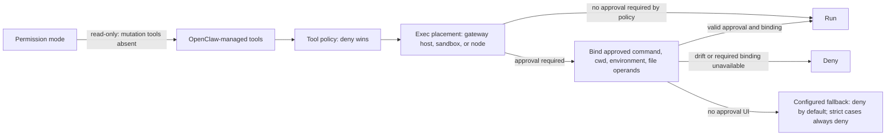

基于代码的强制执行并不是 OpenClaw 独有的 — Claude Code、Codex 和 Goose 均通过代码进行审批。多通道助手（而不是终端）中的结构工具门控更为罕见：[ 权限模式](/gateway/permission-modes) 确定工具是否存在。对于 OpenClaw- 托管工具，`read-only` 会话会忽略 `edit`、`write` 和 `apply_patch`，并且其执行工具解析为调用边界处的拒绝策略。本机工具可以保留自己的工具表面并单独应用本机权限控制（[Codex 运行时策略](/plugins/codex-harness-runtime)）。 `full` 需要 `operator.admin`，并且范围是在分派之前从请求参数派生的（[operator 范围](/gateway/operator-scopes)），因此具有特权参数的方法仍然需要特权范围。

三种控制控制单独的决策（[沙箱与工具策略与提升的](/gateway/sandbox-vs-tool-policy-vs-elevated)）。沙箱决定工具运行的位置。工具策略决定存在哪些工具；否认总是胜利。例行策略过滤器诊断命名已配置的层并在调试级别匹配拒绝条目； [持久审计账本](/gateway/audit)单独记录被阻止的结果，没有匹配规则。 `tools.elevated` 是一个仅执行的逃生口，无法覆盖拒绝。

[执行批准](/tools/exec-approvals) 将批准的运行绑定到其确切的命令、cwd、环境哈希和内容哈希文件操作数，并在批准后拒绝任何偏差。支持的管道和命令链可以使用强制执行计划。 OpenClaw 无法建立所需执行且文件绑定的 Shell 表单或解释器调用被拒绝。当无法获得批准 UI 时，默认答案是拒绝，并且严格情况（内联评估、heredocs）无法通过任何后备设置来软化。

工具策略按名称过滤，而不是副作用：允许 `exec` 而拒绝 `write` 不会使 shell 命令变为只读。如文档所述，限制副作用是沙箱的责任。
