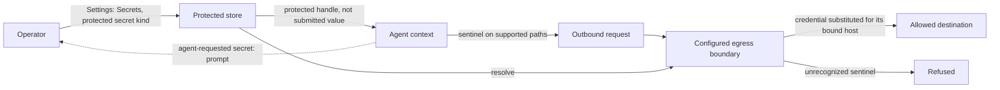

每个受支持的凭证字段都采用 [SecretRef](/gateway/secrets)：`env`、`file`、`exec`（这就是 1Password、Vault、Bitwarden 和 sops 的插入方式）或共享存储。映射的、可隔离的所有者的可重试解析失败会导致网关开始降级。确切的所有者（一个提供商、一个频道帐户、一个插件路由）被标记为不可用，对其发出的请求因输入错误而失败，没有任何回退到不同的凭据，并且 [`doctor`](/cli/doctor) 和 `status` 会用经过编辑的原因命名每个降级所有者。网关入口身份验证失败、未知所有权和无效的秘密配置仍然会阻止启动。

模型提供者凭证在支持的出口路径上使用哨兵：实际值在出口边界处被替换，并且无法识别的哨兵形状值将被拒绝而不是转发。操作员可以通过在 [Control UI](/web/control-ui) 中的 **Settings → Secrets** 下选择受保护的 **secret** 类型来提供凭证，而无需将其值暴露给代理。面向代理的读取中会省略受保护的值；为操作员提供了单独的管理范围解析。代理可读的环境条目是另一种类型。选择加入的 [egress 代理](/gateway/secrets) 仅替换受保护哨兵的绑定目标主机。单独泄露加密的哨兵不会泄露网关进程之外的底层凭证，但这并不能保护其他私有上下文或防止滥用授权服务。允许的服务还可以将凭据反映回代理，因此目标信任和主机隔离仍然很重要。 [ 代理请求的机密 ](/tools/secrets) 提示使用相同的受保护存储，而不将提交的值放入对话中。

Hermes 支持环境和保险库支持的凭证、用于多路配置文件的 [ 上下文本地秘密解析 ](https://github.com/NousResearch/hermes-agent/blob/6defe7eb6c462bb784d1f27f5afe7ca4b627fc70/agent/secret_scope.py) 以及可选的 [iron 代理集成 ](https://github.com/NousResearch/hermes-agent/blob/6defe7eb6c462bb784d1f27f5afe7ca4b627fc70/website/docs/user-guide/egress/iron-proxy.md)，该集成为 Docker 工具提供不透明的提供商令牌，同时主机端代理注入凭证。这些都是真正的保护，具有不同的托管和旁路限制；这两个项目的代理都不能替代进程和网络隔离。在 OpenClaw 中，[`secrets audit`](/cli/secrets) 查找静态明文，而 `secrets configure --apply` 将受支持的字段移到引用后面。工作区 `.env` 文件无法覆盖提供程序密钥或 `OPENCLAW_*` 运行时控件。

OpenClaw 将代理请求的凭据作为集成网关流提供：操作员通过受保护的表面提交值，代理接收可重用句柄。这不是一个独特的模式。 MCP 支持 [ 带外 URL 敏感数据获取 ](https://modelcontextprotocol.io/specification/2025-11-25/client/elicitation#url-mode-elicitation-for-sensitive-data)，包括服务器存储的凭证供以后使用；它禁止通过表单模式启发请求秘密。 Hermes 还支持操作员配置的保管库解析。这些机制的不同之处在于集成和托管，而不在于凭证是否可以脱离模型上下文。

商店本身是 `0600`- 权限 SQLite，而不是 HSM，并且文档将具有更强托管要求的操作员引导到外部金库。 SecretRef 从引用配置中删除内联凭据；存储暴露取决于所选的提供商。它不会阻止主机执行代理读取文件。限制文件访问是沙箱的责任。
