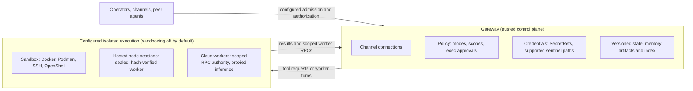

网关拥有通道连接、配置、凭证和 [ 控制平面 API](/gateway/protocol)。它默认绑定到环回，并拒绝没有有效身份验证路径的非环回绑定（[architecture](/concepts/architecture)、[network model](/network)）。

[`tools.exec.host`](/tools/exec) 解析为网关主机、[sandbox](/gateway/sandboxing) 或配对的 [node](/nodes)。当沙箱运行时处于活动状态时，对主机的每次调用转义都会被拒绝。未配置运行时的显式 `host=sandbox` 会失败，而不是在主机上静默运行。后端为 Docker 和 Podman、SSH 和 [OpenShell](/gateway/openshell)。默认的 Docker 和 Podman 配置文件没有网络、只读 root、删除所有功能以及非 root 用户。 OpenShell 作为插件安装，并通过与 Docker 相同的后端合约进行注册。如果您已经运行 OpenShell，OpenClaw 将使用其沙箱。它不需要被包裹在一个里面。

沙箱绑定安装会经过两次验证，一次在规范化路径上，另一次在通过最深的现有祖先解析后进行验证，因此基于符号链接的绕过尝试会被拒绝。无法禁用凭证和系统路径的拒绝列表 — `dangerouslyAllowExternalBindSources` 覆盖仅放宽允许的根检查。

这种分离也适用于跨机器。托管会话的配对 [node](/nodes) 接收密封的工作工件。 OpenClaw 在三个点验证该工件的内容哈希：下载、清单和每次重用。该节点不安装任何软件包，也不运行生命周期脚本。它还可以将每个托管会话放入其自己的容器中，由网关的启动请求无法表达的节点本地配置强制执行。

使用 [Cloud 工作人员](/gateway/cloud-workers)，会话的编码工作在一次性云计算机上运行。该计算机使用封闭的、调度程序强制执行的 RPC 方法白名单连接回网关。它获取每次调度铸造的凭证，以十分钟的 TTL 静态存储哈希值，并且不持有任何常设模型、GitHub 或云凭证。推理通过网关进行代理。 [ 持久记录 ](/concepts/session) 仅存在于网关上。工作人员看到一个有界的每回合上下文窗口，并且不会保留本地转录本副本。

远程工具后端还改变了沙盒代码可以到达的范围。 Hermes 可以将终端、文件和 Python `execute_code` 工作移动到配置的后端，而其父进程处理工具 RPC（[ 执行源](https://github.com/NousResearch/hermes-agent/blob/6defe7eb6c462bb784d1f27f5afe7ca4b627fc70/tools/code_execution_tool.py#L1078)）。 OpenClaw 的云工作人员设计还为工作人员提供了网关拥有的生命周期、范围 RPC 权限、代理推理和网关拥有的持久记录。在任一设计中，可访问的凭据和服务都取决于启用的工具、安装、网络策略和后端配置。

**沙箱默认关闭。** 开箱即用，OpenClaw 是一位受信任操作员的个人助理，exec 在网关主机上运行，​​无需提示。企业态势需要显式配置，可通过两个命令进行验证：[`openclaw sandbox explain`](/gateway/sandbox-vs-tool-policy-vs-elevated) 打印有效的执行态势，[`openclaw security audit`](/gateway/security/audit-checks) 使用可发出警报的稳定检查 ID 来标记漂移。
