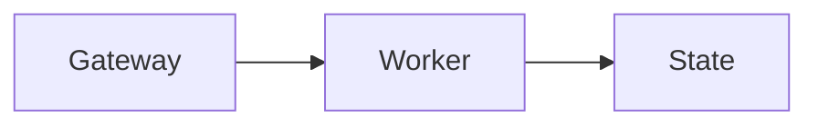

聊天窗格的行为方式：会话栏、编辑器以及脚本的呈现方式。

当可见对话未填满聊天窗格时，包括最新历史记录页面为空或隐藏工具活动时，布局稳定后会自动加载较早的历史记录。一旦预取余量被填满、每次打开三个自动页面后、历史记录结束或请求失败时，填充就会停止。已填充视口的第一页不会启动此自动加载。向上滚动或选择 **更早显示** 以加载更多或重试。隐藏窗格、背景选项卡以及编程或维护滚动不会触发自动加载。不完整的历史记录页面不会显示新聊天欢迎屏幕。

启用 **设置 → 实验室 → 语音气泡** 来尝试实验视图（默认关闭）。启用后，主页默认使用气泡。会话菜单的 **View → Speech bubbles** 选项仅更改该对话。对于该网关，显式选择保留在该浏览器中；禁用实验室会恢复标准视图而不清除它们。重新启用实验室会恢复这些选择，包括明确的主页选择退出。每组中的第一条消息指向其现有的头像；后面的消息保持圆角。评论保留在记录中，而标记的活动行会展开以显示常用的工具卡和输出。动画点标记当前工作状态，而不是已完成的工作。启动、批准、问题和子代理等待控件保持其独特的外观。文本在到达时出现，包括工具调用或最终响应之前的短片段。

如果非活动运行的保存历史记录在工具使用期间结束并且没有终端助手消息，则 Chat 会保持其注释和工具活动可见，并将运行标记为 **Interrupted**。此演示文稿不会恢复运行或恢复从未保存的答案。

工具活动在其用途或详细信息旁边显示特定于工具的图标，而不是重复工具名称。当没有明确的目的或详细信息时，该行将显示工具标签，而不是将文本留空。将鼠标悬停在图标上即可查看确切的工具名称；屏幕阅读器保留该身份。扩展活动组可保持各个工具的详细信息和结果可用。完成的组摘要保留其操作计数。工具搜索调用使用被调用工具的名称、图标以及工具行和活动摘要中的输入详细信息。内置工具使用语义图标，包括用于消息的信封、用于计划作业的日历时钟以及用于图像生成的图像。未知工具使用拼图图标，除非其插件提供活动图标。

当工具完成时，它会停止显示 **Running**，即使父轮仍在继续。如果该完成未确定成功或失败，则该行显示 **Outcomeknown**。仅部分输出并不能完成工具。

当回合仍在工作并且有子代理运行时，其工作指示器以其计数结束，例如 **3 子代理正在运行**，并在完成时倒计时。选择计数会在其列表中打开 **Subagents** 面板。启动或发现子代理不会自动打开面板或更改您选择的面板。不是子代理的子会话不计入该计数。

在回复下，每个未完成的子代理都有自己的行，显示其名称和当前活动标题。当活动发生变化时，行保持启动顺序，并在子代理完成时消失。在当前运行的标题可用之前，该行会显示 **Running**、**Queued** 或 **当子代理已委托其自己的工作时在子代理上等待**。选择一行以在 **Subagents** 面板中打开该子代理，或者在面板未列出该子代理时打开其会话。这些行重复使用聊天加载的子代理列表；他们不会加载每个孩子的成绩单。

当转交 `sessions_yield` 且其子代理仍处于活动状态时，它们的实时行将保留在该回复下，而无需单独的 **等待…** 行。这些行最右侧的一个静音计时器显示自您收到消息以来的总时间，包括子代理等待时间，而不是工作线程运行时间的总和。它在切换和恢复过程中保持相同的时钟。如果加载的历史记录无法识别完整的请求，则忽略计时器而不是估计总数。当回合在没有交接的情况下结束时，子级活动也保持可见。在子代理列表可用之前，或者仅保留普通子会话时，现有工作指示器将保留作为后备。它的等待时钟测量从父进程最新记录的运行结束开始的当前空闲间隔，即使切换是在加载历史记录之外的。稍后的父更新会启动一个新的空闲间隔；这不是原始请求持续时间或子进程的运行时间。没有完成父轮的子活动不会产生父等待。当父母积极工作时，父母自己的工作指示器仍然可见。作曲家上方没有额外的等待状态行。一旦它等待的一切都完成，活动行就会消失，直到代理恢复。您打开的工具行在切换过程中保持打开状态。成功的 `sessions_yield` 不会在转录中留下任何标记，并且其私有延续上下文保持隐藏。

当最后一个子代理完成时，其活动行消失，块保持原样，没有工作指示器，直到回合恢复。然后它的答案在同一个块中继续，最后有一个页脚。恢复期间未写入任何内容的工具活动会加入切换之前的活动行。在仪表板会话中，在恢复的答案之后记录的工具活动（例如发送它的步骤）会加入该答案之前的活动，因此答案保留在最后；失败的步骤将留在发生的地方。然后，工作指标和收盘 **Done in…** 行描述整个请求：自您请求以来的时间，包括等待以及该块中运行的输出令牌。当窗格没有看到所有这些运行时，例如在等待期间重新加载之后，令牌计数将被忽略。当加载的记录没有显示直接进入该块的请求时，例如当请求早于加载的历史记录时，这两行都单独描述恢复的运行。您在切换后发送的消息会启动自己的块，并带有该运行自己的时钟和结束行。

在工具活动中，子代理的启动行显示其启动时为其提供的标签，而不是其指令，随后是工作时的 **running** 以及完成后的持续时间。失败或超时的子代理会读取 **failed**，而停止的子代理会读取 **stopped**。选择名称会在 **Subagents** 面板中打开该子代理；该行的其余部分仍然扩展了发布的详细信息。折叠活动自行计数子代理，例如**1其他操作·3个子代理**。被拒绝的启动不会启动任何子代理，并与其他操作一起计数。虽然正在进行的步骤没有自己的标题，但折叠的行会继续显示该计数。本身打开子会话的启动（例如使用 `visible` 请求的启动）不是子代理：它的行及其在计数中的位置仍然是普通操作的行和位置。

运行计数、等待计数和名称以及启动行的状态和链接来自会话的子代理列表。在窗格加载之前，工作指示器不会显示任何计数，并且等待显示为 **Waiting on subagents**；其子代理不在列表中的启动行仅显示其名称。当 [Swarm 关闭 ](/tools/swarm) 和 `tools.swarm: false` 时，该窗格不会加载该列表。

计数和名称仅针对面板列出的子代理（包括 swarm 工作人员）导向 **Subagents** 面板，并且仅在具有该面板的窗格中。 ACP 运行时上的子代理不在该列表中，因此其名称会打开其会话，并且包含 1 的计数是纯文本。没有自己的侧面板的窗格（例如 **Subagents** 面板显示的记录或主页中嵌入的会话）也会打开子代理的会话。 **等待 2 个会话** 始终是纯文本。

当您的角色或会话策略阻止消息时，编写器将被禁用，并在您尝试发送之前显示原因。这包括沙箱要求、共享会话写入限制和只读操作员访问。当访问权限发生变化时，您现有的草稿将保持不变。

保存的分割窗格保留其对话和排列。如果较旧的已保存窗格无法识别其代理，则会显示 **选择对话**，而不是打开另一个代理的历史记录。选择该窗格，然后选择 **Home** 或边栏中的对话。即使您已经在回家的路上，回家也能正常工作；其他窗格保持不变。

当 macOS 应用程序在其本机侧边栏旁边嵌入单个对话时，聊天标题会填充窗口的标题栏行。在 macOS Web 体验和 macOS、Linux 和 Windows 上的 Tauri 桌面应用程序中，导航面板标题和内容标题共享 52 像素标题栏行，back/forward 位于对话标题之前，并在持久栏中进行搜索。折叠面板仅在栏杆旁边留下展开侧边栏，从而保留新会话和搜索；内容标题仍然以 back/forward. 开头拖动标题栏行的空白区域来移动窗口；它的按钮保持正常操作。

## <a id="image-viewing"></a> 图片查看

上传和管理的聊天图像使用压缩的、有尺寸限制的预览，而不是下载原始照片进行显示。浏览器为签名图像 URL 选择适当的像素密度；经过身份验证的图像请求为视口选择有界的呈现。离屏图像会等待直至接近视口。当网关位于另一个源或其 HTTP 媒体路由不可用时，工件图像还会通过经过身份验证的 WebSocket 接收有限预览。失败的预览永远不会默默地退回到下载原始字节。

点击图像以打开可缩放查看器。当加载更清晰的屏幕大小的呈现时，现有预览保持可见。如果该请求失败，**Retry** 会再次加载它，而无需替换预览或打开另一个选项卡。滑动到图库图像会加载该选择，而不是提前加载图库的其余部分。 **下载图像** 仅在选择时获取原始图像。当无法加载预览时，也可以从图像的操作菜单中进行复制和下载。第三方图像 URL 保留辅助浏览器链接，因为它们的服务器可能允许图像显示但阻止跨源下载；这不是针对上传或托管预览的恢复操作。

## <a id="collaborator-drafts"></a> 协作者草稿

在共享会话中，当其他人暂停打字时，他们正在进行的消息仍然可见。草稿预览每秒最多更新四次，从而在输入更快到达时保留最新文本。 10 秒未打字后，其标签从 **is typing...** 更改为 **Draft**，而无需删除气泡或移动转录本。再次输入会更新相同的气泡。发送、清除草稿、离开作曲家或离开会话会将其删除。空闲预览会在 30 秒到期前的最后 300 毫秒内淡出并平滑地关闭其空间，因此废弃的选项卡无法使其无限期可见。再次键入将取消退出。启用减少运动后，预览将保持静止并在相同的截止日期时消失，而不会出现动画。草稿预览是临时的浏览器状态，而不是保存的消息；更改会话或重新连接会清除它们。

繁忙的会话使前两个人的预览气泡按到达顺序排列，包括他们单独的 **Draft** 生命周期。只有这两个之外的积极打字的人才会出现在溢出行中：其有限堆栈最多显示五个头像和一个句子。自然地命名一个、两个或三个活跃的溢出协作者；四到五个使用前两个名字和其他名字。如果活跃溢出人数超过 5 人，则句子变为 **几个人正在打字…**。停止、暂停、发送或离开会立即将人员从该行中删除；当没有人在那里保持活动状态时，即使前两个预览气泡保留草稿，该行也会消失。长名字仍然是句子的明显一部分，带有响应式省略号和完整的可访问名称；放大的文字可以换行。该小组保留两行文本。它的第一个头像与预览头像对齐，并且句子遵循实际堆栈宽度，但有一个小间隙。主动打字文本使用微妙的共享闪光；预览 **Draft** 标签、减少的运动和强制颜色保留了清晰的静态文本。编辑或暂停不会对两个预览槽重新排序；仅当其人员发送、离开、清除或过期时，槽位才会打开。

## <a id="reactions"></a> 反应

将鼠标悬停在已保存的提示或助理回复上，然后选择消息操作旁边的 **添加反应**，或现有反应行末尾的 **+** 芯片。快速调色板提供 **👍**、**❤️**、**🎉**、**👀**、 **🚀**，和**😂**；您已放置的表情符号显示已按下，再次选择它会将其删除。箭头键在调色板中移动，Esc 键将其关闭。

对于任何其他表情符号，请选择 **…**。输入或粘贴一个表情符号，或者在 macOS 上使用 **⌃⌘Space** 或 **Win+.** 在 Windows 上打开系统表情符号选择器：完整的表情符号一落地就会应用，因此系统选择器不需要额外的按键。任何不是单一表情符号的内容都会保留在字段中并带有提示。空白字段中的退格键返回到调色板。

反应片直接出现在每条消息下方，并带有计数，并在计数变化时以动画形式显示。将鼠标悬停在一个筹码上，看看谁做出了反应，您首先列出。选择一个芯片来添加您的反应，或再次选择一个按下的芯片来删除您的反应。观众可以阅读筹码；添加或切换需要在该会话中发送或建议的权限。请参阅 [ 多用户反应 ](/concepts/multi-user#reactions) 了解代理和通道行为。

## <a id="session-rail-and-side-chat"></a> 会话导轨和侧聊

当您观看跑步会话时，网关会立即显示模型的最新安全序言作为会话标题。当实用新型可用时，在积累了足够的活动后，它可以用更丰富的紧凑状态摘要替换该标题。聊天将结果保存在**会话轨道**：其紧凑的药丸显示实时摘要，而扩展的轨道显示拉取请求、经过的时间和只读的侧聊天线程。当运行陷入困境或需要输入时，轨道可以扩展一次，并且完成或失败的运行会根据最终摘要保留冻结的“完成”时间。在宽阔的聊天窗格上，扩展的铁路码头作为400px 右栏；在较窄的移动布局上，它仍然是一个覆盖层。

侧面聊天可以回答有关所选会话及其项目的问题，而无需进入或中断主代理运行。关于第一个问题，网关在启动实用程序模型之前延迟加载所选会话的有界可见快照。如果历史记录暂时不可用，则问题会通过 **Retry** 保持可见，而不是被视为空会话。边聊使用对目标会话的 history/search 和座席工作区的只读访问权限。其有界线程保存在网关内存中，当您在 Control UI 中切换会话时恢复，并通过导轨的垃圾按钮、会话重置或删除、网关重新启动或空闲到期来清除。它永远不会进入 `chat.history`，并且私有参考上下文不会存储为操作员对话。在 Apple 平台上使用 Shift-Command-S 或在其他地方使用 Ctrl-Shift-S 打开它，或者在主 Control UI 编辑器中键入 `/btw` 或 `/side` 并按 Enter 键打开导轨并聚焦其问题框。从斜杠菜单中选择 `/btw` 的作用相同。在任一命令后添加问题以将其发送到侧聊；请求完成后，焦点将移至问题框。其他客户端保留其现有的 BTW 行为。

当代理的主要模型在 CLI 运行时（例如 `claude-cli`）上运行时，未显式设置实用程序模型，并且直接提供者身份验证不可用，侧聊天将通过相同的 CLI 运行时进行应答。仅订阅安装不需要提供商 API 密钥。在该路线上，每个答案都是一个无需工具的一次性侧面问题，它使用有界会话快照和观察者注释而不是只读会话工具，并且不支持图像问题。使用直接提供程序身份验证进行安装可保持直接路径，包括只读工具和图像支持。

恢复侧聊天线程会检查当前会话可见性，而无需等待不相关的会话写入。打开侧聊、重新打开其面板或选择其选项卡会聚焦问题框。如果您在侧聊天加载或回答时聚焦另一个输入或继续键入，则新的输入将保持焦点。

使用输入法确认文本不会发送侧聊问题。完成撰写，然后使用您配置的发送快捷方式或“询问”按钮。

编辑旁聊草稿不会中断加载其早期答案。 **清聊**网关确认后删除之前的内容；单击后添加的草稿、图像和问题仍然存在。

Control UI 保留最新的 24 个侧面聊天回合，包括失败的问题。发送后续消息可以使之前的失败保持有序； **Retry** 重新发送该问题。失败的问题通过重新连接保留在当前窗格中，但在页面重新加载时不会保留。

问题框像主要作曲家一样包裹和生长； Enter（或您配置的发送快捷方式）询问问题，然后 Shift+Enter 添加一行。突出显示聊天消息中的文本可在侧面聊天中提供 **Ask**。在选择编辑器中添加可选评论，然后将其保存以在侧聊天中上演可编辑评论。一个空的问题框以简短的引言开头；现有的旁聊草稿和主要作曲家保持不变。完整的选择和评论伴随着该问题作为有限的临时上下文。回答后，恢复的线程保留问题文本，包括其引用，但不保留附加的上下文。为后面的问题重新选择该段落。

如果单独的选择超出了上下文限制，侧聊天将在不添加选择的情况下打开并显示通知。一个空的问题框仍然会得到一个简短的引用；现有草案保持不变。如果评论或组合选择超出限制，编辑器将保持打开状态，以便您可以缩短评论或调整待处理的选择。

将图像拖放到侧聊天中或将图像粘贴到其问题框中。您可以将其与书面问题一起发送或单独发送。侧边聊天接受图像附件，而不是其他文件类型；它的预览从不添加主要作曲家的附件。图像问题需要具有图像功能的侧聊实用程序模型。纯文本模型会产生可见错误，而不是在没有图像的情况下进行回答；在重试之前选择一个具有图像功能的实用新型。图像仅适用于当前问题，不会保留在恢复的文本线程中。当稍后询问有关该图像的问题时，请重新附加图像。失败的问题保留其 **Retry** 的图像，同时保留当前窗格；重新加载页面会丢弃失败的输入。

突出显示文本并选择 **添加到聊天** 以向主要作曲家附加评论。可选的注释字段从一行开始，增长到五行，然后在内部滚动。确认或回车保存； Shift+Enter 添加一行。保存会保留现有草稿并且不会发送消息。

保存后，所选段落旁边会留下一个小的、填充的注释标记。单击该标记或评论计数悬停预览中的铅笔，以重新打开其旁边的同一编辑器。 **Save** 或 Enter 保存更改； **Cancel** 或 Escape 放弃编辑；垃圾按钮会删除评论。将鼠标悬停、键盘焦点或单击作曲家的评论计数即可打开其预览。删除一条评论会使剩余的列表保持打开状态；退出、在外部单击或将指针移开可将其关闭。计数的 **删除所有评论** 操作可一键清除待处理评论，并将焦点返回给作曲家，而不显示通知。已清除的评论无法撤消。清晰的操作出现在悬停或键盘焦点上，并在触摸时保持可见。清除待处理评论会保留普通附件、消息草稿和对话中已发送的评论。归档另一个拆分窗格会保留当前评论编辑器和键盘焦点。保存的注释及其源标记遵循作曲家现有的草稿和队列恢复行为。当您发送时，每条评论都会作为文本文件附加，其中包含选择、评论和源消息参考；其草稿标记已被删除。将鼠标悬停、键盘焦点或点击已发送的评论计数，即可在紧凑的可滚动预览中阅读其选择和评论。已发送的评论保持只读状态。按 Esc 键或点击预览外部以将其关闭。

该标题拥有该运行的侧边栏副标题，而不是依赖启发式的实时活动。它会与官方 iOS 和 Android 会话列表共享。最终完成或失败的摘要在会话未读期间仍会可见，之后该行会恢复为其正常的工作副标题。

会话观察默认已启用。安全前导语标题不需要实用模型；实用模型只负责更丰富的评估和终态摘要。在 **设置 > 外观 > 侧栏** 中，你可以在整个 gateway 范围内关闭观察，检查已解析的小模型及其来源，或者选择自动路由、禁用实用任务，或显式选择 `agents.defaults.utilityModel`。等效的配置控制项是 `gateway.controlUi.sessionObserver: false` 和 `agents.defaults.utilityModel: ""`。

## <a id="session-links-in-messages"></a> 消息中的会话链接

消息中的会话链接在 Control UI 内打开。这包括 `agent:` 密钥、根相对聊天 URL 以及加载应用配置时当前源或网关公共源上的 URL。链接显示会话的标题，将鼠标悬停在链接上会显示其会话卡。不在加载的侧栏中的会话 URL 通过网关进行解析，包括缩短的 ID，使用与打开它们相同的访问规则。丢失、无法访问或不明确的参考文献在没有卡片的情况下保持简单的可导航链接；到其他来源的链接保持正常的浏览器行为。文档相关的 href 绝不是会话链接；文件引用（例如 `src/utils/foo.ts` 和 `qa-café/index.md`）保留工作区文件处理，包括 Unicode 名称和百分比编码的 Markdown 链接目标。显式 Markdown 文件链接还支持文件名中的空格、表情符号和标点符号；例如，`[Read notes](notes/caf%C3%A9%20note.md)` 打开工作区文件。创作链接中的裸 CSV 文件名（例如 `[Read inventory](inventory.csv)`）和代码跨度也会打开文件预览。纯文本和内联代码文件检测保持保守，以避免将散文变成链接。

转发的消息中的文件链接针对发送会话的工作区打开，包括折叠的更新组内的链接和消息详细信息。他们的文件名选项卡保留在当前聊天窗格中。会话根外部的文件遵循该会话的文件工具读取边界，并且还需要权限才能在该会话中启动轮次。这些根外预览是只读的。

在聊天和新会话中，当您关闭并重新打开同一模型选择器时，提供程序组将保留其展开或折叠状态。关闭会清除搜索文本，而不重置这些切换。重新加载页面会再次初始化所选模型中的组。

对于没有推荐的提供商，模型选择器最初会显示最多九个选择，在可用时首先保留当前模型和 **Default**。选择**所有模型**浏览其余，或直接搜索完整目录。

在模型搜索中使用输入法编写文本时，Enter、Escape 和箭头键保留在输入法中。在合成完成之前，他们不会选择模型、清除搜索或移动突出显示的模型。打开工具提示也会将 Escape 留给输入法。

当身份验证状态可用时，聊天模型选择器中的每个提供商标题都会显示该提供商的登录方式：API 密钥（或明确选择的 API-key 帐户）的 **API**、具有一项订阅的提供商的计划名称，以及**订阅** 对于具有多个的提供商。对于多个订阅，标题会在网关提供时添加明确选择的帐户的电子邮件，并且 **Account** 行显示每个帐户的电子邮件；自动选择不显示帐户身份。将鼠标悬停在截断的标题上即可阅读全文。

## <a id="suggested-tasks"></a> 建议的任务

建议的任务卡提供 **在新会话中开始** 和 **在新工作树中开始**。两者都在后台启动任务并保持当前对话和草稿打开。任务开始后卡片消失；当您想要跟踪其进度时，请在侧栏中选择新会话。 **在此会话中启动**在当前会话中运行任务。

在启动工作树之前，OpenClaw 检查建议的文件夹是否是具有提交的 Git 存储库。如果不是，该卡会保留提示并让您选择已注册的项目或输入正确的存储库路径。再次选择**在新的工作树**中开始继续；不会为无效的源文件夹启动子会话。

## <a id="composer-predictions"></a> 作曲家预测

启用 **设置 → 实验室 → 作曲家预测** 以尝试可选的下一条消息建议。实验默认关闭。在活动对话中完成回复后，OpenClaw 可以发出一个额外的模型请求，并在空编辑器中将可能的后续内容显示为静音文本。它可能不显示任何建议。它不会预测每次击键。每个活动浏览器选项卡都可以发出自己的预测请求。只读、导入和隐身对话不显示预测。

按 **Tab** 或选择 **使用建议** 将建议复制到草稿中。这永远不会发送它：您可以在正常发送之前编辑或撤消它。 **Escape**、**忽略建议**，或输入您自己的消息将其忽略。在您接受建议之前，建议不会保存为消息或协作者草稿。切换对话、隐藏页面或开始另一轮都会丢弃待处理的结果。

Labs 模型选择器提供：

- **实用模型**（默认）：使用代理配置的实用模型。快速、廉价的模型通常最适合这项简短的可选任务。
- **对话模型**：使用为此对话选择的模型。
- **默认模型**：使用代理配置的默认模型，忽略对话的模型覆盖。

预测在孤立的、无需工具的请求中使用当前对话中的有限最近文本。他们无法运行工具、检索内存或发送消息。不可用的选定模型会跳过建议，而不是默默地切换到另一个模型。启用实验可以增加模型使用量和成本；现有的模型配置、提供者凭据和会话访问规则仍然适用。

## <a id="composer-capability-menu"></a> Composer 能力菜单

选择聊天编辑器旁边的 **+**，即可在一个菜单中打开附件和会话能力：

- **技能** 可为此会话启用或禁用单个技能。
- **Connectors** 启用或禁用为此会话配置的 MCP 服务器。 **session** 标记标记与继承的配置不同的值。
- **网页搜索** 可为此会话启用或禁用托管网页搜索，以及原生 OpenAI 和 Codex 搜索。
- **管理插件** 可打开插件页面。

这些控件是稀疏会话覆盖，例如聊天标题中的模型和思维设置。没有覆盖的功能会继承当前代理或全局配置，并且 OpenClaw 在下次运行实现其工具和技能时应用已解析的值。设置覆盖后，打开 **+** 并选择菜单底部的 **1 override** 或 **N overrides**，以清除此会话的所有功能覆盖并返回继承的设置。

当 `tools.web.search.enabled` 为 `false` 时，**Web 搜索** 在聊天和新会话中保持关闭状态。禁用的控件解释了全局设置。如果会话具有较旧的启用覆盖，则选择该控件会清除该覆盖，同时搜索保持关闭状态。显式会话禁用仍会保存。

对于聊天和新会话中的附件，Android、Chrome、Edge、Firefox 和 Samsung Internet 将 **Take photo** 直接发送到设备捕获输入，无需先打开网络摄像头预览。 **Photo** 和 **File** 仍然是单独的选择。桌面浏览器保持预览、捕捉和重拍流程； iPhone 和 iPad Safari 保留其单个 **Attach…** 选择器。嵌入式本机主机保持其现有行为。取消捕获会使消息草稿保持不变。

在聊天或新会话中选择的视频文件会显示一个小的本地帧预览，文件名旁边有一个播放标记。加载时插槽保持其大小。如果浏览器无法及时解码视频，播放图标将保留。删除附件会释放其预览；生成预览不会上传视频。

当选定的视频超出附件限制或剩余批次预算时，选择 **压缩以适合** 以在设备上准备较小的副本。压缩仅在您选择后才开始；已经适合的普通文件和视频保持不变。编码器按需加载并在后台工作程序中运行，在您继续输入时显示每个文件的进度。删除要取消的文件。在准备完成并发送消息之前，不会上传任何内容。

副本保留音频和方向，当浏览器支持所需的编解码器时使用 MP4，否则使用 WebM，并将最长边缘限制为 1920 像素，帧速率限制为 30 fps。原始文件从未改变。最终字节必须符合公布的每个文件和批次限制；如果浏览器无法解码或编码视频及其音频，或者较小的副本仍然无法容纳，则插槽会显示错误。选择较小的文件、修剪视频或尝试其他浏览器。

在**连接器**中，管理员可以选择**添加 MCP 服务器…**并选择作用域。**此会话**会将服务器定义全局保存但默认禁用，然后仅在当前会话中启用。**处处**会将定义全局保存并启用。传输、身份验证及其他服务器定义字段始终是全局的。会话策略可以覆盖服务器启用状态，并通过**工具访问权限**拒绝单个工具。

一次运行发现连接器的工具后，**工具访问权限**会列出这些工具。在此之前，它会说明列表为空的原因，而不是报告工具数量为零：新添加的服务器尚未连接、已连接的服务器尚未完成工具列表，或者运行时目录早于配置更改。在 Codex 运行框架上运行的会话会将其 MCP 连接保留在 Codex 内部，因此其工具不会显示在此处。

能力开关会一直处于禁用状态，直到网关、会话和运行时配置加载完成；只读操作员无法更改这些开关。添加服务器需要管理员权限。请参阅[连接 MCP 服务器](/tools/mcp)，了解设置、CLI 和配置路径。

## <a id="emoji-shortcodes"></a> Emoji 短代码

在聊天和新会话中，键入冒号，后跟表情符号名称（例如 `:smi`），以查看短代码上方的紧凑列表。列表大小与其匹配并保留在视口内。使用向上和向下箭头选择匹配项，然后按 Enter 或 Tab 键将其插入。您也可以单击匹配项。 Escape 会驳回这些建议，但不会更改您的草稿。选择表情符号不会发送消息。

输入可识别的完整短代码（例如 `:smile:`），会将其 Unicode 表情符号直接插入到您的草稿中。代码跨度和代码块、URL、转义短代码和未知名称保持原义。现有消息不会被重写。您仍然可以粘贴表情符号或使用操作系统的表情符号键盘；作曲家中没有单独的表情符号选择器。

## <a id="json-in-chat"></a> JSON 聊天中

助理消息和代码围栏中完成的 JSON 对象和数组共享具有可扩展嵌套值的 **Tree** 视图和原始源的 **Raw** 视图。 **Copy** 在任一视图中复制源，保留重复键、大数字和转义序列。 Raw 保留了通常的长代码预览、显示控制和自动换行。

未完成的流栅栏、无效的 JSON 和超出树渲染预算的 JSON 仍作为源可读。用户消息围栏和被动预览仍然是纯代码，没有交互式控件。

## <a id="chat-behavior"></a> 聊天行为

活动运行进度保留在转录本中，而不是在编辑器内重复 **Working…** 行。作曲家保留其 **停止生成** 控制和屏幕阅读器运行公告；子代理等待详细信息保留在其上方。

即使在发送、准备或流式传输回复时，模型选择器也会显示您选择的首选项。您可以更改模型和推理工作，而无需中断该回复。成功保存的选择适用于尚未开始的普通排队消息；显式的每条消息覆盖保持其现有的优先级。当前回合保留其执行设置，并且其记录的模型（包括任何后备）不会替换选择器标签。

在模型更改期间，模型和工作量控件会等待新模型支持的设置。在主动回复期间，快速模式和上下文窗口更改仍然不可用。只读、断开连接和不可用后端保护仍然适用。发送时不会重新加载缓存的模型目录；目录加载和刷新反馈保留在选择器中。

新会话在加载模型目录时显示代理的已知默认模型。当前连接、代理、会话和帐户的模型选择缓存在内存中，因此重新打开选取器或返回草稿可以立即显示它们。目录和帐户更改使这些副本无效；重新连接会再次加载当前选择。在报告的冷却时间到期后重新打开选择器会再次检查准备情况。目录刷新使现有控件保持可见，并且网关在开始运行时仍然验证模型和帐户。模型查找待处理期间的重复更改将收集到一次后续查找中以获取最新选择。

加载聊天历史记录不会禁用模型选择器。在 **设置 > 模型** 中，一旦模型行已知，主模型选择器就会打开；选择新的默认值仍然等待配置准备就绪和突变访问。

目录刷新会更新打开对话的模型和上下文事实，而无需重新加载不相关的会话列表。共享会话存储将生命周期行快照应用于本地现有的活动成员。成员资格或配置更改以及没有行快照的事件通过其定速事件调度程序刷新受影响的列表。

技能选择或会话设置更改后，聊天会刷新其可用命令。重复的更改在每个对话和连接中共享一个挂起的刷新；如果读取已在运行，则后续读取将获取最新更改。较旧的结果无法替换当前的命令列表。

如果新会话模型查找未在 30 秒内完成，控件将显示 **Models unavailable**。打开模型选择器重试；您的草稿保持不变。重试会等待较早的查找完成，然后再开始更多工作，其 30 秒的截止时间包括该等待。重新连接会清除先前连接中的待处理查找。

当您打开现有会话时，对话会在支持面板和拉取请求详细信息加载之前出现。一旦其身份被解析，您就可以开始输入，而转录本仍然显示其加载骨架。当对话出现时，同一个作曲家会保留您的草稿和焦点。您可以在历史记录加载时发送普通消息和附件：消息立即进入发件箱，让作曲家为您的下一个草稿做好准备。在自动继续传送之前，打开的聊天会确认其当前会话和对话分支。切换聊天可以使排队的消息与其原始对话相关联。如果历史记录加载失败，在您解决历史记录错误时，排队的消息将保持可用。目标和其他斜杠命令等待历史记录； `/stop` 和 `/approve` 仍然可用。初始任务进度读取只保留其卡槽；文字记录和作曲家仍然可用。

当您打开一个简短的聊天链接时，在当前连接期间准备的身份可以使作曲家更快准备好。原始链接将保持不变，直到会话查找确认相同的对话及其当前标题。

只有在可见的文字记录准备好后，将鼠标悬停或聚焦在其导航条目上时，其他对话才会变得温暖。简单的连接不会获取未打开的对话。

已保存的侧边栏过滤器、组、自动化状态和收件箱的后台刷新会等待对话出现。任务建议和进度卡会在成绩单绘制后刷新。更改过滤器或打开针对组的新会话仍然是即时的。

窗格共享同一对话的发件箱恢复。另一个对话中的活动不会重新启动该恢复；重新连接会检查每个已保存的发件箱。

当提交的消息等待附件存储时，文件保留在编辑器中。如果您在等待期间开始另一份草稿，则保存第一条消息会删除其未更改的文件，除非另一个待处理的提交仍然拥有它们。您的新文本以及添加或替换的文件保留在编辑器中。存储故障使这些文件可用于重试。

在宽桌面窗格上，仅当对话超出可见高度时，文本的左侧装订线中才会出现一条紧凑的水平标记栏。随着对话的发展，它会慢慢淡出；如果整个对话在调整大小后适合，它会再次隐藏；减少运动会禁用淡入淡出。将鼠标悬停可预览短信，或单击标记跳转至该消息。 Tab 聚焦导轨；箭头键在标记之间移动，Enter 或 Space 跳转，Home 和 End 选择端点，Escape 关闭预览。静止时，所有标记都是相同的 8 × 2 像素笔画，间距为 12 像素。他们保持昏厥状态；当您滚动时，抄本中当前可见的消息标记会一起亮起。将鼠标悬停在某个标记上会将其大小增加到 32 像素，并仅以文本颜色点亮该标记，并在两侧的三个相邻标记上逐渐缩短笔画。当指针移到预览卡上时，波浪和突出显示的标记保持在原位。离开导轨和卡，或按 Escape 键，清除波浪。其他标记保持其静止颜色。在该悬停范围之外，宽度保持固定。空消息预览显示“预览不可用”。每条可见的用户消息都有一个标记，来自同一运行的辅助消息共享一个标记。工具调用、结果和进度本身并不会创建标记。助理标记跳转到其运行中当前显示的第一个响应，并预览最新显示的响应。随着流输出成为持久历史，其身份保持稳定，并且其当前位置突出显示在同一运行中后续响应内容之后。铁路覆盖了装载的历史；没有运行标识的消息保留其转录分组。长导轨在视口高度的 45% 范围内内部滚动，仅在隐藏更多消息的末端淡入淡出。滚动成绩单可保持当前标记可见；您还可以滚动导轨来浏览其他消息。当您保存的消息宽度留下的装订线空间太少时，栏杆会隐藏在移动设备上的狭窄或短窗格中。跳跃会短暂地将目标消息着色为柔和的背景，在 1.2 秒内逐渐淡出，没有边框或圆环。减少运动会禁用标记过渡并静态显示目标色调一秒钟。

会话仪表板遵循所选对话的代理，包括当多个代理各自使用 `global` 会话时。分割窗格将其所有者分开；显示相同代理和对话的窗格共享仪表板更新。

自动会话标题描述了第一条消息中的主题或预期任务。命名模型需要提供该消息的纯文本标签，而不是注入的harness或项目指令，也不是输入的 JSON 包装器的副本。它们是与代理的工作分开生成的，因此标题不是完成状态或工具访问报告。现有标题和手册名称保持不变；单击标题即可重命名。

工作树创建等待标题长达 30 秒，然后继续，同时命名在后台完成。较晚的标题仍会更新会话，而不会重命名其现有的 Git 分支。并发命名请求共享相同的工作；如果该请求失败，等待的仪表板请求将重试一次。当第一个回复开始时，命名开始；如果在该回复仍在运行时失败，就像在一次处理一个请求的模型服务器上一样，它会在回合结束后重试一次。如果两个模型路由均失败，会话将使用双字甲壳动物主题名称。当聊天命名使用此后备时，网关会记录一条警告。

折叠的工具行使工具标签保持可见，并用省略号截断长摘要。已完成的答案在折叠的工作之外仍然可见，包括当稍后的网关通知到达时。当重新加载后恢复早期工具活动时，已完成的响应页脚会保留最终答案的时间戳。展开工具行以检查其命令、路径或查询。使用 `/subagents list` 和 `/subagents info <id|#>` 检查父对话的子代理状态，或使用 `/subagents log <id|#>` 读取最近的子消息。参见[子代理斜线命令](/tools/subagents/slash-command)。

当代理工作时，其最新的工具活动披露显示当前操作的目的而不是操作计数。在该披露中，每个标题在新标题取代之前有三秒钟的时间阅读；快速调用仅保留最新的待处理更新。最后一个目的在工具之间保持可见，操作结束后不会出现省略号。该行始终保持可扩展状态。失败或阻止的操作以及运行结束将绕过保留，并且已解决的活动将返回到计数或单个工作流自己的行，如下所述。内嵌旁白之后的新披露以其当前的目的开始，而不是在旁白中移动旧的操作。减少运动会禁用标题转换。

工具活动摘要对工作流内的操作进行计数，而不是再次对其包装器进行计数。如果工作流的记录呼叫都是例行公事（例如计划或进度更新），则将其本身计算在内。一旦不再是实时活动，包含一个此类成功完成的工作流的活动将显示该工作流自己的标题行而不是计数；将其扩展为例程调用和**工具输入**。失败、被阻止、没有记录结果或经过审批审核的工作流程会保留计数行及其状态。执行调用显示代理提供的目的（如果可用）；标题描述了预期的工作，而结果决定了成功或失败。录制的子呼叫显示在其操作下方，而不是作为单独的对等行。展开操作以检查其子项，然后展开子项以获取其命令、完整输出和报告的退出状态。 **工具输入**保留包装器的源和输出。崩溃的操作包括子操作的失败，即使包装器或稍后的调用成功。错误消息和诊断路径保留在可扩展工具详细信息中。嵌套关系使用来自同一运行的记录的调用元数据，并在重新加载后继续存在；没有可用的、明确的父级的调用保持独立。无标题命令预览展平换行符和截断长命令；扩展的细节保留了原始来源。

当没有可用的目的时，本机 Codex 代码模式调用显示 **run JavaScript**。展开**工具输入**读取源码。捕获的文本块响应直接显示其文本，完成的命令信封显示可读输出，非零退出代码保持可见。 JSON 输出缩进，而不更改数字或字符串值。 **原始详细信息**保留原始响应，包括执行元数据。对于长结果，选择 **显示完整输出** 以检查完整响应；复制和下载保留那些捕获的字节。

文件系统路径和凭证形状的值在工具活动和对话文本中保持可读。日志和诊断导出保留秘密屏蔽。紧凑工具标签将 macOS、Linux 和 Windows 主目录前缀缩短为 `~`，同时保留目录和文件名。

重试停留在工作爪行中：**正在重试...**、**当运行时提供截止时间时在...s**中重试，或**正在尝试后备模型...**。当自动恢复继续进行时，尝试失败不会出现在对话中。终端故障会在线程中留下一个图标支持的通知，保留任何部分输出。最新失败的运​​行提供了 **Try Again**（检查已完成工作而不是重播原始提示的延续）和 **Change model**。您未发送的草稿保持不变。如果您在运行期间重新加载或重新连接，其终端错误会自动刷新对话，以便故障通知和恢复操作可用。 **详细信息** 公开安全故障诊断，而无需启动另一个请求。

失败和超时轮流还会在侧边栏的紧凑摘要和运行错误工具提示中显示可用的失败原因，包括在会话刷新仍在进行时。当持久线程通知尚未加载时，运行错误横幅仍然可用；一旦出现该通知，重复的横幅就会被隐藏。

聊天错误横幅（包括云运行器故障）会完整显示短消息。使用标题中 **Copy error** 旁边的 **Details** 来复制 UI 收到的完整诊断信息，即使在折叠时也是如此。 **Details** 仅当完整诊断添加了预览之外的信息（例如为预览而缩短的附加行或文本）时才会出现；重复的行和仅空白的差异不会添加细节。打开它以阅读并选择完整的诊断信息。该披露适用于 Enter 或 Space；展开的文本会换行，并且可以使用键盘滚动。复制不会打开或关闭详细信息，并且复制或扩展错误都不会重试失败的操作。重试和其他恢复操作与披露无关。

当正在准备下一条消息时主动运行压缩对话时，OpenClaw 会自动遵循已验证的延续，即使先前的运行在准备之前完成也是如此。这会保留原始消息和发送身份，而不显示重试错误。

运行错误横幅提供 **Refresh** 来重新加载对话，而无需重新发送消息或替换草稿。如果在消息运行之前对话发生变化，并且调度无法验证安全继续，则横幅会解释消息未运行，并要求您在再次发送之前刷新。原始诊断保留在 **Details** 下。 OpenClaw 不会自动将该消息重定向到替换对话中。

<AccordionGroup>
  <Accordion id="send-and-history-semantics" title="发送和历史语义">
    - `chat.send` 是 **非阻塞**：它通过 `{ runId, status: "started" }` 确认准入并通过 `chat` 事件确认响应流。可选的 `messageSeq` 标识已提交的转录本位置；当输入仅处于可接受的保管状态时，它被省略。受信任的 Control UI 客户端还可以接收可选的 ACK 定时元数据以进行本地诊断。
    - Chat 上传接受图像、视频和其他文件。图片保持原生图片路径；其他文件存储为托管媒体，并在历史记录中显示为附件链接。准备工作一开始，文件就会出现在最终的编辑器插槽中，并显示每个文件的进度填充，如果读取失败，则会显示一个就地错误图标。发送前，使用**删除暂存附件一角的附件**，其中包括一个仍在准备中的附件；该控件支持聊天和新会话中的触摸和键盘输入。
    - 在侧面板中打开 Markdown 附件（`.md`、`.markdown` 或 Markdown MIME 类型）会显示格式化的标题、列表、表格和代码块。 HTML 附件打开带有 **Source** 开关的沙盒页面；其他文本附件保持原样。 HTML 附件预览最多接受 2 个 MiB 的 UTF-8 内容；其他文本预览保留 256 KiB 限制。全部保留原下载链接； Markdown 不执行嵌入的 HTML 或自动加载远程图像。
    - 同源 PDF 附件最多可在填充侧面板的本机阅读器中打开 16 个 MiB。当文档未更改时，后台下载链接更新可保持读者的页面和缩放。不可用或过大的预览会提供原始下载；外部 PDF 和 Office 文档仍然仅供下载。
    - 暂存附件在不再适合时会水平滚动。褪色的边缘显示了更多附件的剩余位置，包括添加文件或调整编辑器大小之后。
    - 使用相同的 `idempotencyKey` 重新发送时，运行期间返回 `{ status: "in_flight" }`，完成后返回 `{ status: "ok" }`。
    - `chat.history` 响应的大小受到限制，以确保 UI 安全。当会话记录条目过大时，Gateway 可能会截断较长的文本字段、省略占用空间较大的元数据块，并将超大的消息替换为占位符（`[chat.history omitted: message too large]`）。
    - Long工具输出使用历史上2000个字符的文本预览。完整的结构化结果保留了现有的显示限制，因此源卡和嵌入视图仍然可用。选择**显示完整输出**按需加载捕获的结果；从该视图复制或下载会使用完整结果。用户和助理文本保持各自的显示限制。
    - 当 `chat.history` 中可见的助理消息被截断时，Control UI 自动通过 `chat.message.get` 和 `sessionKey` 获取完整的显示标准化转录条目，在需要时激活 `agentId`，并获取转录 `messageId`。条目加载时预览仍然可见；恢复的文本将替换它内联。
    - 图像预览在加载时保留空间。新上传的图像在保存的消息中保留其像素尺寸；没有尺寸的旧图像适合稳定的 3：2 预览，而不是在加载时改变周围的对话。打开图像以查看其完整尺寸。
    - Assistant/generated 图像作为托管媒体引用保留。新客户端通过经过身份验证的 `artifacts.download` 解析其稳定的工件 ID，并接收短暂的、精确资源的媒体 URL，因此重新加载不依赖于原始 Base64 有效负载或图像 URL 中的可重用凭据。聊天使用静态图像的有界缩略图。 GIF 附件内联加载其原始字节，因此无需打开图像查看器即可生成动画。开场使用屏幕大小的再现；下载和复制明确请求完整图像。这些操作共享浏览器有限的内存中图像缓存，避免在渲染保留缓存时重复下载。
    - 网关准备`chat.history`用于显示，剥离内联指令标签（例如`[[reply_to_*]]`和`[[audio_as_voice]]`），纯文本工具调用XML有效负载（`<tool_call>`，`<function_call>`， `<tool_calls>`、`<function_calls>` 和截断块），并泄露了 ASCII/full-width 模型控制令牌。存储的助手可见性首先尊重显示、相位和最终源事实，然后省略修剪为大写 `NO_REPLY` 的原始助手文本；小写和换行形式仍然可见。用户文本永远不会被归类为静音。心跳确认保留其单独的显示规则。 Control UI 呈现准备好的历史记录和实时输出，而无需解析静音标记。
    - 在主动发送和最终历史记录刷新期间，如果 `chat.history` 短暂返回较旧的快照，则聊天视图会保持本地乐观 user/assistant 消息可见；一旦网关历史记录赶上，保存的文字记录将替换那些本地消息。共享会话中的待处理发送仍然是一个气泡，而增量历史记录会赶上，即使另一个参与者的回复首先到达也是如此。当增量历史记录在完成、取消或失败后到达时，保存的注释也会替换其匹配的实时项目，从而将进度文本保留在其原始位置。
    - 即使在重新连接后历史记录恢复完成之前回复到达，您的待处理提示仍保留在其自己保存的助手回复之前；现有保存的消息保持其转录顺序。
    - Live `chat` 事件是交付状态，而 `chat.history` 是从持久会话记录重建的。在工具最终事件之后，Control UI 重新加载历史记录并仅合并一个小的乐观尾部；转录本边界记录在 [WebChat](/web/webchat) 中。在就地 `/clear` 或 `/reset` 后，新的轮流在实时更新、增量历史记录追赶和重新加载中保持用户回复之前的顺序。
    - `chat.inject` 将助理注释附加到会话记录中，并广播 UI-only 更新的 `chat` 事件（无代理运行，无通道传送）。
    - Root 会话和普通的主页链接仪表板会话可以固定。生成的会话和嵌套子会话保留其侧边栏嵌套并拒绝 pin 请求。子代理运行也会拒绝 pin 请求，并且不会出现在侧边栏导航中。
    - 侧边栏按代理部分和 pinned/channel/work/custom/Chats 存储桶列出了每个已加载的活动会话，并通过一个可打开草稿对话框的“新建会话”操作。打开可见行仅移动突出显示。会话可以拖放到“固定”上以固定它们，或者拖放到自定义组或聊天上以移动它们；自定义组是可折叠和可拖动重新排序的，组名称和顺序通过网关同步，并且折叠状态保留在浏览器中。新的仪表板会话从其第一条非命令消息中异步获取简洁的生成标题；显式名称和经过身份验证的发件人身份保持独立，因此帐户名称永远不会用作生成的标题。当“新会话”创建没有显式工作树名称的工作树时，OpenClaw 还会使用会话标签或生成的标题作为其分支名称，回退到可读的甲壳类主题名称。设置 `agents.defaults.utilityModel`（或 `agents.entries.*.utilityModel`）以将此单独的模型调用路由到成本较低的模型；如果该不同模型失败，标题生成将使用主模型重试一次。展开另一个代理部分可浏览该代理的会话，而无需离开打开的聊天。
    - 在 Mac 上使用 **⌘F** 或在 Windows/Linux 上使用 **Ctrl+F** 搜索活动转录本； Mac **Ctrl+F** 仍可用于本机文本导航。搜索包括恢复的完整消息文本以及正在进行的恢复完成时的更新。在搜索获得焦点时按 **Escape** 可将其关闭、清除查询并将焦点返回到打开它的控件。清除搜索可使恢复的文本在线程中可用。
    - 命令面板中的线程搜索（Mac 上的 ⌘K、Windows/Linux 上的 Ctrl+K 或左上角控制簇中的搜索按钮）在网关上配置的代理中搜索授权活动会话范围，在结果限制之前过滤内部 child/cron/system 行，并在导航命令旁边列出最佳可见匹配。结果限制不限制哪些会话可以匹配。仅实际索引、不可用的转录历史记录或搜索失败显示状态消息；匹配数超过显示限制是正常的。在位于 `/sessions` 的 **Sessions** 页面上，快速过滤器在分页之前搜索网关上的可见会话元数据，包括名称、代理身份、model/runtime 标签、运行状态以及目标文本和使用情况。所选代理（或 **所有代理**）和 **活动/已存档/所有** 过滤器仍然适用。 **Limit** 设置服务器页面大小（默认50）； **加载更多会话** 附加下一个匹配页面。表排序、分组、概览计数和 **每页行数** 对加载的行进行操作，而不是全局排序的结果。 **搜索记录** 在网关上的整个选定会话范围内搜索消息内容，与快速过滤器和名册页面大小分开。即使会话位于过滤表之外，可用的会话标题也会保留在成绩单匹配项中。当会话标识符共享前缀时，包括从会话和工作树重新加载链接后，打开会话链接会保留其完整的 UUID 身份。
    - E每个侧边栏行保留直接引脚访问以及用于未读状态、重命名、分叉、分组、存档和删除的完整上下文菜单。 Cmd/Ctrl-click 在新的浏览器选项卡中打开会话。多选行（Alt/Option-click，按住 Shift 键单击范围）可获得涵盖未读状态、分组、存档和删除的批处理菜单；当选择包含活动工作时，批量归档会要求确认，然后在归档符合条件的行时报告每个会话的失败，而批量删除则保留其单独的空闲或已归档资格。对于代理主会话（包括全局范围内的 `global`）和 `unknown` 哨兵，存档保持禁用状态。对于任何其他会话，包括具有活动工作的会话，网关会在归档之前停止并完全耗尽该会话的工作。选定的存档会话保持打开状态，并带有存档通知和 **Unarchive** 操作；删除所选会话会将 Chat 切换回该客服人员的主会话。如果您在重命名、存档、删除或批量更新完成时切换代理，则其完成将保留新选择的代理的会话列表、分页和正在进行的更新，包括在“已存档”和“所有”视图中。
    - 频道链接的会话在侧边栏中显示其消息服务。将鼠标悬停或键盘聚焦于会话即可查看其链接的对话、聊天类型以及可用的联系人或帐户详细信息。直接聊天可以显示电话号码、电子邮件地址或 Matrix 句柄；频道对话保留其记录的名称，线程或 Telegram 主题单独标识。 **在此会话中**人员芯片描述了会话贡献者，而不是当前的外部组成员身份。主会话和仪表板会话不会仅仅因为它们最后通过消息传递服务传递回复而成为通道链接。
    - 在 macOS 应用中，OpenClaw 标志会使用窗口控件旁原本空置的原生标题栏区域，而不是占用一个侧边栏行。
    - 在桌面宽度下，聊天控件保持在一行紧凑布局中，并在向下滚动会话记录时折叠；向上滚动、回到顶部或到达底部时会恢复控件。
    - 当其他人正在查看同一会话时，会话标题会在工作区芯片旁边显示一个小脸堆；它最多列出四个观众头像，并且数量过多，当您独自一人时，它就会消失。在多用户网关上，标头还携带永久会话所有者芯片和最多四个提示会话的参与者的面孔堆（所有者除外）；侧边栏行将相同的信息压缩为一对堆栈 - 所有者在前面，一个偷看的参与者或在后面的 +N 计数（请参阅 [ 多用户模式](/concepts/multi-user#reading-the-avatars)）。
    - 连续重复的纯文本消息会合并为一个气泡，并带有数量徽章。包含图像、附件、工具输出或 Canvas 预览的消息不会折叠。
    - 用户消息气泡携带转录操作：悬停快退按钮（使用“不再询问”选项确认弹出窗口）加上右键单击**快退到此处**和**从此处分叉**。倒带将会话重新指向该消息之前的状态，并将其文本返回给编辑器进行编辑和重新发送（`sessions.rewind`、`operator.admin`）。仍在加载倒带替换的草稿的文件将被丢弃，因此它们无法附加到恢复的提示。如果您在倒回挂起时编辑作曲家或选择另一个文件，则新的草稿和附件将保留在原处，即使该文件仍在加载也是如此。 Fork 从消息之前的活动路径前缀创建一个新会话，打开它，并使用相同的文本（`sessions.fork`、`operator.write`）为其编写器播种。当代理工作时，这两个操作都会通过解释性工具提示禁用，仅适用于持久的用户消息，并且对于其对话由外部代理工具拥有的会话被拒绝。倒回仅移动聊天上下文 - 文件和其他工具副作用不会恢复 - 并且预倒回记录仍保留在仅附加会话存储中。当该商店包含多个成绩单分支时，聊天标题栏会显示一个历史记录图标，打开 **Versions**，并提供每个版本的最新消息、消息计数和新近度的纯文本预览。右侧的复选标记标识当前版本。 **Versions** 旁边的信息按钮说明倒回或修复会保留对话副本；此帮助根据需要打开，并且可以在不更改版本的情况下关闭。每个对话都保留自己的帮助控件，导航离开会关闭其版本菜单和帮助，包括使用浏览器返回。选择非活动版本会将当前会话切换回保留的路径（`sessions.branches.list`、`operator.read`；`sessions.branches.switch`、`operator.admin`）。保留分支上生成的图像和文件与其消息一起保存，因此在您切换回来后它们会再次加载。保存消息时，分支菜单会刷新，包括快退后的回复，无需重新加载页面。当代理工作时，分支切换也不可用，并且选择已经活动的分支是 RPC 边界处的类型化无操作错误。打开的聊天会跟随其他选项卡的倒带和分支切换，而不会丢失未发送的草稿。
    - 对于 GitHub 会话，**详细信息 → 会话详细信息 → 拉取请求** 列出与会话的工作分支关联的拉取请求，而不是在编辑器上方放置单独的栏。在对话中提及或链接 PR 不会创建横幅。当结帐分离或返回到默认分支时，基于分支的 PR 芯片将停止出现；发布流程单独保留其适用的记录结果。每个芯片显示 PR 编号、存储库、分支、差异计数、CI 药丸和 draft/merged/closed 状态，每个都链接到 PR。该部分列出了每个返回的 PR，首先是实时 （open/draft） PR。 CI 药丸打开一个 CI 监视弹出窗口，其中包含 passed/failed/running/skipped 总计和命名检查，首先显示失败的工作和正在运行的工作。展开 GitHub Actions 作业以检查其有序步骤、状态和持续时间；跳过的检查保留在折叠组中。详细信息在弹出窗口打开时加载，而不是在每次后台摘要刷新时加载。作业链接打开 GitHub 以获取完整日志。来自其他 CI 服务的检查仍然可见，无需发明步骤详细信息。按 Escape 键关闭活动窗格的 CI 弹出窗口。网关仅轮询连接的 Control UI 中可见的会话，并通过 `controlUi.sessionPullRequests.changed` 推送更改的快照；它使用显式 Control UI GitHub 凭据或共享进程环境后备来实现此只读预览。当达到 GitHub API 速率限制时，芯片会保留最后已知的状态，并显示状态可能已过期的警告；关闭某个芯片会将该会话隐藏在当前浏览器配置文件中。在任何 PR 存在之前，该行显示分支本身 - 存储库、分支名称以及与默认分支合并基础的差异的 +/- 大小（已提交和未提交的工作）。仅当共享帐户和个人帐户都可用时，**Publish PR** 旁边的帐户箭头才会出现，并带有紧凑的帐户菜单和所选帐户上的复选标记。单一共享账户只需**Publish PR**；单一个人帐户使用 **Publish 作为 @account** 来明确选择并一键发布。如果两条路由使用相同的帐户名，则菜单会区分它们的来源。一旦出版物被锁定或有结果，箭头就会消失。连接设置保留在“设置”中；仅当帐户丢失或个人出版物被阻止时才会显示内联指南。待处理状态、重试操作、确认详细信息、错误和结果保持内联。帐户发现和状态读取显示 **Loading**，而不是 **Publishing**；控制器分别记录读取、发布和确认活动。仅在明确请求后才开始发布。共享发布状态读取现有收据而不是重播发布。重新连接会恢复最新的适用共享收据，并且可以通过其原始调用密钥查找丢失的确认。提交的收据更改通过会话事件刷新该范围视图，而无需另一个轮询循环。如果 GitHub 无法刷新缓存的 PR 快照，则该行会将该状态标记为不可用，而不是将其显示为当前状态。自动 PR 刷新提示等待每个会话安静五秒；立即发送显式刷新请求。网关在十秒窗口内合并每个监视会话的强制刷新，并进行一次跟踪刷新，同时切换会话或隐藏选项卡会立即更新监视集。本地 Git 事实通过会话和客户端之间的签出来共享；刷新重新验证相关的引用和暂存索引，而不是丢弃未更改的事实。仅未分阶段的差异计数五分钟回退的更新。恢复使未完成的 Git 事务处于待处理状态，而不会阻止独立工作区的发布收据的结算。网关拥有的代理从会话所有权派生存储库和分支，验证所选连接而不是使用预览凭证，并返回草稿拉取请求 URL 或可操作的类型化故障。个人发布需要空闲、协调的工作空间和当前对会话的写入访问权限。仅存储库会话在其工作线程空闲时或停止后发布接受的 Git 规范化检查点，而不创建网关签出。来自网关工作树的远程会话仍然需要先 **Stop 云工作线程…**。它永远不会跟随其他参与者稍后的回合或退回到另一个帐户；网关重启后，未完成的个人出版物需要同一所有者确认。请参阅 [ 使用您的帐户 ](/concepts/user-model#publish-with-your-account) 发布。当该分支存在开放或草稿 PR 时，该行会隐藏自身；对于网关源签出，一旦分支的 PR 被合并并且推送的提示仍然与合并的头匹配，该行也会消失。分支行来自本地 Git 或存储库会话记录的 URL 和分支，因此在 GitHub 受到速率限制并带有相同的陈旧状态警告时，它保持可用，因为在限制重置之前无法信任“未找到 PR”。
    - CI 弹出窗口还提供 **自动修复 CI 和地址注释**、**准备好时自动合并** 和 **合并或时自动存档关闭**。每次选择加入都会为 PR 创建一个单独的、持久的代理自动化，您打开其弹出窗口，在网关运行时每五分钟检查一次。会话中的其他 PR 不包括在内，并且不会阻止 PR 的自动合并。这些检查使用会话代理并消耗模型使用情况；当浏览器关闭时它们会继续并在网关重新启动后继续存在。修复和合并运行使用命名会话和正常存储库工作流程，验证所选 PR 的签出，而不会干扰不相关的工作。对话重置不会更改其 PR 目标。合并准备情况包括所需的审查和检查，而不仅仅是绿色的 CI 总数，并且永远不会授予批准或绕过。存档独立运行，验证 PR 是否合并或关闭，使用存档 API 的精确会话-ID 防护，并推迟会话是否有其他活动工作或 PR；正常的归档行为可以清理其托管工作树。更改切换需要自动化管理权限。关闭一项请求取消当前运行并阻止将来的运行，但不会撤消 GitHub 已接受的效果。在后台保存时立即切换更新，无需添加状态行或重新加载面板。当一个开关保存时，其他开关仍然可用。该弹出窗口仅报告错误和阻止程序，包括调度程序暂停和运行失败。不确定保存后，请使用 **再次尝试** 刷新保存的状态，然后再进行另一次更改。
    - 会话差异面板显示会话的签出实际更改的内容：工作区栏或聊天标题栏中的分支按钮打开一个密集的每个文件查看器，其中包含标准化的 added/deleted/modified 计数、可折叠文件、包装和带有源语法突出显示的 unified/split 布局、文件 copy/open/editor 操作以及块之间的“N 未修改行”标记。页脚在所有更改、未提交的工作和单独提交之间切换，同时显示分支比其合并基础领先多远；提交的分支还提供可复制的本地同步命令。通过 `sessions.diff` 网关方法（`operator.read` 范围）在服务器端计算差异；二进制和超大文件会降级为仅统计条目，并且该按钮仅在连接的网关通告 `sessions.diff` 时出现。即使无法显示文件，不完整的结果也会显示警告；只有完整的空结果报告没有变化。一旦准备好新的工作树，就会在会话签出之后进行审核，并且在此之前不会显示任何更改。它在刷新时保持当前差异可见。
    - 每个 Chat 窗格都有标题栏。点击会话标题即可重命名；workspace 标签会复制 checkout 路径或分支，并可以在主机文件管理器中显示本地 Gateway workspace。远程和 exec-node 会话保留复制操作，但隐藏显示位置操作。
    - 每个聊天窗格的统一侧面板中的 **Files** 选项卡列出了线程文件、项目文件和工件。顶部搜索涵盖会话文件、工件和项目树；周围的空白将被忽略，而查询内的空格仍保持原义；过滤器片显示已更改的文件、已读取的文件或工件，并且可折叠组共享一个滚动区域。 **Show in Files** from Review 会清除搜索和筛选器，以便目标项目目录可见。对于活动的仅存储库会话，它读取节点签出。停止后，它会公开保留的更改文件预览；未更改的上游文件、编辑和完整差异需要工作人员再次运行。停止的差异面板解释了这一限制。使用⇧⌘B重新打开它，**在聊天标题的**Layout**菜单或面板的**+**菜单中显示会话文件**。
    - 在聊天消息中识别的文件路径读取为它们的基本名称，前面带有一个小字形表示文件类型 - Markdown 页面、`package.json` 清单、TypeScript 源、`.tsx` 组件、配置或数据文件、shell 脚本和图像每个都有自己的标记，其他任何内容都会回退到一个普通的文档。当同一消息中的两个链接共享基本名称时，每个链接都会保留足够的尾随路径以保持不同。完整路径保留在链接上：它是工具提示显示的内容、文件面板中打开的内容以及消息的 **Copy** 操作返回的内容，因为复制交还了原始 Markdown。将鼠标悬停或键盘聚焦文件链接，即可使用工具提示的复制按钮复制其路径。单击或点击文件名仍会直接打开文件面板； touch 不需要先打开工具提示。您自己在 `[label](path)` 链接中编写的标签永远不会被重写。该字形是从捆绑的图标集中绘制的，从未从网络中获取，并且仅具有装饰性：屏幕阅读器不会读取它，也不是复制文本的一部分。不是可识别路径的文本（任何带有空格、括号、`#` 片段或 `?` 查询的文本）仍然是简单的散文。
    - 单击聊天中的文件引用、展开的 read/edit/write 工具卡中的文件路径或 **Files** 中的文件行会在共享侧面板标题中打开其自己的文件名选项卡。从同一拥有会话重新打开同一文件会选择其现有选项卡，并在没有未保存的草稿时重新读取其内容。选择文件名选项卡会保留其当前预览；未保存的草稿永远不会被重新打开的文件所取代。文件夹操作返回到文件浏览器，而不关闭预览。最后打开的文件在会话和项目列表中保持突出显示，包括刷新文件列表后。待处理列表无法清除较新的文件选择或替换不同文件夹或搜索的结果和错误。如果正在浏览的文件夹不可用，**Files** 会保留其父文件夹操作，以便您可以继续浏览，而无需重新加载或更改会话。会话文件标签显示文件名和足够的父文件夹以区分匹配的名称；悬停或复制路径会保留完整路径。关闭文件名选项卡只会关闭其预览，而不会关闭基础文件。关闭或替换文件预览会取消延迟复制回退；已发出的本机剪贴板写入可能仍会完成。打开预览的范围仅限于当前窗格、会话、代理和连接，并且不会在重新连接后保留。转发的文件保留其发送会话作为其读取和编辑目标；来自不同会话的相同路径具有单独的选项卡和草稿。 HTML 文件打开沙盒 **Preview**，其中 **Source** 位于同一文件名选项卡中。其他 UTF-8 文本文件使用基于 CodeMirror 的代码视图，具有语法突出显示、行号、跳转到行、文件内搜索、复制操作和在外部编辑器中打开的菜单。代码视图具有 **自动换行** 工具栏切换，包括在 HTML **Source** 视图中。开始缠绕；浏览器会记住您在文件中的选择并重新加载，而不会更改文件内容。搜索遵循显示的 LF、CRLF 和 CR 行结尾的行号；编辑会保留原始行结尾，包括当粘贴的文本使用不同的行结尾时。只读预览（包括具有混合行结尾的文件）不会创建未保存的草稿或阻止界面重新加载。 Escape 关闭文件内搜索并将键盘焦点返回到工具栏中 file**中的**Search。 AVIF、GIF、JPEG、PNG 和 WebP 图像不大于 256 KiB 内联渲染；其他二进制文件显示没有有损文本解码的元数据。当网关将 `sessions.files.set` 通告到 `operator.admin` 连接时，文本面板会添加具有脏跟踪和 Cmd/Ctrl-S 保存的编辑模式；未保存的草稿将在当前浏览器选项卡中的文件、面板和会话导航中保留下来，直到明确保存或丢弃为止。如果服务器更新阻止编辑和重新加载，请在重新加载通知中选择“**查看文件草稿**”以复制或下载保留的编辑，然后显式放弃每个已解析的草稿并再次尝试 **Refresh**。 **保留草稿**在此选项卡中使它们受到保护；恢复绝不会在断开连接或更新的网关上写入文件。保存对 `sessions.files.get` 返回的内容哈希进行比较和交换：如果文件自加载后在磁盘上发生更改（例如，因为代理继续工作），面板将显示与重新加载（获取最新内容）和覆盖（保留本地编辑）操作的冲突通知。写入保留 fs 安全工作区防护 — 路径包含、symlink/hardlink 拒绝和 256 KiB UTF-8 上限 — 并且仅覆盖现有文件；编辑器永远不会创建或删除它们。如果编辑器无法加载，请使用**Retry**或**View Raw Text**。更新后丢失的编辑器块提供 **Reload**，它等待网关变得可访问。
    - 打开侧面板，然后从 **+** 菜单中选择 **Subagents** 来跟踪子会话（包括 swarm 工作人员），或者在记录中选择子代理计数或子代理名称。窗格太窄，无法显示对话旁边的侧面板，但该面板已打开，因此会在对话位置显示 **Subagents**，而不是在对话下方；关闭面板将返回到对话，并且更宽的面板再次并排显示两者。当面板占据对话位置时，键盘焦点将移动到面板的选项卡上，并在面板关闭后返回到拥有该选项卡的控件，或者在该控件消失时返回到窗格标题中的第一个控件。 **Running** 和 **Finished** 使列表保持紧凑：标题和停止控件位于可用呼叫计数和公共活动文本上方，右侧显示经过时间。当没有可用的公开描述时，活动会回退到工具的显示名称；当有界历史无法建立精确总数时，计数将被省略。所有子页面都会自动加载，因此较旧的正在运行的工作人员仍然可见。父级的并行任务视图还显示集群的总体进度。选择一个子项会在面板中打开其现有的仅供查看的记录。 **返回子代理**、任务标题和现有的 **Stop** 操作出现在记录上方；该嵌入视图中没有经过时间行、作曲家或家长通知。直接打开子代理会保留一个紧凑的 **仅查看子代理** 通知，命名其父代理和 **打开父会话** 按钮。子代理保留在左侧边栏导航之外。保存的草稿恢复保留在父级或其他普通对话中；嵌入子代理视图和直接子代理视图均不显示其恢复或删除操作。消息输入、回复操作、模型和访问选择器、麦克风和附件控件仍然不可用；复制和分叉保留其现有行为。使用 `visible: true` 创建的持久会话仍然是您可以输入和引导的普通对话。
    - **Processes** 是对话后台执行命令的单独侧面板选项卡。通过 **Panels → Processes** 或侧面板 **+** 菜单打开它。一个狭窄的窗格会显示它来代替对话，就像 **Subagents** 一样。其 **Running** 和 **Finished** 列表显示派生的命令名称、状态、经过的时间和可用的退出代码。选择一行来检查保留的输出尾部，而不消耗代理的待处理输出。 **Stop** 请求终止该进程； **停止中…** 保持不变，直到流程所有者报告完成为止。完成的记录在正常流程保留限制下到期。不可用的工作进程或读取失败将显示为错误，而不是空进程列表。面板仅在可见时刷新并保留父草稿。
    - **Review** 和文件选项卡保留其自己的内容。待处理的文件或工件仅更新其自己打开的选项卡：它无法在较新的选项卡上选择自身、重新打开关闭的预览或在离开聊天页面后返回。切换选项卡或隐藏整个侧面板会保留待处理的预览，而不会在完成后更改您选择的布局。在打开的文件之间切换时，文本附件保留其预览或查看原始文本模式。后台下载链接刷新使未更改的附件阅读器保持在适当的位置，包括键盘焦点和代码块控件。
    - 每个聊天窗格都有一个主视图和一个统一的侧面板。窗格工具栏的 **Swap** 按钮交换主视图和活动侧面板选项卡；它的工具提示为这两个视图命名，例如 **Swap Chat 和 Dashboard**。聊天、仪表板、浏览器、终端、文件和审阅都可以是主要的。其他侧面板选项卡仍然可用。主窗格标题中的 **Focus** 提供了整个窗格区域的视图； **恢复拆分**使侧面板恢复。交换或聚焦可以保留实时内容和草稿。关闭整个侧面板会隐藏它而不改变主视图，并且浏览器会记住每个会话的排列。
    - 窗格工具栏的 **Layout** 菜单将侧面板定位在主区域的左侧、右侧或下方。它适应每个窗格自己的宽度而不是窗口，回退到狭窄窗格或紧凑窗口中的底部条带，并隐藏其停靠控件，直到窗格变宽。 **Subagents** 和 **Processes** 是例外：狭窄的窗格显示它们而不是主视图。手机大小的视口仍然全屏打开评论内容。
    - 在**处理**、**完成**开始折叠；单击其标题可展开或折叠列表。
    - A 新的浏览器侧​​面板使用聊天窗格的可用宽度和渲染的聊天列来回收未使用的聊天边距。此默认值适用于 Web、macOS 和 Tauri；保存的宽度和手动分隔线调整优先。
    - 聊天头模型和思维选择器通过`sessions.patch`立即修补活动会话；它们是持久会话覆盖，而不是仅一回合的发送选项。如果后续会话刷新失败，已确认的模型选择将保持可见；以后的网关更新仍然可以改变它。对于目录支持的 OpenAI 模型，工作量选择器仅在模型通告禁用推理时才提供 **Off**。继承模型的默认工作不会关闭推理。
    - Diff 语法突出显示使用每个文件的语言和当前主题；未知的文件类型和超大的预览仍然是纯文本。内联和会话差异不需要可选的 [Diffs 插件 ](/tools/diffs)，该插件创建独立的查看器链接和 PNG/PDF 附件。
    - **拆分视图：** 从聊天标题栏（在线程差异和线程文件切换旁边）打开它，然后将活动窗格向右或向下拆分为尽可能多的窗格。每个窗格都有自己的会话标题、线程、脚本、作曲家和工具流。当您聚焦属于另一个代理的窗格时，标题会保留在他们的对话中。
    - 使用 `screen` 工具的代理可以在请求转向的功能强大的 Control UI 浏览器中请求窗格、侧边栏、终端、浏览器、桌面、门户、焦点和导航更改。其他连接的浏览器保留自己的布局；请参见 [Screen](/tools/screen)。
    - 将会话从侧边栏拖入聊天即可在窗格中打开。动态放置预览会在区域之间滑动，并标记结果——新窗格将占据的精确半区上显示“拆分”，整个窗格上显示“在此打开”；单窗格模式同样支持拖放。
    - 活动分割窗格驱动侧边栏选择和URL。选择另一个窗格或关闭活动窗格会使用剩余对话的“聊天”或“仪表板”首选项；它不会复制前一个窗格的视图。关闭保持键盘焦点的窗格会将焦点返回到剩余窗格的标题，该标题标有辅助技术的会话标题。它的标题栏增加了分割和关闭控件；分隔线调整列和堆叠窗格的大小，浏览器在重新加载时在本地存储布局。
    - 在窄屏幕上，分割视图保留布局，但仅以完整的可用宽度和高度渲染活动窗格，包括带有关闭控件的标题。加宽窗口可恢复保存的列和行比例，而不会丢失草稿。
    - 如果你在同一会话的模型选择器更改仍在保存时发送消息，编辑器会等待该会话补丁完成，然后再调用 `chat.send`，以确保发送使用所选模型。
    - 在“新建会话”页面上，提交会自动打开创建的会话。 **Cmd+Enter** 在 macOS 或 **Ctrl+Enter** 其他地方是普通提交，具有任一发送首选项。使用**Cmd/Ctrl+Shift+Enter**显式在后台启动，无需离开页面；完成通知将开启该会话。所选的本地、云配置文件或配对设备放置将被保留。显式草稿可见性保持其仅创建行为。
    - 输入 `/new` 会创建并切换到与 New Chat 相同的新 dashboard 会话，但当配置了 `session.dmScope: "main"` 且当前父会话是 agent 的主会话时除外；此时它会原地重置主会话。输入 `/reset` 会保留 Gateway 对当前会话执行的显式原地重置。
    - 聊天模型选择器请求网关的配置模型视图。如果 `agents.defaults.modelPolicy.allow` 非空，则该策略驱动选取器，包括保持提供者范围目录动态的 `provider/*` 条目。否则，选择器会显示已配置的条目以及具有可用身份验证的提供程序； `agents.defaults.models` 下的别名和设置不对其进行限制。通过调试 `models.list` RPC 和 `view: "all"`，完整目录仍然可用。
    - 展开模型菜单中的 **Account** 类别，为聊天或 **新会话** 中的所选提供商选择已保存的帐户，即使 **Automatic** 没有符合条件的模型也是如此。新会话选项可预览符合条件的模型，并在创建会话时附加；它不会更改个人新聊天默认值或保存的模型首选项。请参阅 [ 每人模型帐户](/concepts/multi-user#per-person-model-accounts)。
    - 当网关报告缺少提供商凭据或已确认的身份验证失败时，Chat 和新会话会阻止发送。缺少指向 **Models 的凭证 → 连接提供商**；身份验证失败会要求您检查凭据或登录。新会话中的显式帐户选择也会等待成功预览，确认该帐户和合格的模型；待定或失败的预览显示“开始”被阻止的原因。否则，临时凭证冷却和未知模型可用性不会阻止发送或显示身份验证横幅；运行错误在记录中仍然可见。不可用的模型选择在选择器中保持禁用状态。
    - 配置更改或发布的凭证更新后，连接的聊天和新会话视图会自动重新读取模型准备情况；无需重新加载页面或选择器操作。在模型或身份验证配置文件选择更改后，聊天还会重新读取其会话投影。当读取挂起或失败时，现有的丢失凭证或身份验证失败块将保持在原位置，直到替换元数据对其进行更改。现有的聊天保留其会话选定的身份验证配置文件；新会话准备情况反映了设置时的草稿帐户选择。此刷新是事件驱动的，而不是定时轮询保证。
    - 聊天编辑器使用环遵循选定的会话和代理，包括全局会话。打开它以获取当前上下文窗口、最新运行的令牌计数以及报告时的当前提供商的帐户、计划和配额。认购配额取代了美元预估；其他会话可以显示估计的总成本和最新提供商响应的 input/output/cache 成本明细。新用法在高上下文压力下切换为警告样式；过时的令牌快照在没有该警告的情况下仍然可见，作为近似使用情况。在智能体切换期间，前一个智能体的会话行不会重新用于环。

  </Accordion>
  <Accordion id="talk-mode-browser-realtime" title="谈话模式（浏览器实时）">
    通话模式使用注册的实时语音提供商。使用 `talk.realtime.provider: "openai"` 配置 OpenAI。 GA `gpt-realtime-*` 浏览器 WebRTC 按以下顺序使用平台身份验证：`talk.realtime.providers.openai.apiKey`、`openai`、API-key 配置文件，然后是 `OPENAI_API_KEY`。已发布的 GPT-Live 浏览器和网关中继 WebRTC 路由首先尝试 ChatGPT OAuth 订阅配置文件，然后回退到平台 API-key 访问。未列出或私有 GPT-Live 浏览器会话和直接网关中继传输需要平台 API-key 访问。两者都在网关上保留经过身份验证的 GPT-Live 控制路径。 GPT-Live 有自己的语音选择，由模型感知的谈话选择器显示； GA 实时语音不适用。有关设置和传输详细信息，请参阅 [ 通话模式](/nodes/talk)。使用 `talk.realtime.provider: "google"` 加 `talk.realtime.providers.google.apiKey` 配置 Google。浏览器永远不会收到标准提供商 API 密钥或 ChatGPT OAuth 令牌：平台 GA OpenAI 接收临时实时客户端密钥，本机 GPT-Live WebRTC 接收一次性网关预留，并且Google Live 接收浏览器 WebSocket 会话的一次性受限 Live API 身份验证令牌。网关中继将提供商凭据和供应商套接字保留在服务器端，而浏览器音频则通过经过身份验证的网关 RPC 移动。平台 GA 会话使用网关的直接工具提示，而 GPT-Live 使用提供程序委托。 `talk.client.create` 不接受调用者提供的指令覆盖。

    持久提供者、模型、语音、传输、推理工作、精确的 VAD 阈值、静音持续时间和前缀填充默认值位于 **Settings → Communications → Talk** 中；更改它们需要 `operator.admin` 访问权限。配置网关中继强制后端中继路径；配置 WebRTC 会使会话保持为客户端所有，并且如果提供程序无法创建浏览器会话，则会失败，而不是默默地回退到中继。

    Talk 控件本身是编写器工具栏中的麦克风按钮。其插入符号列出了 **系统默认值** 以及浏览器公开的每个麦克风，包括 USB、蓝牙和虚拟输入。所选设备 ID 保持浏览器本地状态，并且永远不会发送到网关；如果该设备消失或浏览器无法打开它，Talk 会要求您选择另一个输入，而不是从另一个麦克风静默录音。

    如果 Talk 不可用或其提供商仍在检查中，则即使正在加载聊天历史记录，单击麦克风也会通过 **Configure** 操作打开其选择器。启动 Talk 会话仍需等待历史记录加载。

    对于所选麦克风约束失败，请单击 **此呼叫使用系统默认值** 以使用系统默认值显式重试。这不会更改您保存的麦克风首选项。在您单击之前，不会打开任何其他麦克风，也不会分配任何提供商会话。消除错误、离开聊天、断开连接或开始另一个通话都会取消该恢复操作。对于听写，请从现有麦克风选择器中选择另一个输入或 **系统默认**，然后重新开始；听写永远不会自动切换麦克风。

    当 Talk 进行直播时，麦克风按钮会变成一个显示实时输入电平表的药丸；单击它会停止语音输入，将其悬停会显示停止字形。屏幕阅读器读出 `Connecting voice input...`、`Listening...` 或 `Asking OpenClaw...`，而实时工具调用则通过 `talk.client.toolCall` 查询配置的较大模型。停止正在运行的代理响应会在药丸旁边保留一个单独的方形 **Stop** 控件。

    **Video Talk** 适用于 OpenAI 平台实时 WebRTC 和 Google 实时浏览器会话； GPT-Live 仅限音频。单击相机按钮，允许访问相机和麦克风，并确认本地预览。当 `describe_view` 请求视觉上下文时，OpenAI 通过其浏览器数据通道发送一个有界 JPEG 帧。 Google Live 以支持的每秒一帧的最大速度直接从浏览器向提供商发送有界 JPEG 帧，并使用摄像机流状态应答 `describe_view` 函数调用。相机帧永远不会通过网关。停止谈话会关闭预览并释放两个媒体轨道。有关提供商电汇合同，请参阅 Google 的 [Live API 功能 ](https://ai.google.dev/gemini-api/docs/live-api/capabilities#video) 和 [ 函数调用指南 ](https://ai.google.dev/gemini-api/docs/live-api/tools)。

  </Accordion>
  <Accordion id="stop-and-abort" title="停止并中止">
    - 单击**停止**。使用精确的本地运行 ID 调用 `chat.abort` 来运行；当选定会话状态报告活动工作但 Control UI 没有本地运行 ID 时，它会调用 `sessions.abort`。在准备请求时，参与者显示更新不会中断停止。对于非全局会话，该选定会话路径还会丢弃排队的后续会话，因此它们无法在停止后重新启动工作。
    - Exact-run Stop 取消该父级的关联子代理和 Swarm 收集器，包括其后代。成功取消可防止选定的排队子级在运行兄弟级停止时启动；它只留下不相关的父轮流和会话范围的队列。
    - 如果 Stop 报告不完整的后代取消，请检查使用 `/subagents list` 运行的剩余本机子代理，并要求代理使用 `subagents` 重试取消。不要将父级的停止状态视为每个子级都已停止或运行时清理是即时的确认。有关范围详细信息，请参阅 [ 子代理停止 ](/tools/subagents#stopping)。
    - 当运行处于活动状态时，正常后续操作将使用网关的有效 `messages.queue` 模式。 `steer`注入运行转弯；其他模式保持浏览器的持久排队交付。如果网关对输入进行排队而不是引导它，则消息将显示在编辑器上方，直到被消耗或取消。重新连接还可以从较旧的历史页面恢复排队的输入，而无需更改您正在查看的页面。一旦网关接受现有会话的输入，其数据库就拥有批准的输入，直到它到达记录。收集的消息与其组合的记录条目一起被废弃。未使用的输入在网关重新启动后仍然存在，因为输入中断需要显式重新发送。在浏览器拥有的排队消息上单击 **Steer** 以手动注入；删除服务器拥有的排队消息请求将其取消。当传送开始时，您控制的消息会从队列移动到记录的底部。当确认和历史记录赶上时，它会保留在那里，直到其保存的副本取代它。接受的消息保留其保存的转录位置：较早保存的输出保留在转向上方，稍后的输出显示在其下方。此顺序在历史记录刷新、重新连接和重新加载已完成的运行后仍然有效。未保存的辅助文本在保存的行之后仍然是单个实时尾部，直到其自己的转录条目到达。
    - 与**设置→外观→发送快捷方式**设置为**输入**，**Cmd/Ctrl+Enter**在连接到主动运行：进入转向时排队，或进入队列时转向（包括继承的`collect`和`followup`模式）。发送按钮工具提示显示当前后续设置的两个操作。这仅影响该消息，而不影响您保存的首选项。选择 **Cmd/Ctrl+Enter** 发送快捷方式后，修改后的 Enter 仍保持正常发送操作，而普通 Enter 会插入换行符。中断模式保持其正常行为。
    - 从排队消息左侧的句柄处重新排列队列：拖动它，或聚焦后按向上和向下箭头键。位置会与消息一起存储，因此重新加载后仍会保留，并决定投递顺序，而不只是决定列表的显示方式。已经交给某个运行的行——正在发送、正在引导、正在运行命令、正在等待设置，或正在等待不确定的投递结果——会保持其位置并拆分队列：一条消息只能在其中两个行之间的行中移动，因此永远不会越过已经交出的工作提前到达 Gateway。
    - 使用铅笔在其行上编辑排队消息，或双击该行。该行成为其自己的文本区域并保持在原位，而主要作曲家保持独立，包括任何单独的草稿和附件。提交会替换同一槽中的行并保留其附件和交付选择，即使作曲家当前默认为“引导”或“中断”； Cancel 或 Escape 会丢弃行本地草稿并恢复排队的消息。即使行编辑打开，普通的编写器发送仍保留为单独的排队项目。已编辑行后面的队列会等待，而不是传递您仍在重写的消息，因此该行会像正在运行的行一样分割队列以进行重新排序。排队的斜杠命令保持丢弃并重新输入流程。
    - **设置 → 外观 → 聊天 → 代理工作时的跟进** 可以覆盖当前浏览器的服务器默认值。该页面显式标记覆盖，并向服务器默认值 **提供**Reset。 `Steer into the active run` 立即发送后续数据，而 `Queue until the run ends` 保留它们直到运行完成。
    - Type `/stop`（或独立中止短语，如 `stop`、`stop action`、`stop run`、`stop openclaw`、`please stop`）以在带外中止。键入 `/stop` 通过 `sessions.abort` 停止整个选定的会话：它会中止活动运行，并且对于非全局会话，会丢弃排队的后续操作，例如后台命令和子代理完成，因此代理不会在停止后立即再次启动。 **Stop** 按钮保持其精确运行范围。离线时，键入 `/stop` 会将与按钮相同的精确运行停止排队。
    - `chat.abort` 支持 `{ sessionKey }`（无 `runId`）中止该会话的授权活动运行，包括在运行程序启动之前在没有网关聊天控制器的情况下允许或排队的运行（例如 OpenAI- 兼容的 HTTP 请求），以及活动通道回复，无需级联给孩子们。当 Control UI 没有本地运行 ID 时，它使用更广泛的 `sessions.abort` 路径。

  </Accordion>
  <Accordion id="abort-partial-retention" title="中止部分保留">
    - 运行中止时，保留的部分助手回复会在文本下方显示 **Interrupted**。保存回复时重新加载后，标记仍然存在，并且还将记录的回复标记为超时或取消。
    - 当缓冲输出存在时，Gateway 将中止的部分助理文本保留到转录历史记录中。
    - Persisted 条目包括中止元数据，因此转录使用者可以区分中止部分和正常完成输出。
    - 如果无法保存回复，停止仍然成功，并且聊天显示保存警告。在离开聊天之前复制您想要保留的任何可见文本；当您重新打开对话时，它可能不可用。

  </Accordion>
</AccordionGroup>

### <a id="clawhub-recommendation-cards"></a> ClawHub推荐卡

要求查找或安装插件或技能，例如“查找 WhatsApp 插件”，让代理搜索 ClawHub。代理首先使用可用的工具和技能；它会针对显式发现或安装请求或缺少所需功能时建议使用卡片。日常任务、工具错误和权限修复不需要目录搜索。当 `message` 工具可用时，它可以在对话中显示最多三张匹配的卡片。

如果使用 `coding` 工具配置文件，请将 `"message"` 包含在 `tools.alsoAllow` 中（例如，`tools: { profile: "coding", alsoAllow: ["message"] }`）。现有的拒绝规则仍然适用。参见[工具访问配置](/gateway/config-tools)。

选择一张卡以在 Control UI 中打开其列表：插件在 **Plugins** 中打开，技能在 **Skills** 中打开。卡的 **Install** 按钮可打开功能详细信息。在插件概述中选择 **Install** 以立即开始安装。配置的安装策略警告仍然需要明确确认；请参阅 [ 管理插件](/web/control-ui/settings#manage-plugins)。 **Dismiss** 从当前视图中消除该卡。

已安装的功能显示绿色复选标记和 **Installed**。这意味着存在插件包或链接的技能。插件可能仍需要启用、配置或连接到帐户，然后代理才能使用它。该卡检查当前安装状态；选择 **Status unavailable · 如果检查失败，请重试**。

代理通过 `message` 请求卡并进行能力查询：

```json
{
  "action": "send",
  "clawhub": { "query": "whatsapp", "kind": "plugin" }
}
```

`query` 为必填项； `kind` 可以是 `plugin` 或 `skill`。省略`kind`，先检查插件，如果没有官方插件匹配，再检查技能。省略 `channel` 和 `target` 以回复当前 Control UI 对话。 ClawHub提供官方指定，网关检查安装状态；代理无法分配这些徽章。没有官方匹配或不可用目录的搜索会在聊天中返回解释。

### <a id="source-previews-and-copying-code"></a> 源预览和复制代码

长剪贴板文本在编辑器中显示为文件大小的卡片，在转录文本中显示为紧凑的芯片。其标签显示纯文本摘录的前 30 个字符，并删除了 HTML 和 Markdown 格式。空或不可用的摘录显示 **粘贴文本**。在文字记录中，芯片与其他附件一起位于文本气泡上方；多个芯片共享一行并在需要时换行。单击作曲家摘录或图标，或者转录芯片，打开现有附件侧面板并复制原始文本，保留标记、换行符和缩进。摘录和芯片还支持键盘激活。选择作曲家卡内第二行的 **Show in text field**，以将其文本返回到草稿，而无需打开侧面板。使用卡片右上角的 **X** 丢弃粘贴的文本，而不更改草稿或其他附件。作曲家侧面板也提供相同的操作和删除。仅包含注释或粘贴文本片的消息使用透明外壳。新上传的文本文件仍保留在文件卡中，即使它们的名称类似于粘贴文本附件。没有原始元数据的旧历史记录会将名为 `pasted-text-<digits>.txt` 的 `text/plain` 附件识别为粘贴文本。

上传的附件在下载时保留其原始文件名，包括空格和 Unicode 字符。当没有预览可用时，文档卡在文字记录和 **Files** 面板中显示标记为 **Download** 的操作，无需悬停。发送和重新加载后，上传的图像还会在可访问的文字图像和图像查看器标签中保留其名称；提供描述性替代文本时优先。在上传的文本附件上选择 **Open** 可直接在 **Files** 侧面板中阅读。纯文本附件 CSV 和 JSON 保留换行符和缩进。 Markdown 附件呈现为带有交互式代码块的文档。当打开的附件刷新且文本未更改时，其代码块会在加载后保留您的扩展和换行选择。不同的附件或更改的文本以新的控件开始。长预览在文件选项卡内滚动；切换选项卡可以保留您的阅读位置。 HTML 文件（`.html`、`.htm` 或 `text/html`，包括 MIME 参数）默认呈现为沙盒页面。 **Source** 和 **Preview** 共享相同的文件名选项卡和精简工具栏。同源HTML附件预览接受UTF-8内容最多2个MiB；其他文本附件预览仍限于 256 KiB。不受支持、外部、过大或不可用的附件将保留其原始 **Download** 操作。跨源 HTML 附件仅供下载。

自包含的HTML可以在默认`scripts`沙箱设置下使用内联CSS和JavaScript。该页面运行在现有的独立源沙箱主机上，而不是在 Control UI 文档中。它不接收代理提示、工具或仪表板 API。全局 `strict` 设置禁用文档 JavaScript，同时保留相同的沙箱资源策略和后代框架限制； `trusted` 不允许普通 HTML 文件访问 Control UI 原点。外部资源仍然受沙箱默认内容安全策略的约束。

会话文件 HTML 预览通过同一会话读取边界从文件文件夹加载相关图像、媒体、样式表和脚本。这也适用于未保存的 HTML 草稿。每个资产请求最多接受 64 个引用，每个资产限制为 1 MiB，在进行 Base64 编码之前总共限制为 4 MiB。样式表获得一项针对相关 CSS `url(...)` 资源的额外资源请求；内联样式使用相同的资源处理。云存储库资产保留现有的 256 KiB 预览限制；停止的存储库仅公开保留的已更改的工件。字体和 CSS `@import` 保持不变，因此不会加载本地字体。作者为 `<base href>` 的文档保留其所有原始参考文献。丢失、被拒绝、不受支持或过大的资源保持不变，并在预览工具栏中生成一个紧凑的通知。附件 HTML 预览没有会话文件夹，并且不加载相关资源。使用 `defer` 加载经典脚本，在解析后运行，按文档顺序与非异步模块脚本一起运行，同时保留经典脚本全局变量。

创作的页内 HTML 链接（例如 `href="#section"`）在预览中滚动，包括在 `strict` 模式下。这使得原始文件和 **Source** 保持不变；创作的基本 URL、针对另一个窗口的链接以及下载链接会保留其行为。

工作区文件读取和编辑保留其现有的256 KiB限制。成功保存后，“文件”会刷新其元数据，“审阅”会刷新其差异，而无需切换活动面板或清除当前的“文件”搜索。代码预览和编辑器按文件名命名，可通过 Tab 访问，包括只读预览。文件内搜索公布其结果计数。对于工作空间HTML， **编辑**、文件内搜索和显式`file:line`导航打开**来源**。切换回**预览**渲染最新未保存的编辑器文本而不保存它。切换视图可以保留编辑器、撤消历史记录和草稿；切换文件选项卡会保留每个文件的模式和未更改的页面状态。重新打开的未保存草稿可以直接保存**预览**，包括相同的冲突检测和**重新加载**/**覆盖**行动如**来源**。预览传输失败显示**重试**无需循环重试，并且**来源**仍然可用，包括当可选预览无法加载时。

**View Raw Text** 打开 **Source** 视图，该视图保留 Markdown 符号文字，包括嵌套代码围栏。当该视图打开时，原始文本操作会消失。解码的文本工件使用相同的文字预览。 **复制代码** 保留代码的前导空格和最后的换行符（如果存在）。缩进的 Markdown 代码块也可以在消息的开头工作，并在流式传输时保持原义，包括块内的空白行。

当关闭栅栏到达并且后面的段落流入相同的助理回复时，代码块会保留您的扩展和换行选择。替换消息、更正较早的内容或更改呈现选项会启动全新视图。先前更改 Markdown 的引用也可以重置视图。当后面的块到达时，完成的列表也会保留在缓存中；松散或嵌套的列表延续保持在一起，直到列表结束。

X 和 Twitter 帖子的浏览器结果使用更宽的卡片，其中包含作者、句柄、可用帖子文本和预览图像。 **打开帖子**和**更多操作**在触摸屏上保持可见。文本和社交图像重用匿名页面预览；当元数据不可用时，该卡会保留帖子链接和句柄。它不加载 X 嵌入脚本或需要 X 帐户。

浏览器选项卡中的 **Copy URL** 也适用于浏览器不提供剪贴板 API 的普通 HTTP 连接。

如果浏览器拒绝文本剪贴板写入，则启动另一个文本或图像副本会取消其延迟回退。在流式处理和美人鱼图期间替换了代码块，其源更改也取消了回退。这不会取消浏览器已接受的本机剪贴板写入。

### <a id="markdown-tables"></a> Markdown 表

Markdown 表格包装标题和单元格文本以适应对话。在宽桌面窗格上，顶级辅助表格在内容适合时保持阅读宽度，并仅根据需要使用额外空间，而不会扩大周围的散文。长单元格在窗格限制内环绕；真正密集的表格仍然水平滚动。除了长文件名或哈希值之外，字节数等短值保持不变，包括在移动设备上。表格控件出现在表格下方。宽桌面桌子使用紧凑的纯图标控件；移动和手机横向视图保留了更大的触摸控件和可见的 **扩展表** 标签。普通的内联表垂直增长，而不是添加垂直滚动条。 **复制表格**复制制表符分隔的单元格，**展开表格**打开带有粘性标题的更大视图。如果复制失败，该按钮会清除任何先前的成功复选标记。在聊天中，工作区文件和会话链接在任一视图中均有效，包括 Enter 和 Space 键盘激活。单击链接将关闭展开视图，以便您可以使用其目标。

**Ask OpenClaw** 面板支持表格滚动、复制、扩展和 Web 链接。单击或 Enter 键即可打开其会话链接。空间不会激活这些链接，工作区文件引用也不会打开预览。

### <a id="mermaid-diagrams"></a> 美人鱼图

在聊天中使用 `mermaid` 隔离代码块。 Control UI 自动将其呈现为图表：

````markdown

````

打开右上角的 **图表选项** 菜单，在图表和源之间切换，或选择 **展开图表** 作为具有缩放功能的图像查看器。复制按钮出现在悬停或键盘焦点上，并在触摸屏上保持可见。它复制了原始的美人鱼文本。图表颜色和字体遵循当前的 UI 主题。

未完成的流栅栏仍作为代码可读。当关闭栅栏到达或响应完成时，渲染开始。无效或过于复杂的图表会使其源代码可见并出现错误；更正语法或简化图表。图表源无法运行脚本或单击处理程序、加载外部图像或将自定义 CSS 添加到 Control UI。

渲染器加载或超时错误建议重新加载仪表板并检查代理身份验证。渲染器在独立框架中运行，因此其 `assets/mermaid.min-*.js` 和 `assets/frame-*.js` 请求不会发送 `SameSite=Lax` 或 `SameSite=Strict` cookie。在经过 cookie 身份验证的反向代理后面，必须可以在没有这些 cookie 的情况下访问这些静态资产 URL，包括在任何配置的 `gateway.controlUi.basePath` 下。检查浏览器网络面板是否有被阻止的请求或重定向到登录页面。在仪表板和网关 API 上保持身份验证；任何代理异常都应仅涵盖这些静态渲染器资源。更正资产访问规则后重新加载。

## <a id="hosted-embeds"></a> 托管嵌入

助手消息可以通过 `[embed ...]` 短代码以内联方式渲染托管的网页内容。iframe 沙箱策略由 `gateway.controlUi.embedSandbox` 控制：

<Tabs>
  <Tab id="strict" title="严格的">
    禁用托管嵌入中的脚本执行。
  </Tab>
  <Tab id="scripts-default" title="脚本（默认）">
    允许交互式嵌入，同时保持源隔离；对于独立浏览器来说通常足够了 games/widgets.
  </Tab>
  <Tab id="trusted" title="值得信赖的">
    在 `allow-scripts` 之上添加 `allow-same-origin`，用于有意需要更强权限的同站点文档。
  </Tab>
</Tabs>

```json5
{
  gateway: {
    controlUi: {
      embedSandbox: "scripts",
    },
  },
}
```

<Warning>
仅当嵌入文档确实需要同源行为时才使用 `trusted`。对于大多数 agent 生成的游戏和交互式画布，`scripts` 是更安全的选择。
</Warning>

默认情况下，绝对外部 `http(s)` 嵌入 URL 会被阻止，专用 [YouTube 视频卡 ](/web/control-ui/chat#youtube-videos) 除外。如需让`[embed url="https://..."]`加载其他第三方页面，请设置`gateway.controlUi.allowExternalEmbedUrls: true`。

由 `show_widget` 创建的小部件在每个沙盒模式下都通过经过身份验证的网关连接加载，包括加载设置时。在 `strict` 模式下，它们的内容仍然可见，但脚本交互被禁用。

当实时小部件进入助理的最终回复时，Chrome 和 Edge 133+ 和 Firefox 144+ 保留其播放和本地交互状态。没有原子 DOM 移动的浏览器（包括 Safari）会在该移动期间重新加载小部件。

当小部件加载时，微妙的闪光会保留其空间，而不显示加载文本。启用减少运动后，占位符保持静止。

核心 [`show_widget`](/tools/show-widget) 工具直接通过工具调用呈现独立的 SVG 或 HTML。浏览器和支持的本机聊天客户端宣传 `inline-widgets` 网关功能，并且生成的 Canvas 文档在聊天历史记录重新加载时仍然可用。 Discord 活动等频道插件可以在同一工具后面注册上下文演示者。没有合格演示者或内联客户端的渠道发起的运行不会收到它。

### <a id="youtube-videos"></a> YouTube 视频

助手可以直接在回复中嵌入 YouTube 视频：

```text
[embed url="https://www.youtube.com/watch?v=VIDEO_ID" title="Trailer" /]
```

Control UI 显示缩略图和 **Play** 按钮。仅在用户按下 **Play** 后才加载播放器；不需要 HTML 小部件或媒体下载。当视频无法内嵌播放时，YouTube**链接上的**Open 仍然可用。

支持的 HTTPS 链接包括 `youtube.com/watch?v=...`、`youtu.be/...`、YouTube、`shorts`、`live` 和 `embed` URL 以及 `youtube-nocookie.com/embed/...`。保留 `start`、`t` 或 `#t` 中的开始时间；不相关的 URL 参数将被丢弃。

专用卡独立于 `gateway.controlUi.allowExternalEmbedUrls` 识别 YouTube 视频 URL。它不会在 `show_widget` 中启用任意嵌套 iframe。使用 `gateway.controlUi.embedSandbox: "strict"`，该卡无需加载播放器即可提供观看链接。其他聊天界面应使用常规 YouTube 链接；该卡是 Control UI 功能，与本机内联小部件分开。

缩略图从 `i.ytimg.com` 加载，在播放前与 Google 联系。激活后，播放器从 `www.youtube-nocookie.com` 加载。它的帧仅发送 Control UI 来源作为引用者，从不发送聊天 URL 或查询字符串； YouTube 要求该源允许嵌入播放。直接视频附件和 HTML 小部件媒体保留其现有行为。

## <a id="session-details"></a> 会话详情

**Details** 在对话之外将会话上下文和任务进度结合在一起。在宽聊天窗格上，它会自动打开为停靠的右侧列，文字记录和作曲家位于剩余空间的中心。停靠使用导航、分割窗格和其他面板之后剩余的空间，而不仅仅是窗口宽度。该栏独立滚动，从不覆盖对话。

当窗格变得太窄时，自动打开的详细信息会折叠。选择 **Details** 将其作为较窄屏幕上的覆盖层打开。明确关闭它会使其保持关闭状态，同时对话保持打开状态，包括通过进度更新、调整大小和暂时隐藏其窗格。选择 **Details** 重新打开它。

**会话详情**和**任务进度**具有独立的披露状态。会话上下文对工作区信息、拉取请求、人员、子代理和附加自动化进行分组；它重用他们现有的操作而不是复制他们的数据。以前的拉取请求和任务进度栏不会在作曲家上方重复。

扩展进度卡的选项包括**不再显示任务进度**。这将关闭现有浏览器本地 **Show 任务进度卡** 首选项并提供 **Undo**。它不会停止工作或删除保存的进度。会话详细信息仍然可用，仪表板进度小部件和会话悬停预览也是如此。从 **设置 → 外观 → 聊天** 重新启用卡。

## <a id="chat-transcript-layout"></a> 聊天记录布局

建议任务卡完整地显示了他们的简短摘要。异常长的摘要在卡片内滚动，**显示说明**扩展了完整的任务提示。在短窗口中，卡体滚动，而标题和“开始”控件保持可见。

在页脚保持固定的情况下，在编辑器或其周围空间上使用鼠标滚轮或触控板滚动对话。持续的通知和作曲家在文字记录下方保留自己的空间；会话上下文和任务进度可在 **Details** 中找到。当内容溢出时，长草稿、详细信息部分和菜单会保持自己的滚动。在页脚的边缘，轮子继续进行对话。在触摸设备上，滑动脚本或页脚即可滚动该区域。

当图像或其他消息内容完成调整大小时，最后向下滚动会将最终回复保留在编辑器上方。向上滚动会保持您的阅读位置。

默认情况下启用任务进度卡。在 **设置 → 外观 → 聊天** 中切换 **显示任务进度卡** 可在此浏览器中隐藏或显示详细信息中的卡。隐藏它不会停止代理工作或清除保存的进度。

开放细节并不耦合两个部分的披露状态。发送消息、运行完成和进度更新在显式关闭详细信息或重新打开用户折叠的卡片后不会重新打开详细信息。请参阅 [ 任务进度卡](/tools/progress-card#where-the-card-appears) 了解卡的生命周期和首选项行为。

流式输出和布局调整保持阅读模式完好无损。当您结束或接近结束时，新消息和回复会将文字记录固定到最新内容，包括从其他浏览器、设备、频道或自动化启动的回合。键入预览会保留此跟随状态。随着传入内容的增加，向上滚动会暂停跟随并保留您的阅读位置。滚动回到末尾，选择 **Latest**，或从此窗格发送消息以继续关注。助理文本在流式传输并成为保存的历史记录时保持可见，没有回复条目淡入淡出或滑动。提交的提示向上滑动一次，不淡出；在作曲家和新行确定其布局后，平滑的发送滚动开始。减少运动会禁用提示滑动和平滑滚动。

将鼠标悬停在外部 Web 链接上，或使用键盘将其聚焦，即可查看其页面标题、描述和社交图像（如果有）。 GitHub 存储库和公共登陆页面链接使用相同的卡；问题和拉取请求链接保留其专用预览。该卡使用 OpenClaw 的主题，并包含 **在浏览器中打开**。按 Esc 键将其关闭。没有元数据的页面保留链接标签和目标。触摸点击可以正常打开链接。 GitHub 登录、帐户和个人资料链接不会触发页面预览。这些匿名预览尊重 **自动获取链接 Favicons** ；请参阅 [ 请求和隐私详细信息 ](/web/control-ui/security-model#content-security-policy)。

当完成的回复的 Web 链接与同一运行中记录的 `web_search` 或 `web_fetch` 结果匹配时，可以显示紧凑的 **Sources** 条带。选择标题和域名卡片预览其**搜索片段**或**页面摘录**，然后使用**开源**打开录制的页面。预览重复使用检索到的内容，而无需再次获取页面。站点图标使用现有的 **自动获取链接 Favicons** 首选项和网关图标加载器，在禁用或不可用时显示地球仪。会话链接和 GitHub 问题或拉取请求链接保留其专用预览，而不是再次出现在源条中。仅引文结果保留链接并显示 **无可用摘录**。未引用的结果、失败的工具和其他运行的结果不包括在内。源卡需要在记录中运行标识并遵循工具活动可见性。当运行处于活动状态或转录搜索正在过滤消息时，它们会被隐藏。

在已完成的仪表板轮次中，评论、仅推理消息和工具活动共享一个 **工作于...** 的披露，位于答案之上。展开它会按其原始顺序显示活动；明确的答案片段和视觉结果在其下方保持可见。浏览器选项卡预览保持其相对于这些可见结果的执行顺序，因此在内联小部件之后打开的页面会出现在该小部件之后。最后一个答案之后失败的工具结果在公开内容之外仍然可见，直到后面有一个答案为止。这是显示分组，而不是对存储的历史记录的更改。实时转弯、搜索结果和没有答案的转弯保持扩展状态。使用 `sessions_yield` 传递的转弯也是如此，无论它正在等待、已恢复还是从未进行过：其活动保持在原位，一旦恢复，关闭线就会报告请求。用户消息、转发的输入和结构标记仍然是分组的边界。在回复的 **回复** 行中选择作者姓名，滚动到原始消息并简要突出显示它，首先打开其包含 **为…** 组工作（当原始消息位于其中时）。

在宽桌面窗格上，对话位置栏提供消息的键盘快捷键。在从右到左的界面语言中，导轨使用右侧装订线，其预览向对话打开。 Tab 在当前消息处输入，如果当前没有消息，则在第一个标记处输入。 ArrowUp和ArrowDown移动焦点； Home 和 End 转到第一个和最后一个标记。按 Enter 或空格键跳转到焦点消息。 Tab 或 Shift+Tab 一步离开导轨，Escape 关闭预览并将焦点返回到记录。在拆分视图中，Escape 会先处理聚焦窗格，然后再处理另一个窗格中的悬停预览。聚焦标记也会显示其预览，而无需跳转到消息。更改拔模高度或进入目标模式可以保持导轨的滚动位置稳定。导航和键盘焦点仍然显示所选标记。

聊天记录使用与作曲家对齐的居中可读框架。助手和工具输出保持左对齐，而您自己的消息在该框架内保持右对齐。在多用户会话中（例如从频道插件转发的群聊），来自其他归属参与者的消息会与作者的头像、姓名和稳定的每个身份颜色左对齐，因此只有登录查看者的消息才会读作“我的”。回复可以包含一个“回复”行，其中包含作者的头像和姓名，但不包含消息摘录。当助理回复较旧的消息或共享对话时，助理回复会显示它：两个或更多人出现在会话参与者或记录中的任何位置，包括通过搜索隐藏或尚未加载的消息。在一对一对话中，如果回答了本轮的提示，则不会显示任何行。仅当从加载的消息、获取的原始消息或指定其发件人的回复快照中知道其来源和作者时，该行才会出现；直到那时，或者当作者仍然未知时，它被省略而不是猜测。对当前消息的回复只能通过提示启动的运行来解析，因此没有该链接的旧版、镜像或不明确的回复不会显示任何行。当确认原件已删除或无法访问时，该行会在快照命名时的发件人姓名后面显示“原始邮件不可用”，不带头像或链接。在获取原始行时保留行的行永远不会改变高度：它会填充到位，并且无法到达网关的查找会保留该行，直到新连接重试。一个例外是共享对话，其中获取的原始内容没有发件人元数据，也没有回复快照命名其发件人：作者仍然未知，因此该行结束隐藏，并且在答案到达时释放其保留行。在桌面上，代理头像位于属性回复组的顶部，有一个短的弯曲连接器从其后面延伸到该线。在窄屏幕上，消息旁边的座席和参与者头像保持隐藏，以保留内容宽度；一个小的回复箭头引入了线路而不是连接器，同时作者的头像仍然可见。您自己的回复将界线保留在气泡内。选择要滚动到的作者并简要突出显示原始内容。系统条目（例如本地斜杠命令输出）呈现为居中通知行，没有头像。例行重启恢复仅显示其标题，排队的代理更新不会添加单独的等待传递行。中断或取消的交付和恢复仍然显示他们的解释。

您自己的消息中的图像和视频预览显示在任何随附文本上方，周围没有气泡背景。视频使用带有播放图标的静止帧；选择预览以在“文件”面板中打开视频。如果无法加载预览，附件卡仍然可用。悬停媒体使布局保持不变，并且文本保持其正常的气泡颜色，包括任何每个身份的色调。助理视频保留其内嵌播放器。使用 previous/next 按钮或 Left/Right 方向键展开视频以同时浏览助手视频。在触摸屏上滑动视频图片或周围空间left/right；底部的本机控制条仍然可供查找。当视频播放器本身具有键盘焦点时，其本机播放快捷方式优先。导航会停止上一个剪辑，关闭查看器会停止播放并将焦点返回到原始控件。不包括其他回合或会话的视频。

图像在可用或预览加载时使用普通的浅色微光。需要明确许可的图像会保留一张紧凑的 **Allow image** 卡，直到您选择允许为止；不可用的图像保留其状态并重试控制。

托管图像预览为高密度显示保留了足够的细节。打开图像图块以立即在图像查看器中检查它；加载原始预览时，缓存的预览保持可见，并在原始预览准备好后立即替换。重新打开图像会重复使用缓存的原始图像。如果加载失败，预览仍然可见。当邮件包含多个图像时，请使用 **上一张图像** / **下一张图像**、左右箭头键或水平滑动来浏览该邮件的图像。导航在任一端停止并在从右到左的布局中反转方向。捏合或使用缩放控件来检查细节；拖动或按住 Shift 键的同时按箭头键可平移缩放的图像。键盘快捷键对话框列出了这些控件。按 Esc 键，选择 **关闭图像预览**，或单击图像外部以关闭并将焦点返回到您打开的图块。

内联音频播放器支持使用箭头键进行五秒搜索，包括当搜索滑块具有焦点时。滑块宣布当前时间和持续时间。

当任务继续时，附加到助理进度消息的图像会内嵌显示，并在重新加载对话后保持可见。任何网关所有者启动的运行都会保留进度附件，包括聊天发送、重新启动恢复和内部调度。远程附件 URL 不需要文件扩展名：网关检测媒体类型并通过用于最终回复的相同经过身份验证的媒体路径提供预览。文件保留其文件卡。

会话记录中保留的计算机屏幕截图也会作为图像预览加载，包括重新加载后。打开预览会在图像查看器中显示保存的屏幕截图。 Control UI 通过经过身份验证的工件访问检索像素；计算机观察结果不会自动作为传出附件发送。仅包含遗漏元数据的历史条目将 **O 保留在历史记录** 卡中。

在自动可见回复模式下，这包括模型撰写的评论中提交给转录本的独立 `MEDIA:` 行，而不仅仅是最终回复。只有在转录挂钩之前捕获并保留在该评论中的参考文献才符合资格；添加钩子的引用仍然是文本，正常的媒体访问和实时 run/session 检查仍然适用。仅消息工具传递使用带有结构化附件字段的 `message(action=send)`。 Tool/plugin 输出和流式块有效负载还必须使用结构化字段。请参阅 [WebChat 注释兼容性 ](/reference/rich-output-protocol#webchat-commentary-compatibility)。

`sessions_send` 转发的消息呈现为左对齐语音气泡，消息上方有 **From** 属性行。已知发件人（包括当前代理）保留其代理身份。未知或未列出的发件人在气泡旁边或归因行中不会显示头像，并且不会保留空的内联头像空间。消息列与相邻消息保持对齐。选择链接源以打开其会话；将其悬停以查看会话进度。每个源会话都有稳定的气泡色调。没有已知源会话的转发消息会显示源代理（如果可用）或通用转发消息标签。接收代理自己的回复仍然是平面文本。

当会话中没有其他人类参与者时，您的名字会隐藏在您自己的消息下方。共享对话会保留发件人姓名，包括在搜索记录时也是如此。网络消息不显示“通过网络”标签；其他记录的客户来源仍然可见。

## <a id="run-transcripts"></a> 运行成绩单

打开会话以检查其记录的消息和工具调用。

自动化运行脚本与记录的运行保持关联，包括在删除其临时连续会话或自动化再次运行之后。如果记录的脚本不可用，查看器会报告错误，而不是显示较新的运行。在 **Automations 下选择** 查看记录 **→ 运行历史记录** 以读取确切的运行，而无需打开其临时会话。选择 **所有自动化**、打开另一个自动化或启动新的自动化将关闭运行查看器；刷新同一面板使其保持打开状态。

自动化运行查看器显示提供的脚本。核心会话记录目前每个文本块的字符数上限为 8,000 个字符；加载较早的消息不会恢复上限回复的丢失文本。

## <a id="conversations-stopped-for-review"></a> 对话已停止以进行审查

当提供商停止对话作为错位预防措施时，聊天将保留普通发送、排队输入和对话。 **审查结果** 打开可用的解释。如果提供程序和运行时支持继续，该对话框将显示确切的继续消息，并要求您 **确认结果并继续**。发送该请求会使聊天暂停，直到提供商接受该请求为止；刷新、另一次会话或较新的发现无法确认较旧的评论。

排队的消息在继续后仍保留。如果仍然需要，请单独查看并重试每一项。如果没有支持的继续，对话将保持停止状态。有关运行时支持和恢复限制，请参阅 [ 错位预防措施](/concepts/model-failover#misalignment-precautions)。

## <a id="chat-message-width"></a> 聊天消息宽度

宽屏显示器用户可以在 **设置→外观→聊天→消息宽度** 下覆盖文字记录宽度。该首选项保留在该浏览器的本地存储中。支持的形式包括普通长度和百分比，例如 `960px` 或 `82%`，以及浏览器支持的约束 `min(...)`、`max(...)`、`clamp(...)`、`calc(...)` 和 `fit-content(...)` 宽度表达式。无效输入显示错误并保留上次保存的宽度。清除该字段以恢复默认值。
